-- Active: 1790969573527@@127.0.0.1@5442
# MundoRepuestos — Modelo de base de datos

> Estado: **Revisión 2** (ajustes del usuario aplicados). PostgreSQL 16. **Fase 1 implementada** en `backend/` (modelos SQLAlchemy + migraciones Alembic); Fases 2 y 3 solo diseño. Cambios de esta revisión: D-25 a D-37 (§15) y P-1/P-5/P-6/P-10 provisionales (§17).
> Zona horaria de sesión: `America/Bogota`; todas las marcas de tiempo son `timestamptz`.

## Contenido
0. [Cómo leer este documento](#0-cómo-leer-este-documento)
1. [Convenciones y objetos transversales](#1-convenciones-y-objetos-transversales)
2. [Diagrama general](#2-diagrama-general)
3. Módulos: [referencia](#3-schema-referencia) · [organizacion](#4-schema-organizacion) · [identidad](#5-schema-identidad) · [catalogo](#6-schema-catalogo) · [inventario](#7-schema-inventario) · [compras](#8-schema-compras) · [cajas](#9-schema-cajas) · [ventas](#10-schema-ventas) · [pedidos](#11-schema-pedidos) · [fiscal](#12-schema-fiscal) · [sync](#13-schema-sync) · [auditoria](#14-schema-auditoria)
4. [Decisiones de diseño](#15-decisiones-de-diseño)
5. [Flujos validados contra el modelo](#16-flujos-validados-contra-el-modelo)
6. [Preguntas abiertas](#17-preguntas-abiertas)
7. [Resumen de tablas](#18-resumen-de-tablas)
8. [Fases de implementación](#19-fases-de-implementación) · schema [cartera](#14a-schema-cartera--diseño-mínimo--fase-3-no-se-implementa-ahora)

---

## 0. Cómo leer este documento

Para no repetir en cada tabla las mismas seis columnas, se definen **tres plantillas de columnas comunes** (sección 1.3). En cada tabla se indica `Plantilla: [M]`, `[A]`, `[R]` o `[L]` y a continuación solo se listan las columnas propias. Las plantillas **sí son columnas reales** de la tabla.

Notación de índices: `ix_` índice normal, `uq_` único, `ck_` CHECK, `fk_` clave foránea. Cada índice lleva su justificación; si una FK no tiene índice se dice por qué. Los nombres de índices en las secciones de módulos son **descriptivos**; los nombres reales en la BD siguen la convención de nombres de SQLAlchemy (`ix_<tabla>_<columnas>`, `uq_<tabla>_<columnas>`, `ck_<tabla>_<nombre>`, `fk_<tabla>_<columna>_<tabla_ref>`, `pk_<tabla>`) y los índices especiales (GIN/GiST/expresiones) llevan el nombre indicado en la migración 0003.

Notación de FKs: `→ schema.tabla(col) ON DELETE X`. Como regla general **ningún `ON DELETE CASCADE` toca datos históricos o fiscales**: el borrado físico está prohibido en maestros y documentos, por eso la mayoría es `RESTRICT`. `CASCADE` solo se usa dentro de un agregado cuyo hijo no tiene sentido sin el padre y que **no es inmutable** (ej. `carritos_items`).

---

## 1. Convenciones y objetos transversales

### 1.1 Schemas

| Schema | Responsabilidad |
|---|---|
| `referencia` | **(agregado, no estaba en la lista)** Tablas de códigos DIAN y geografía. Separado porque lo usan casi todos los módulos (identidad, organizacion, catalogo, fiscal, ventas); ponerlo en uno de ellos crearía dependencias circulares. |
| `organizacion` | Empresa, sedes, nodos (cloud/edge), configuración. |
| `identidad` | Empleados, roles/permisos, terceros, cuentas de clientes, direcciones, autorizaciones de supervisor. |
| `catalogo` | Productos, categorías, marcas, referencias, vehículos, compatibilidades, impuestos, precios. |
| `inventario` | Bodegas, kardex, existencias, reservas, conteos, traslados. |
| `compras` | Proveedores, órdenes, recepciones, documento soporte (estructura). |
| `cajas` | Cajas, dispositivos, turnos, movimientos de caja, arqueos. |
| `ventas` | Ventas, pagos, devoluciones. |
| `pedidos` | E-commerce: carritos, pedidos, pasarela, envíos. |
| `fiscal` | Resoluciones, documentos DIAN, bitácora de envíos. |
| `sync` | Outbox/inbox, cursores, conflictos. |
| `auditoria` | Log de acciones sensibles. |

Dirección de dependencias entre schemas (una FK solo puede apuntar "hacia la izquierda"):
`referencia → organizacion → identidad → catalogo → inventario → compras → cajas → ventas → pedidos → fiscal`. `sync` y `auditoria` no tienen FKs de negocio hacia ellos (referencian por `uuid` + tipo). Donde el flujo de negocio iría en sentido contrario (p. ej. una reserva de stock que pertenece a un pedido) se usa **referencia polimórfica** `(origen_tipo, origen_id)` sin FK y se explica en la tabla.

### 1.2 Tipos de datos

| Concepto | Tipo | Nota |
|---|---|---|
| Identidad | `uuid` | UUIDv7 generado por la aplicación. Sin `DEFAULT` en BD (PG16 solo trae `gen_random_uuid()`, que es v4 y destruye la localidad del índice). |
| Total / valor monetario | `numeric(18,2)` | |
| Precio o costo unitario | `numeric(18,4)` | |
| Cantidad | `numeric(14,3)` | Litros, metros, kg. |
| Porcentaje / tarifa | `numeric(7,4)` | `19.0000` = 19 %. |
| Texto | `text` | Con `CHECK (char_length(...) <= n)` solo donde hay un límite real (NIT, códigos). Sin `varchar(n)` por costumbre. |
| Fechas | `timestamptz` para instantes; `date` para fechas calendario (vigencias de resolución). | |
| Moneda | `text DEFAULT 'COP' CHECK (moneda = 'COP')` | Se guarda para que un cambio futuro no sea una migración destructiva. |
| JSON | `jsonb` | Solo para snapshots, payloads externos y configuración. Nunca para datos que se filtren o sumen. |

### 1.3 Plantillas de columnas comunes

**`[M]` Mutable** (maestros y documentos que se editan mientras están vivos)

| Columna | Tipo | Null | Default | Notas |
|---|---|---|---|---|
| `id` | uuid | NOT NULL | — | PK. UUIDv7 de la app. |
| `created_at` | timestamptz | NOT NULL | `now()` | |
| `updated_at` | timestamptz | NOT NULL | `now()` | Trigger `tg_tocar`. |
| `created_by` | uuid | NULL | — | → `identidad.empleados(id)` ON DELETE RESTRICT. NULL = sistema, autoregistro de cliente web o sync. |
| `nodo_origen_id` | uuid | NOT NULL | — | → `organizacion.nodos(id)` ON DELETE RESTRICT. Nodo donde se **creó** la fila (no cambia nunca). |
| `version` | integer | NOT NULL | `1` | Bloqueo optimista: `UPDATE … WHERE id=:id AND version=:v`; el trigger `tg_tocar` fuerza `NEW.version := OLD.version + 1` (compatible con `version_id_col` del ORM, que envía el mismo valor; un `UPDATE` por SQL directo también la incrementa). `CHECK (version >= 1)`. |

**`[A]` Append-only** (kardex, eventos, bitácoras, líneas de documentos inmutables): `id`, `created_at`, `created_by`, `nodo_origen_id` (mismos tipos). **Sin** `updated_at` ni `version`: no se editan. Trigger `tg_inmutable` rechaza `UPDATE`/`DELETE`.

**`[L]` Link / proyección** (tablas puente N:M puras y proyecciones): PK compuesta natural, sin `id`. Excepción deliberada a "PK = id uuid": una fila `(bodega_id, producto_id)` ya es la identidad y un `id` extra solo añadiría un índice. Traen `created_at`, y `updated_at` si son mutables.

**`[R]` Referencia**: PK natural (`codigo text`, el código oficial), `nombre`, `activo`. Se siembran por migración, son **idénticas en todos los nodos y no se sincronizan** (se versionan con el código). Sin `nodo_origen_id`.

> **Ciclo de arranque**: `nodos.nodo_origen_id` y `empleados.created_by` apuntan a tablas que aún no tienen filas al sembrar. Todas las FKs `nodo_origen_id` y `created_by` se declaran `DEFERRABLE INITIALLY DEFERRED`; la migración de semilla inserta el nodo "nube" apuntándose a sí mismo en una sola transacción.

### 1.4 ¿ENUM nativo o tabla de referencia? (decisión)

| Criterio | Se usa **ENUM de PostgreSQL** | Se usa **tabla de referencia** |
|---|---|---|
| Quién define los valores | El código (máquina de estados cerrada) | Una entidad externa (DIAN) o el negocio desde el backoffice |
| Ejemplos | `estado_venta`, `estado_pedido`, `tipo_movimiento_inventario`, `estado_documento_fiscal`, `estado_outbox` | medios de pago, tributos, tipos de documento, motivos de devolución, conceptos de nota |
| Cambia sin desplegar | No | Sí / con la DIAN |
| Necesita atributos extra (código DIAN, nombre, activo) | No | Sí |

Por qué ENUM nativo y no `text + CHECK` para los estados: 4 bytes en lugar de texto repetido, validación en el motor, y el esquema documenta los valores permitidos. **Riesgo asumido**: `ALTER TYPE … ADD VALUE` no se puede revertir y exige que edge y nube tengan la misma migración antes de intercambiar eventos con el nuevo valor. Mitigación: el agente de sync compara `version_esquema` en el handshake y se niega a sincronizar con un nodo con esquema menor (ver columna `version_esquema` en `organizacion.nodos`). Los ENUM viven en el schema del módulo que los usa.

### 1.5 Propiedad de los datos (clave para la sincronización)

Cada tabla tiene un **dueño de escritura** que determina quién gana en un conflicto (detalle en §13.5):

| Clase | Dueño | Ejemplos | Regla |
|---|---|---|---|
| **N — Nube** | Nube | catálogo, precios, impuestos, cuentas_clientes, pedidos web (hasta `pagado`), roles/permisos, empleados | Edge solo lee (cache). Si edge necesitó escribir, va como solicitud a la nube. |
| **S — Sede** | El nodo edge de la sede | ventas POS, kardex, existencias, turnos, cajas, documentos fiscales POS, resoluciones de las cajas | Edge escribe; nube solo recibe (append). Los IDs son únicos globalmente → no hay colisión. |
| **C — Compartida** | Ambos, con regla de merge | terceros, direcciones, conteos, traslados entre sedes | Merge por clave natural o por máquina de estados; ver §13.5. |
| **L — Local** | Cada nodo | `sync.*`, cursores, `nodos_estado`, `existencias` recalculables | No se replica (o se replica solo como lectura). |

### 1.6 Objetos transversales (se crean una vez, los usan todas las tablas)

| Objeto | Para qué |
|---|---|
| Extensiones | `pg_trgm` (búsqueda difusa), `unaccent` (búsqueda sin tildes), `btree_gist` (exclusión de vigencias solapadas), `pgcrypto` (solo `digest`/utilidades; los hashes de contraseña/PIN los calcula la app con argon2id). Verificadas disponibles en la imagen `postgres:16`. |
| `public.tg_tocar()` | `BEFORE UPDATE`: `NEW.updated_at := now(); NEW.version := OLD.version + 1;`. No rechaza al cliente: simplemente impone el valor correcto, de modo que `UPDATE … WHERE version = :v` (SQLAlchemy `version_id_col`) detecta la concurrencia por filas afectadas = 0. Se instala en toda tabla `[M]`. |
| `public.tg_inmutable()` | `BEFORE UPDATE OR DELETE`: `RAISE EXCEPTION`. Se instala en toda tabla `[A]` y, con condición, en las que se congelan (ventas confirmadas, documentos fiscales emitidos). |
| `public.f_unaccent(text)` | Envoltorio `IMMUTABLE` de `unaccent` para poder usarlo en índices (la original es `STABLE`). |
| `public.f_normalizar_ref(text)` | `upper(regexp_replace(x, '[^A-Za-z0-9]', '', 'g'))`, `IMMUTABLE`. Para que "04465-0K240" y "044650k240" sean la misma referencia. |
| Roles de BD | `app_rw` (la API), `sync_rw` (el agente), `reporte_ro`. `app_rw` **sin** `UPDATE/DELETE` sobre tablas `[A]` (defensa en profundidad además del trigger). |

### 1.7 Fórmulas de dinero (válidas para ventas, pedidos y documentos fiscales)

Los precios de lista **incluyen IVA** (así los ve el cliente en Colombia). Por línea:

```
bruto_linea      = round(cantidad × precio_unitario, 2)            -- con IVA
total_linea      = bruto_linea − descuento_valor                   -- con IVA
base_gravable    = round(total_linea / (1 + tarifa/100), 2)        -- extracción del IVA
impuesto_valor   = total_linea − base_gravable                     -- cuadra siempre al centavo
```

Documento: `subtotal = Σ base_gravable`, `impuesto_total = Σ impuesto_valor`, `descuento_total = Σ descuento_valor` (informativo, ya está descontado), `total = subtotal + impuesto_total + redondeo`. `CHECK` en BD: `total = subtotal + impuesto_total + redondeo` y por línea `base_gravable + impuesto_valor = total_linea`. Se usa `numeric` y redondeo **half-up** (`ROUND_HALF_UP`) en la app. El `redondeo` (a $50 en efectivo, si el negocio lo decide) es un renglón explícito del documento, nunca una diferencia escondida.

### 1.8 Precio antes de IVA y algoritmo de redondeo

**¿Se puede mostrar el precio antes de IVA a clientes con NIT? Sí, sin cambiar el modelo.** La lista guarda el precio **con IVA** (fuente única); el "precio antes de IVA" es una **vista derivada**: `precio_sin_iva = precio / (1 + tarifa/100)` (4 decimales, solo para mostrar). Se activa con `configuracion_sede`: `ventas.mostrar_precio_sin_iva_con_nit = true` y el cliente de la venta tiene `tipo_documento_codigo = '31'`. Cada línea guarda además `ventas_items.precio_unitario_base numeric(18,4)` (el precio sin IVA mostrado) como snapshot. Si el negocio prefiriera listas B2B **definidas** sin IVA, `listas_precios.precios_incluyen_impuesto = false` activa el algoritmo B (abajo); no hay otro cambio.

**Algoritmo A — precio incluido → base + IVA** (el de uso general). Redondeo `ROUND_HALF_UP` a 2 decimales, **por línea**, y los totales son **suma de líneas** (nunca se re-extrae el IVA del total):

```
1. bruto_linea    = round(cantidad × precio_unitario, 2)            -- con IVA
2. descuento      = round(bruto_linea × desc_pct/100, 2)  (o valor manual)
3. total_linea    = bruto_linea − descuento                          -- con IVA
4. base_gravable  = round(total_linea / (1 + tarifa/100), 2)
5. impuesto_valor = total_linea − base_gravable                      -- por diferencia: cuadra siempre al centavo
6. subtotal = Σ base_gravable ; impuesto_total = Σ impuesto_valor ; total_antes_redondeo = Σ total_linea = subtotal + impuesto_total
7. redondeo (solo efectivo, si la sede lo configura a $50/$100) = round_half_up(total_antes_redondeo a la unidad) − total_antes_redondeo
8. total = subtotal + impuesto_total + redondeo
```
El `redondeo` **no altera base ni IVA** (va como renglón propio; en el XML, como ajuste de redondeo). Excluidos/exentos (tarifa 0) cumplen el mismo algoritmo con `base = total_linea`.

**Algoritmo B — precio sin IVA → base + IVA** (listas B2B): `base_gravable = round(cantidad × precio_base − descuento, 2)`; `impuesto_valor = round(base_gravable × tarifa/100, 2)`; `total_linea = base_gravable + impuesto_valor`. Igual que arriba desde el paso 6.

**Ejemplo numérico (algoritmo A, cuadra al peso)** — cliente con NIT, efectivo, redondeo a $50:

| # | Producto | Cant. | Precio c/IVA | Desc. | Total línea | IVA % | Base (÷1+t) | IVA (por dif.) | Precio unit. antes de IVA (mostrado) |
|---|---|---:|---:|---:|---:|---:|---:|---:|---:|
| 1 | Filtro de aceite | 2 | 45 900,00 | — | 91 800,00 | 19 | 77 142,86 | 14 657,14 | 38 571,43 |
| 2 | Pastillas freno | 1 | 12 500,00 | 10 % = 1 250,00 | 11 250,00 | 19 | 9 453,78 | 1 796,22 | 10 504,2017 → 10 504,20 |
| 3 | Aditivo (IVA 5 %) | 3 | 3 300,00 | — | 9 900,00 | 5 | 9 428,57 | 471,43 | 3 142,86 |
| 4 | Mano de obra (excluida) | 1 | 8 030,00 | — | 8 030,00 | 0 | 8 030,00 | 0,00 | 8 030,00 |

Detalle de las divisiones: `91 800 / 1,19 = 77 142,857… → 77 142,86`; `11 250 / 1,19 = 9 453,781… → 9 453,78`; `9 900 / 1,05 = 9 428,571… → 9 428,57`.
- `subtotal = 77 142,86 + 9 453,78 + 9 428,57 + 8 030,00 = 104 055,21`
- `impuesto_total = 14 657,14 + 1 796,22 + 471,43 + 0,00 = 16 924,79`
- Σ `total_linea` = 91 800 + 11 250 + 9 900 + 8 030 = **120 980,00** = `104 055,21 + 16 924,79` ✔ (cuadra al centavo)
- `redondeo`: el efectivo se redondea a $50 → 121 000 → **redondeo = +20,00**; `total = 104 055,21 + 16 924,79 + 20,00 = 121 000,00`.
- Pago: efectivo recibido 130 000, `cambio_devuelto` 9 000, `valor` aplicado 121 000 ✔.

**Por qué por línea y no sobre el total**: dos líneas de $1 000 con IVA 19 %: por línea `840,34 + 840,34 = 1 680,68` de base; extrayendo del total `2 000 / 1,19 = 1 680,67`. Esos 0,01 descuadran el XML contra el tiquete. Regla: **la base y el IVA de cada línea son la verdad; el documento solo suma**. Esta lógica vive en un módulo puro (`app/core/dinero.py`) con una prueba unitaria que reproduce este ejemplo.


---

## 2. Diagrama general

Solo entidades principales; el detalle está en cada módulo.

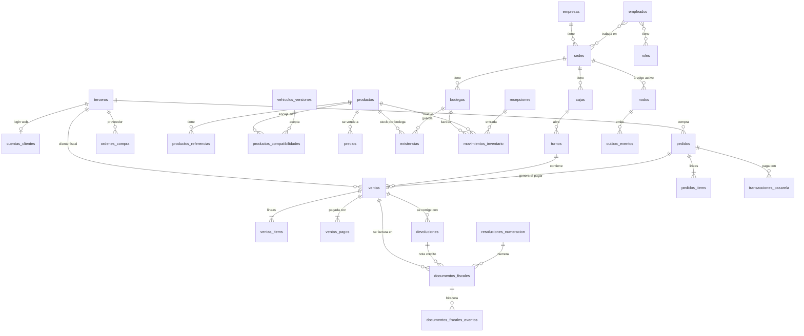

---

## 3. Schema `referencia`

Todas `[R]` salvo que se indique. PK = `codigo`. Se siembran por migración con los códigos del anexo técnico DIAN vigente (**los códigos de abajo son los habituales; se validan contra el anexo técnico y el proveedor elegido antes de sembrar**). Al ser `[R]` no se sincronizan.

| Tabla | PK | Columnas propias | Semilla (ejemplos) | Quién la usa |
|---|---|---|---|---|
| `tipos_documento_identidad` | `codigo text` (2) | `nombre`, `abreviatura`, `activo` | 11 RC · 12 TI · 13 CC · 21 TE · 22 CE · 31 NIT · 41 Pasaporte · 42 Doc. extranjero · 47 PEP · 50 NIT otro país | `terceros`, `empleados`, snapshot fiscal |
| `tipos_persona` | `codigo text` | `nombre` | 1 Persona jurídica · 2 Persona natural | `empresas`, `terceros` |
| `regimenes` | `codigo text` | `nombre` | 48 Responsable de IVA · 49 No responsable de IVA | `empresas`, `terceros` |
| `responsabilidades_fiscales` | `codigo text` | `nombre` | O-13 Gran contribuyente · O-15 Autorretenedor · O-23 Agente de retención IVA · O-47 Régimen simple · R-99-PN No aplica | `empresas_responsabilidades`, `terceros_responsabilidades` |
| `tributos` | `codigo text` | `nombre` | 01 IVA · 02 IC · 03 ICA · 04 INC · ZZ No aplica | `impuestos`, líneas fiscales |
| `medios_pago` | `codigo text` | `nombre`, `es_efectivo boolean`, `requiere_referencia boolean`, `activo` | 10 Efectivo · 20 Cheque · 42 Consignación · 47 Transferencia · 48 Tarjeta crédito · 49 Tarjeta débito · ZZ Otro | `ventas_pagos`, `arqueos_turno`, `documentos_fiscales_pagos` |
| `formas_pago` | `codigo text` | `nombre` | 1 Contado · 2 Crédito | documentos fiscales |
| `unidades_medida` | `codigo text` | `nombre`, `abreviatura`, `permite_decimales boolean` | 94 Unidad · LTR Litro · MTR Metro · KGM Kilogramo · GLL Galón | `productos`, líneas |
| `departamentos` | `codigo text` (2) | `nombre` | 11 Bogotá D.C. · 05 Antioquia … | `municipios` |
| `municipios` | `codigo text` (5, DIVIPOLA) | `departamento_codigo → departamentos RESTRICT`, `nombre` | 11001 Bogotá · 05001 Medellín … | direcciones, sedes, terceros |
| `tipos_documento_fiscal` | `codigo text` | `nombre`, `codigo_dian`, `requiere_referencia boolean`, `usa_resolucion boolean`, `activo boolean` | **Activos:** `FE` Factura electrónica · `NC` Nota crédito · `ND` Nota débito. **Reservados (`activo=false`):** `POS_E` Doc. equivalente POS · `NA` Nota de ajuste · `DS` Documento soporte | `fiscal.*` |
| `conceptos_nota` | PK `(tipo_documento_codigo, codigo)` | `nombre` | NC: 1 Devolución parcial · 2 Anulación · 3 Rebaja/descuento · 4 Ajuste de precio · 5 Otros. ND: 1 Intereses · 2 Gastos por cobrar · 3 Cambio de valor · 4 Otros | notas |

Índices: ninguno adicional (PK cubre toda búsqueda; tablas de < 1.200 filas). Excepción `municipios`: `ix_municipios_departamento (departamento_codigo)` para listas dependientes en formularios, y `ix_municipios_nombre_trgm` GIN `(f_unaccent(lower(nombre)) gin_trgm_ops)` para autocompletar ciudad.

**Por qué `codigo` como PK natural y no UUID**: son datos oficiales con identificador estable, idénticos en todos los nodos, y las tablas de negocio los referencian en snapshots (`medio_pago_codigo = '10'`) legibles sin JOIN.

---

## 4. Schema `organizacion`

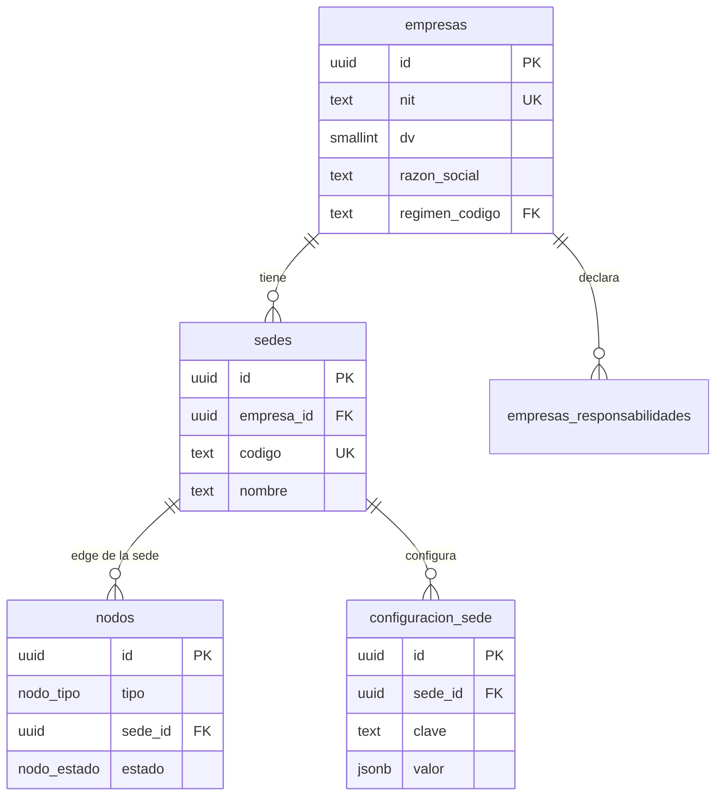

### 4.1 `organizacion.empresas` — Plantilla `[M]` · Clase N
**Propósito**: el contribuyente (emisor) ante la DIAN. Hoy una fila; el modelo admite varias razones sociales sin migrar.

| Columna | Tipo | Null | Default | Notas |
|---|---|---|---|---|
| `nit` | text | NOT NULL | — | Sin puntos ni DV. `CHECK (nit ~ '^[0-9]{6,12}$')`. |
| `dv` | smallint | NOT NULL | — | Dígito de verificación. `CHECK (dv BETWEEN 0 AND 9)`; la app valida que coincida con el cálculo módulo 11. |
| `razon_social` | text | NOT NULL | — | |
| `nombre_comercial` | text | NULL | — | |
| `tipo_persona_codigo` | text | NOT NULL | — | → `referencia.tipos_persona` RESTRICT |
| `regimen_codigo` | text | NOT NULL | — | → `referencia.regimenes` RESTRICT |
| `actividad_economica_ciiu` | text | NULL | — | Código CIIU principal (4 dígitos). |
| `matricula_mercantil` | text | NULL | — | |
| `municipio_codigo` | text | NOT NULL | — | → `referencia.municipios` RESTRICT |
| `direccion` | text | NOT NULL | — | |
| `telefono`, `email` | text | NULL | — | `email` es el de notificación fiscal. |
| `logo_url` | text | NULL | — | Para tiquetes/PDF. |
| `activo` | boolean | NOT NULL | `true` | |

UNIQUE `uq_empresas_nit (nit)`. Índices: ninguno más (tabla de 1–3 filas).

### 4.2 `organizacion.empresas_responsabilidades` — `[L]` · Clase N
Responsabilidades fiscales (O-13, O-15, O-23, O-47…) de la empresa; van en el XML del emisor.
PK `(empresa_id, responsabilidad_codigo)`. FKs: `empresa_id → empresas ON DELETE CASCADE` (link puro, no histórico: el snapshot fiscal ya copió las responsabilidades), `responsabilidad_codigo → referencia.responsabilidades_fiscales RESTRICT`. Índice: el PK cubre la búsqueda por empresa; no hace falta uno inverso.

### 4.3 `organizacion.sedes` — `[M]` · Clase N
**Propósito**: punto físico de venta. Todo lo operativo (bodegas, cajas, turnos) cuelga de una sede.

| Columna | Tipo | Null | Default | Notas |
|---|---|---|---|---|
| `empresa_id` | uuid | NOT NULL | — | → `empresas` RESTRICT |
| `codigo` | text | NOT NULL | — | Corto, para prefijos y etiquetas (`PRI`, `NOR`). `CHECK (codigo ~ '^[A-Z0-9]{2,6}$')`. |
| `nombre` | text | NOT NULL | — | |
| `municipio_codigo` | text | NOT NULL | — | → `referencia.municipios` RESTRICT |
| `direccion`, `telefono` | text | NOT NULL / NULL | — | Dirección aparece en el tiquete. |
| `permite_recoger_pedidos` | boolean | NOT NULL | `true` | Si el e-commerce puede ofrecer "recoger en esta sede". |
| `activo` | boolean | NOT NULL | `true` | |

UNIQUE `uq_sedes_empresa_codigo (empresa_id, codigo)`. Índice `ix_sedes_empresa (empresa_id)`: listar sedes de la empresa (FK sin índice sería un seq-scan en cada JOIN/borrado de empresa).

### 4.4 `organizacion.nodos` — `[M]` · Clase L
**Propósito**: cada instancia del backend. `nodo_origen_id` de todas las demás tablas apunta aquí. Hay exactamente un nodo `cloud` y un nodo `edge` activo por sede.
ENUM `organizacion.nodo_tipo ('cloud','edge')`, `organizacion.nodo_estado ('activo','inactivo')`.

| Columna | Tipo | Null | Default | Notas |
|---|---|---|---|---|
| `tipo` | nodo_tipo | NOT NULL | — | |
| `sede_id` | uuid | NULL | — | → `sedes` RESTRICT. |
| `nombre` | text | NOT NULL | — | "Nube", "Edge Sede Principal". |
| `estado` | nodo_estado | NOT NULL | `'activo'` | |
| `token_sync_hash` | text | NULL | — | Hash del token con que el agente se autentica contra la nube (nunca el token). |
| `version_app` | text | NULL | — | Última versión del backend reportada. |
| `version_esquema` | text | NULL | — | Revisión de Alembic aplicada; el sync se niega si es menor a la de la contraparte (§1.4). |
| `ultimo_latido_at` | timestamptz | NULL | — | Para el monitoreo "la sede lleva N horas sin sincronizar". |

CHECK `ck_nodos_sede_segun_tipo`: `(tipo='edge' AND sede_id IS NOT NULL) OR (tipo='cloud' AND sede_id IS NULL)`.
Índices: `uq_nodos_un_cloud` UNIQUE `((true)) WHERE tipo='cloud'` (garantiza una sola nube); `uq_nodos_edge_activo_por_sede` UNIQUE `(sede_id) WHERE tipo='edge' AND estado='activo'` (impide dos edges escribiendo la misma sede → rompería el modelo "dueño único" del kardex y de la numeración).

### 4.5 `organizacion.configuracion_sede` — `[M]` · Clase N (edge lee)
**Propósito**: parámetros operativos clave/valor. `sede_id NULL` = valor por defecto de la empresa; una fila con sede sobreescribe.

| Columna | Tipo | Null | Default | Notas |
|---|---|---|---|---|
| `sede_id` | uuid | NULL | — | → `sedes` RESTRICT |
| `clave` | text | NOT NULL | — | |
| `valor` | jsonb | NOT NULL | — | |
| `descripcion` | text | NULL | — | |

Claves previstas: `inventario.politica_stock_negativo` (`"permitir_con_alerta"` en edge), `ventas.redondeo_efectivo` (`0|50|100`), `ventas.descuento_max_sin_autorizacion_pct`, `pedidos.reserva_minutos_expiracion`, `pedidos.reserva_minutos_pago_pendiente`, `fiscal.horas_maximas_contingencia`, `pos.impresora_ancho_mm`.
UNIQUE `uq_configuracion_sede_clave (COALESCE(sede_id,'00000000-0000-0000-0000-000000000000'), clave)` (índice de expresión: UNIQUE normal trataría los NULL como distintos). Sin otro índice: se carga completa al arrancar (decenas de filas).
**Claves operativas (0009, sembradas por sede con `inicializar` y por la migración para las sedes existentes; el código las lee con `organizacion.configuracion.obtener`: fila de la sede → fila global → valor por defecto del código)**:

| Clave | Por defecto | Uso |
|---|---|---|
| `inventario.umbral_aprobacion` | `500000` | Entradas/ajustes sobre este valor (COP) quedan pendientes de aprobación (0008) |
| `inventario.propietario_autoaprueba` | `false` | El propietario puede aprobar lo que él mismo solicitó |
| `ventas.descuento_max_pct_por_rol` | `{"cajero":5,"supervisor":15,"administrador":100,"propietario":100}` | Tope de descuento por rol; el mayor de los roles del empleado. Un rol ausente = 0 %. Por encima: autorización `pos.descuento_mayor` de OTRO empleado |
| `autorizacion.devolucion` | `{"politica":"libre","umbral":200000,"sobre_umbral":"requiere_autorizacion"}` | (0010) Política de devoluciones (ver «Políticas de autorización» abajo) |
| `autorizacion.descuento_mayor` | `{"politica":"requiere_autorizacion"}` | (0010) Descuento sobre el tope del rol |
| `autorizacion.cambiar_precio` | `{"politica":"requiere_autorizacion"}` | (0010) Precio distinto al de lista |
| `autorizacion.retiro_caja` | `{"politica":"libre","umbral":300000,"sobre_umbral":"requiere_autorizacion"}` | (0010) Retiro de efectivo del turno |
| `autorizacion.diferencia_arqueo` | `{"politica":"revision_posterior"}` | (0010) Diferencia de arqueo al cerrar: **nunca bloquea el cierre** |
| `autorizacion.solicitud_expira_min` | `5` | (0010) Minutos de vigencia de una solicitud de aprobación remota |
| `ventas.espera_expira_horas` | `24` | Una venta en espera sin actividad se descarta (de forma perezosa al listar/suspender) |
| `ventas.redondeo_efectivo` | `0` | `0\|50\|100`; solo ventas pagadas ÍNTEGRAMENTE en efectivo |

**Políticas de autorización (0010)** — siete acciones: `devolucion`, `descuento_mayor`, `cambiar_precio`, `retiro_caja`, `diferencia_arqueo`, `ajuste_inventario`, `entrada_inventario`. Valor: `{"politica": ..., "umbral": <COP>, "sobre_umbral": ...}`:
* `libre`: se ejecuta sin más. `revision_posterior`: se ejecuta y queda una fila en `auditoria.revisiones` (§14.2). `requiere_autorizacion`: exige `autorizacion_id` de OTRO empleado (PIN de supervisor en la caja o aprobación remota, `identidad.solicitudes_autorizacion`, §5.15).
* Con `umbral`, hasta ese monto aplica `politica` y por encima `sobre_umbral` (por defecto `requiere_autorizacion`).
* Quien ya tiene el permiso de la acción (`pos.devolver`, `pos.descuento_mayor`, `pos.cambiar_precio`, `pos.retirar_efectivo`; ver `docs/permisos.md`) no necesita pedir autorización.
* `diferencia_arqueo` NO admite `requiere_autorizacion` (el servicio lo rechaza): el cierre del turno nunca se bloquea por una diferencia.
* `ajuste_inventario` y `entrada_inventario` conservan el flujo de aprobación por umbral (`inventario.umbral_aprobacion`, §7.18); `GET /organizacion/politicas-autorizacion/{sede}` los muestra derivados de ese umbral.
* Fijo, NO configurable: un reembolso en efectivo mayor al efectivo esperado del turno se rechaza (`reembolso_excede_efectivo`).
* Las claves `cajas.umbral_retiro_efectivo`, `cajas.umbral_diferencia_arqueo` y `ventas.devolucion_requiere_autorizacion` (0009) se **retiran** en 0010 (la migración las borra y el `downgrade` las restituye).

Claves añadidas en la revisión 2: `fiscal.modo_contingencia`, `fiscal.politica_cambio_adquirente`, `fiscal.momento_facturacion_web` (P-2/P-3, a definir con el contador), `ventas.mostrar_precio_sin_iva_con_nit` (§1.8), `pedidos.stock_seguridad_default` (P-5) y `pedidos.retencion_dias_recoger` (por defecto `3`).

---

## 5. Schema `identidad`

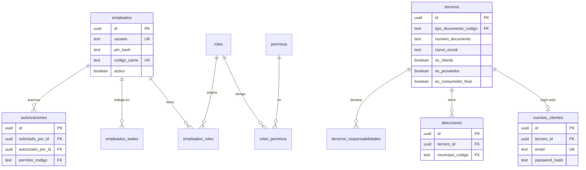

### 5.1 `identidad.empleados` — `[M]` · Clase N (réplica de solo lectura en edge)
**Propósito**: personas que operan el sistema (cajeros, vendedores, bodega, admin, supervisores). **Totalmente separada** de los clientes web: otra tabla, otro login, otros tokens.

| Columna | Tipo | Null | Default | Notas |
|---|---|---|---|---|
| `tipo_documento_codigo` | text | NOT NULL | — | → `referencia.tipos_documento_identidad` RESTRICT |
| `numero_documento` | text | NOT NULL | — | |
| `nombres`, `apellidos` | text | NOT NULL | — | |
| `email` | text | NULL | — | |
| `telefono` | text | NULL | — | |
| `usuario` | text | NULL | — | Login del backoffice. |
| `password_hash` | text | NULL | — | argon2id. NULL = solo opera en POS. |
| `codigo_carne` | text | NULL | — | Token **opaco aleatorio** impreso como código de barras en el carné; NO es el documento ni el id. Se compara tras escanear; el PIN se pide siempre (carné = identifica, PIN = autentica). |
| `activo` | boolean | NOT NULL | `true` | Despedido = `false`; nunca se borra (hay FKs históricas). |

UNIQUE: `uq_empleados_documento (tipo_documento_codigo, numero_documento)`; `uq_empleados_usuario (lower(usuario)) WHERE usuario IS NOT NULL`; `uq_empleados_carne (codigo_carne) WHERE codigo_carne IS NOT NULL` — este último además es el índice que sirve al escaneo en el POS (búsqueda exacta por valor).
CHECK `ck_empleados_credencial`: `activo = false OR usuario IS NOT NULL OR codigo_carne IS NOT NULL` (un empleado activo debe poder entrar por algún medio).

### 5.2 `identidad.roles` — `[M]` · Clase N
`codigo text NOT NULL` (`cajero`, `vendedor`, `supervisor`, `bodeguero`, `admin`), `nombre text NOT NULL`, `descripcion text NULL`, `es_sistema boolean NOT NULL DEFAULT false` (los de sistema no se pueden borrar ni renombrar), `activo boolean NOT NULL DEFAULT true`.
UNIQUE `uq_roles_codigo (codigo)`.

### 5.3 `identidad.permisos` — **`[R]`-like** · Clase: semilla de código
Los permisos son **contratos entre el código y la BD** (el endpoint pregunta por `pos.vender`), así que los define el código y se siembran por migración; no se editan desde la UI.

| Columna | Tipo | Null | Default | Notas |
|---|---|---|---|---|
| `codigo` | text | NOT NULL | — | **PK**. Formato `modulo.accion`: `pos.vender`, `pos.anular`, `pos.descuento_mayor`, `pos.devolver`, `pos.retirar_efectivo`, `caja.cerrar_con_diferencia`, `inventario.ajustar`, `inventario.conteo`, `compras.recibir`, `catalogo.editar_precios`, `fiscal.reenviar`, `admin.usuarios`… `CHECK (codigo ~ '^[a-z_]+(\.[a-z_]+){1,2}$')` (hasta 3 segmentos desde la 0006: `cajas.dispositivos.gestionar`). |
| `modulo` | text | NOT NULL | — | Agrupación en la UI de roles. |
| `descripcion` | text | NOT NULL | — | |
| `requiere_autorizacion` | boolean | NOT NULL | `false` | Si el empleado **no** lo tiene, un supervisor puede autorizarlo puntualmente con PIN (`autorizaciones`). |

### 5.4 `identidad.roles_permisos` — `[L]`
PK `(rol_id, permiso_codigo)`. `rol_id → roles ON DELETE CASCADE`, `permiso_codigo → permisos ON DELETE RESTRICT`. Índice `ix_roles_permisos_permiso (permiso_codigo)`: "¿qué roles tienen este permiso?" (auditoría de accesos).

### 5.5 `identidad.empleados_roles` — `[L]`
PK `(empleado_id, rol_id)`. `empleado_id → empleados RESTRICT`, `rol_id → roles RESTRICT`. Índice `ix_empleados_roles_rol (rol_id)` (reverso). Permisos efectivos = unión de los roles. Los roles son globales; lo que limita dónde opera un empleado es `empleados_sedes`.

### 5.6 `identidad.empleados_sedes` — `[L]`
PK `(empleado_id, sede_id)`; `empleado_id → empleados RESTRICT`, `sede_id → organizacion.sedes RESTRICT`. Columna `es_sede_principal boolean NOT NULL DEFAULT false`. Índice `ix_empleados_sedes_sede (sede_id)`: el edge solo replica los empleados de su sede (`WHERE sede_id = :mi_sede`).

**PIN del POS por sede (migración 0006).** Para identificar al empleado solo con su PIN, el PIN debe ser **único por sede**; un hash argon2 (salado) no permite buscar ni garantizar unicidad, por eso el PIN vive aquí con dos columnas:
- `pin_lookup text NULL` = `HMAC-SHA256(PIN_PEPPER, sede_id ‖ ':' ‖ PIN)` en hex. Determinista: permite el `SELECT` directo y el índice `uq_empleados_sedes_pin UNIQUE (sede_id, pin_lookup) WHERE pin_lookup IS NOT NULL` (dos empleados de la sede no pueden tener el mismo PIN; la misma cifra sí puede repetirse en otra sede).
- `pin_hash text NULL` = argon2id del PIN: es la verificación real. `CHECK ((pin_hash IS NULL) = (pin_lookup IS NULL))`.

Quitar a un empleado de una sede borra su PIN allí. Las columnas `empleados.pin_hash / pin_intentos_fallidos / pin_bloqueado_hasta` **se eliminaron en la migración 0007**; los intentos fallidos se cuentan en la bitácora `auditoria.log_acciones` (§14.1), no en la fila del empleado (que es de la nube y sincroniza). El PIN debe tener **exactamente 6 dígitos** (servicio y esquema); si ya lo usa otro empleado de la misma sede se responde un genérico «PIN no disponible» (no revela de quién es). Índices de apoyo al conteo de fallos: `ix_log_acciones_dispositivo (dispositivo_id, accion, ocurrido_at DESC)` y `ix_log_acciones_actor_accion (actor_id, accion, ocurrido_at DESC)`, ambos parciales.

Riesgo asumido: el espacio de un PIN de 4–8 dígitos es pequeño; con la BD filtrada y SIN la pimienta no se puede inferir el PIN, pero quien tenga ambas puede enumerarlo. Mitigación: la pimienta solo está en el `.env` del servidor, el bloqueo por intentos (dispositivo + empleado) y exigir PIN de 6+ dígitos en producción (`PIN_LONGITUD_MIN`, configurable).

### 5.7 `identidad.terceros` — `[M]` · Clase C (merge por clave natural)
**Propósito**: toda persona/empresa con datos fiscales. Un mismo registro puede ser **cliente fiscal** y **proveedor** (flags). Incluye el **consumidor final**.

| Columna | Tipo | Null | Default | Notas |
|---|---|---|---|---|
| `tipo_persona_codigo` | text | NOT NULL | — | → `referencia.tipos_persona` RESTRICT |
| `tipo_documento_codigo` | text | NOT NULL | — | → `referencia.tipos_documento_identidad` RESTRICT |
| `numero_documento` | text | NOT NULL | — | Sin puntos/guiones, sin DV. |
| `dv` | smallint | NULL | — | Obligatorio si tipo = 31 (NIT). |
| `razon_social` | text | NULL | — | Persona jurídica. |
| `primer_nombre`, `segundo_nombre`, `primer_apellido`, `segundo_apellido` | text | NULL | — | Persona natural. |
| `nombre_completo` | text | NOT NULL | — | Calculado por la app (razón social o nombres); es lo que se busca y se imprime. |
| `nombre_comercial` | text | NULL | — | |
| `regimen_codigo` | text | NULL | — | → `referencia.regimenes` RESTRICT |
| `email_facturacion` | text | NULL | — | A donde el proveedor envía la FE. |
| `telefono` | text | NULL | — | |
| `municipio_codigo` | text | NULL | — | → `referencia.municipios` RESTRICT. Dirección fiscal. |
| `direccion_fiscal` | text | NULL | — | |
| `es_cliente`, `es_proveedor` | boolean | NOT NULL | `true` / `false` | |
| `es_consumidor_final` | boolean | NOT NULL | `false` | Solo UNA fila `true`. |
| `fusionado_en_id` | uuid | NULL | — | → `terceros(id)` RESTRICT. Si dos nodos crearon offline el mismo documento, el perdedor queda apuntando al ganador (§13.5); los documentos que lo referencian siguen válidos. |
| `activo` | boolean | NOT NULL | `true` | |

CHECKs: `ck_terceros_nombre` (jurídica ⇒ `razon_social` NOT NULL; natural ⇒ `primer_nombre` AND `primer_apellido` NOT NULL, **excepto** consumidor final); `ck_terceros_dv_nit` (`tipo_documento_codigo <> '31' OR dv IS NOT NULL`); `ck_terceros_cf` (`es_consumidor_final = (numero_documento = '222222222222' AND tipo_documento_codigo = '13')`); `ck_terceros_fusion` (`fusionado_en_id IS DISTINCT FROM id`).
**Fila semilla "Consumidor final"**: `numero_documento='222222222222'`, `tipo_documento_codigo='13'`, `nombre_completo='Consumidor final'`, con **UUID fijo y conocido** (único id no generado por la app) para que sea idéntico en todos los nodos y los POS lo usen sin consultar.
Índices:
- `uq_terceros_documento (tipo_documento_codigo, numero_documento) WHERE fusionado_en_id IS NULL` — evita duplicados y es la búsqueda "cliente por NIT/cédula" del POS (la más frecuente). Parcial: los fusionados se conservan sin chocar.
- `uq_terceros_consumidor_final ((true)) WHERE es_consumidor_final` — una sola fila.
- `ix_terceros_nombre_trgm` GIN `(f_unaccent(lower(nombre_completo)) gin_trgm_ops)` — buscar cliente/proveedor por nombre parcial.
- `ix_terceros_proveedores (nombre_completo) WHERE es_proveedor` — listado de proveedores en compras (parcial: pocas filas).

### 5.8 `identidad.terceros_responsabilidades` — `[L]`
PK `(tercero_id, responsabilidad_codigo)`; `tercero_id → terceros ON DELETE CASCADE` (link puro; el snapshot fiscal guarda su copia), `responsabilidad_codigo → referencia.responsabilidades_fiscales RESTRICT`. Se copian al snapshot del adquirente en cada documento fiscal.

### 5.9 `identidad.cuentas_clientes` — `[M]` · Clase N
**Propósito**: credenciales del e-commerce. Una cuenta pertenece a un tercero (así, lo que compra en línea y en tienda queda en el mismo cliente). **No** comparte tabla, hash, tokens ni permisos con `empleados`.

| Columna | Tipo | Null | Default | Notas |
|---|---|---|---|---|
| `tercero_id` | uuid | NOT NULL | — | → `terceros` RESTRICT |
| `email` | text | NOT NULL | — | Login. Se guarda en minúsculas por la app. |
| `password_hash` | text | NULL | — | argon2id. NULL si solo usa login social (futuro). |
| `estado` | `identidad.estado_cuenta` | NOT NULL | `'pendiente_verificacion'` | ENUM `('pendiente_verificacion','activa','bloqueada')`. |
| `email_verificado_at` | timestamptz | NULL | — | |
| `acepta_terminos_at` | timestamptz | NOT NULL | — | Habeas data: consentimiento (Ley 1581). |
| `acepta_marketing` | boolean | NOT NULL | `false` | |
| `ultimo_login_at` | timestamptz | NULL | — | |

UNIQUE `uq_cuentas_clientes_email (lower(email))` (login) y `uq_cuentas_clientes_tercero (tercero_id)` (una cuenta por tercero).

### 5.10 `identidad.direcciones` — `[M]` · Clase C
Direcciones de entrega/facturación de un tercero cliente.

| Columna | Tipo | Null | Default | Notas |
|---|---|---|---|---|
| `tercero_id` | uuid | NOT NULL | — | → `terceros` RESTRICT |
| `tipo` | `identidad.tipo_direccion` | NOT NULL | `'envio'` | ENUM `('envio','facturacion')` |
| `alias` | text | NOT NULL | — | "Casa", "Taller". |
| `destinatario_nombre`, `destinatario_telefono` | text | NOT NULL | — | Quien recibe. |
| `municipio_codigo` | text | NOT NULL | — | → `referencia.municipios` RESTRICT |
| `direccion` | text | NOT NULL | — | |
| `complemento`, `barrio`, `indicaciones` | text | NULL | — | |
| `es_predeterminada` | boolean | NOT NULL | `false` | |
| `activo` | boolean | NOT NULL | `true` | |

Índices: `ix_direcciones_tercero (tercero_id)` (listar al hacer checkout); `uq_direcciones_predeterminada (tercero_id, tipo) WHERE es_predeterminada AND activo` (una predeterminada por tipo). Los pedidos **copian** la dirección (snapshot), por eso editar/desactivar una dirección no altera pedidos pasados.

### 5.11 `identidad.autorizaciones` — `[A]` · Clase S
**Propósito**: registro de que un supervisor aprobó con PIN una acción que el solicitante no podía hacer solo. Lo referencian ventas, cajas e inventario; por eso vive aquí y no en `ventas` (evita dependencia circular).
ENUM `identidad.tipo_autorizacion ('descuento_mayor','anulacion','devolucion','precio_manual','retiro_efectivo','cierre_con_diferencia','ajuste_inventario','venta_sin_stock')`.

| Columna | Tipo | Null | Default | Notas |
|---|---|---|---|---|
| `tipo` | tipo_autorizacion | NOT NULL | — | |
| `permiso_codigo` | text | NOT NULL | — | → `permisos` RESTRICT. Permiso que el autorizador **tenía**. |
| `solicitado_por_id` | uuid | NOT NULL | — | → `empleados` RESTRICT |
| `autorizado_por_id` | uuid | NOT NULL | — | → `empleados` RESTRICT. `CHECK (autorizado_por_id <> solicitado_por_id)` (nadie se autoriza a sí mismo). |
| `dispositivo_id` | uuid | NULL | — | → `cajas.dispositivos` — **sin FK** (cajas está después en la cadena); solo referencia lógica. |
| `entidad_tipo` | text | NULL | — | `venta_item`, `movimiento_caja`, `devolucion`… |
| `entidad_id` | uuid | NULL | — | |
| `detalle` | jsonb | NOT NULL | `'{}'` | Valores: descuento %, monto, motivo. |
| `motivo` | text | NULL | — | Texto libre obligatorio por la app. |
| `expira_at` | timestamptz | NOT NULL | — | (0006) La autorización es de **un solo uso** y vence en segundos (`AUTORIZACION_TTL_SEG`, 120 por defecto). |

Índices: `ix_autorizaciones_entidad (entidad_tipo, entidad_id)` (de una línea a su autorización); `ix_autorizaciones_autorizador (autorizado_por_id, created_at DESC)` (reporte "qué aprueba cada supervisor"). FK `solicitado_por_id` sin índice propio: se consulta por autorizador, no por solicitante.

### 5.12 `identidad.autorizaciones_consumos` — `[A]` · **local del nodo, NO se sincroniza** (0006)
**No se replica**: el consumo de una autorización ocurre y se valida en el nodo donde se usó (el edge puede estar sin internet). Una autorización emitida en un nodo solo se puede consumir en ese mismo nodo. Igual que `sesiones_refresh` (§5.13), queda fuera del outbox.

Como `autorizaciones` es inmutable, el **consumo** se registra en una tabla aparte: `autorizacion_id uuid` **PK**/FK → `autorizaciones` RESTRICT, `consumida_at timestamptz DEFAULT now()`, `consumida_por_id` → `empleados`, `dispositivo_id uuid NULL`, `entidad_tipo`, `entidad_id`, `nodo_origen_id` → `nodos`. La **PK impide el segundo consumo de forma atómica** (`INSERT … ON CONFLICT DO NOTHING RETURNING`: sin fila ⇒ ya usada), sin `SELECT … FOR UPDATE` ni carreras. `tg_inmutable`. La acción protegida llama a `consumir_autorizacion(...)`, que además valida: misma acción (`permiso_codigo`), mismo solicitante y dispositivo, misma entidad (si la autorización la fijó) y vigencia.

### 5.13 `identidad.sesiones_refresh` — local del nodo, no se sincroniza (0006)
Refresh tokens del backoffice. Opacos (48 bytes aleatorios); **solo se guarda el SHA-256** (`token_hash UNIQUE`).

| Columna | Tipo | Notas |
|---|---|---|
| `id` | uuid PK | UUIDv7 |
| `familia_id` | uuid NOT NULL | Cadena de rotaciones de un mismo login. Índice `ix_sesiones_refresh_familia_id` |
| `empleado_id` | uuid NOT NULL | → `empleados` RESTRICT. Índice `ix_sesiones_refresh_empleado_id` |
| `token_hash` | text NOT NULL UNIQUE | SHA-256 hex del token |
| `created_at` / `expira_at` | timestamptz | TTL `REFRESH_TTL_DIAS` (7) |
| `usado_at` | timestamptz NULL | Se fija al **rotar** (canjear por uno nuevo) |
| `revocado_at`, `motivo_revocacion` | timestamptz / text NULL | `logout`, `reutilizacion`, `empleado_desactivado`, `cambio_password` |
| `user_agent`, `ip` | text / inet NULL | Informativo |

**Rotación con detección de robo**: cada `/auth/refresh` marca el token usado y emite otro de la misma familia. Si se presenta un token con `usado_at` ya fijado (reutilización), se **revoca toda la familia** y se audita `identidad.refresh_reutilizado`. Desactivar al empleado o cambiar su contraseña revoca todas sus sesiones.

### 5.15 `identidad.solicitudes_autorizacion` — `[M]` · Clase S (0010)
**Propósito**: aprobación REMOTA de una acción sensible: el cajero la pide desde la caja (`POST /pos/solicitudes-autorizacion`) y alguien con `autorizaciones.aprobar` la aprueba o rechaza desde el backoffice. Al aprobarse nace una fila normal de `autorizaciones` (§5.11, de un solo uso) cuyo id queda en `autorizacion_id`.

| Columna | Tipo | Null | Default | Notas |
|---|---|---|---|---|
| `sede_id` | uuid | NOT NULL | — | → `organizacion.sedes` RESTRICT |
| `solicitado_por_id` | uuid | NOT NULL | — | → `empleados` RESTRICT. Cajero que pide |
| `dispositivo_id` | uuid | NULL | — | → `cajas.dispositivos` (sin FK; schema posterior) |
| `caja_id` | uuid | NULL | — | |
| `accion` | text | NOT NULL | — | → `permisos.codigo` RESTRICT (p. ej. `pos.devolver`) |
| `monto` | numeric(18,2) | NULL | — | |
| `motivo` | text | NOT NULL | — | |
| `contexto` | jsonb | NOT NULL | `'{}'` | Lo que ve quien aprueba (venta, producto…) |
| `entidad_tipo`, `entidad_id` | text, uuid | NULL | — | Documento al que se ata la autorización |
| `estado` | text | NOT NULL | `'pendiente'` | `pendiente|aprobada|rechazada|expirada` |
| `expira_at` | timestamptz | NOT NULL | — | Creación + `autorizacion.solicitud_expira_min` |
| `resuelta_por_id`, `resuelta_at`, `comentario` | | NULL | — | |
| `autorizacion_id` | uuid | NULL | — | → `autorizaciones` RESTRICT; solo si `aprobada` |

CHECKs: `ck_solicitudes_autorizacion_estado_valido`, `ck_solicitudes_autorizacion_no_autoaprobacion` (`resuelta_por_id <> solicitado_por_id`), `ck_solicitudes_autorizacion_aprobada_completa`. Índices: `ix_solicitudes_autorizacion_pendientes`, `ix_solicitudes_autorizacion_solicitante`. El vencimiento se aplica de forma perezosa. Consulta del POS por polling cada 2 s (decisión en `docs/arquitectura.md`).

### 5.14 Autenticación y permisos (resumen de diseño)
- **Backoffice**: `POST /auth/login` → access JWT (15 min, `typ=access`) + refresh opaco. El access token no se persiste; cada petición recarga al empleado (si se desactiva, el token deja de servir) y calcula permisos = unión de los roles **activos**.
- **POS**: el dispositivo (registrado por un administrador con `cajas.dispositivos.gestionar`) recibe **una sola vez** un token aleatorio de 32 bytes; en `cajas.dispositivos.token_hash` solo queda su SHA-256. `POST /pos/auth/pin` (+ cabecera `X-Dispositivo-Token`) con PIN o código de carné devuelve un JWT `typ=pos` con claims `sub` (empleado), `dsp`, `caja`, `sede`, `exp` (`POS_SESION_TTL_MIN`, 600). Requisitos: empleado activo, asignado a la sede del dispositivo y con `pos.acceder`. En cada petición se revalida que el dispositivo siga `activo` y el empleado asignado.
- **Fuerza bruta**: sin contadores en las filas maestras. Cada intento queda en `auditoria.log_acciones` (`pos.pin_fallido`/`pos.pin_ok`, `identidad.login_fallido`/`login_ok`) y el bloqueo se **deriva**: ≥ N fallos (por dispositivo: `MAX_INTENTOS_DISPOSITIVO`; por empleado: `MAX_INTENTOS_EMPLEADO`) en los últimos `BLOQUEO_MINUTOS` desde el último éxito ⇒ 429 con `Retry-After`. Índice `ix_log_acciones_dispositivo (dispositivo_id, ocurrido_at DESC) WHERE dispositivo_id IS NOT NULL`. `ocurrido_at` usa `clock_timestamp()` (no `now()`, que es la hora de inicio de la transacción).
- **Autorización de supervisor**: `POST /pos/autorizaciones` con el PIN del supervisor (identificado en la sede de la sesión) y la acción; exige que el supervisor tenga ese permiso y sea otra persona; crea `autorizaciones` y devuelve `autorizacion_id` de un solo uso (§5.12).
- Acciones autorizables → `tipo_autorizacion`: `pos.descuento_mayor`, `pos.anular`→anulacion, `pos.devolver`→devolucion, `pos.cambiar_precio`→precio_manual (0010 unifica `pos.precio_manual` en `pos.cambiar_precio`), `pos.retirar_efectivo`→retiro_efectivo, `caja.cerrar_con_diferencia`→cierre_con_diferencia, `inventario.ajustar`→ajuste_inventario, `pos.venta_sin_stock`.
- 0010: los permisos `autorizaciones.aprobar` (aprobar/rechazar solicitudes remotas) y `revisiones.gestionar` (revisión posterior) los tienen administrador, supervisor y propietario; nuevo rol `vendedor` (`pos.acceder`, `pos.vender`, `catalogo.ver`, `inventario.ver`, `ventas.ver`: arma ventas en espera, no cobra ni abre turno). Tabla completa en `docs/permisos.md`.
- Permisos nuevos (0006): `pos.acceder` (administrador, supervisor, cajero) y `cajas.dispositivos.gestionar` (administrador).

---

## 6. Schema `catalogo`  (Clase N: la nube manda)

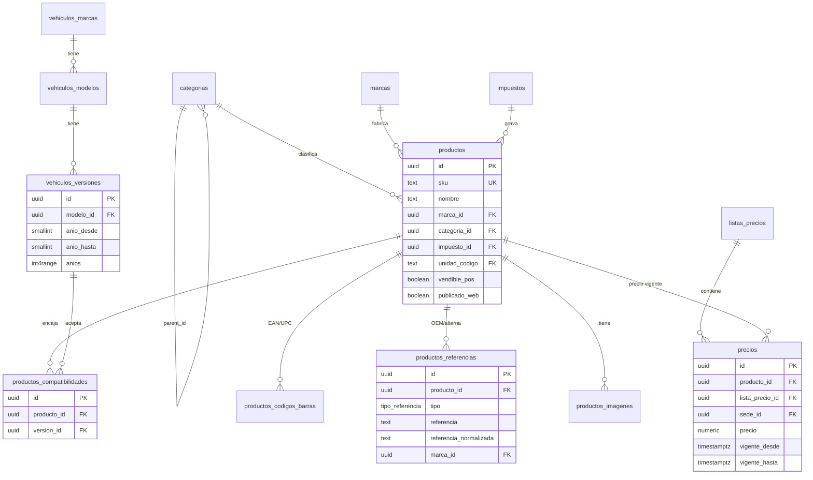

### 6.1 `catalogo.categorias` — `[M]`
Árbol de categorías (Frenos → Pastillas).

| Columna | Tipo | Null | Default | Notas |
|---|---|---|---|---|
| `parent_id` | uuid | NULL | — | → `categorias(id)` RESTRICT. NULL = raíz. La app impide ciclos (CTE al guardar). |
| `nombre` | text | NOT NULL | — | |
| `slug` | text | NOT NULL | — | URL del e-commerce. |
| `orden` | smallint | NOT NULL | `0` | |
| `activo` | boolean | NOT NULL | `true` | Desactivar una categoría no desactiva sus productos. |

UNIQUE `uq_categorias_slug (slug)`; UNIQUE `uq_categorias_hermanas (COALESCE(parent_id, '0000…'), lower(nombre))`. Índice `ix_categorias_parent (parent_id)`: recorrer el árbol (hijos de un nodo). Árbol pequeño (cientos): CTE recursivo sin ltree ni path materializado; se reevalúa si supera ~10 000 nodos.

### 6.2 `catalogo.marcas` — `[M]`
Marca del repuesto (Bosch, Brembo, Gonher, Sakura…) **y** fabricantes OEM de vehículo (Chevrolet/GM, Toyota) cuando se usan como fabricante de una referencia OEM.

| Columna | Tipo | Null | Default | Notas |
|---|---|---|---|---|
| `nombre` | text | NOT NULL | — | |
| `slug` | text | NOT NULL | — | |
| `es_fabricante_oem` | boolean | NOT NULL | `false` | `true` = fabricante original de vehículo. |
| `pais_origen` | text | NULL | — | |
| `logo_url` | text | NULL | — | |
| `activo` | boolean | NOT NULL | `true` | |

UNIQUE `uq_marcas_nombre (lower(nombre))`, `uq_marcas_slug (slug)`. (Chevrolet existe en `marcas` y en `vehiculos_marcas`: duplicación aceptada, ver decisión D-9.)

### 6.3 `catalogo.impuestos` — `[M]`
ENUM `catalogo.tratamiento_impuesto ('gravado','exento','excluido')`.

| Columna | Tipo | Null | Default | Notas |
|---|---|---|---|---|
| `codigo` | text | NOT NULL | — | `IVA_19`, `IVA_5`, `IVA_0`, `EXCLUIDO`. |
| `nombre` | text | NOT NULL | — | |
| `tributo_codigo` | text | NOT NULL | — | → `referencia.tributos` RESTRICT (01 IVA; ZZ para excluido). |
| `tratamiento` | tratamiento_impuesto | NOT NULL | — | **Exento** = gravado a 0 % (reporta tributo 01 con 0 %); **excluido** = no causa IVA. En el XML se tratan distinto. |
| `tarifa_pct` | numeric(7,4) | NOT NULL | — | `CHECK (tarifa_pct BETWEEN 0 AND 100)`; `CHECK (tratamiento <> 'gravado' OR tarifa_pct > 0)`; `CHECK (tratamiento <> 'excluido' OR tarifa_pct = 0)`. |
| `activo` | boolean | NOT NULL | `true` | |

UNIQUE `uq_impuestos_codigo`. **La tarifa no se edita**: si la ley cambia, se crea `IVA_20` y se migran productos; las ventas pasadas conservan su snapshot.

### 6.4 `catalogo.productos` — `[M]`
**Propósito**: el artículo vendible (SKU interno).

| Columna | Tipo | Null | Default | Notas |
|---|---|---|---|---|
| `sku` | text | NOT NULL | — | Código interno estable, mayúsculas. |
| `nombre` | text | NOT NULL | — | "Pastillas de freno delanteras Spark GT". |
| `descripcion` | text | NULL | — | |
| `marca_id` | uuid | NULL | — | → `marcas` RESTRICT |
| `categoria_id` | uuid | NOT NULL | — | → `categorias` RESTRICT |
| `unidad_codigo` | text | NOT NULL | `'94'` | → `referencia.unidades_medida` RESTRICT |
| `impuesto_id` | uuid | NOT NULL | — | → `impuestos` RESTRICT |
| `es_inventariable` | boolean | NOT NULL | `true` | `false` para servicios (instalación, flete). No genera kardex. |
| `vendible_pos` | boolean | NOT NULL | `true` | |
| `publicado_web` | boolean | NOT NULL | `false` | |
| `slug` | text | NULL | — | Para el e-commerce. |
| `peso_kg` | numeric(10,3) | NULL | — | Para costo de envío. `CHECK (peso_kg >= 0)`. |
| `alto_cm`, `ancho_cm`, `largo_cm` | numeric(8,2) | NULL | — | Peso volumétrico del envío. |
| `stock_minimo` | numeric(14,3) | NOT NULL | `0` | Umbral global; se puede sobreescribir por bodega en `existencias`. |
| `stock_seguridad_web` | numeric(14,3) | NULL | — | Unidades que **no** se publican en la web (colchón contra sobreventa, P-5). NULL = usar `pedidos.stock_seguridad_default` de la sede. `CHECK (>= 0)`. |
| *(no existen en `productos`)* | — | — | — | Desde la migración 0005 la búsqueda vive en `catalogo.productos_busqueda` (§6.14). Recalcularla **no modifica** `productos.version` ni `updated_at` (evita eventos de sync y falsos conflictos). |
| `activo` | boolean | NOT NULL | `true` | |

CHECK: `ck_productos_web_activo (NOT publicado_web OR activo)`. Los servicios (`es_inventariable=false`) pueden publicarse y venderse; simplemente no generan kardex.
Índices:
- `uq_productos_sku (sku)` — identidad de negocio y búsqueda exacta por SKU en el POS.
- `uq_productos_slug (slug) WHERE slug IS NOT NULL` — URL del producto en la tienda.
- `ix_productos_categoria (categoria_id) WHERE activo` — navegación por categoría (parcial: solo activos).
- `ix_productos_marca (marca_id)` — filtro por marca.
- (búsqueda: índices sobre `productos_busqueda`, ver §6.14.)
- `ix_productos_web (categoria_id, nombre) WHERE publicado_web AND activo` — listado de la tienda sin escanear el catálogo completo.
- FK `impuesto_id`/`unidad_codigo` sin índice: se consultan solo al cambiar un impuesto (operación rara, tabla de miles).

### 6.5 `catalogo.productos_codigos_barras` — `[M]`
Varios códigos por producto (EAN del fabricante, código de proveedor, código interno de etiqueta).
ENUM `catalogo.tipo_codigo_barras ('ean13','ean8','upc','code128','interno')`.

| Columna | Tipo | Null | Default | Notas |
|---|---|---|---|---|
| `producto_id` | uuid | NOT NULL | — | → `productos` RESTRICT |
| `codigo` | text | NOT NULL | — | Tal como lo lee el lector. |
| `tipo` | tipo_codigo_barras | NOT NULL | `'ean13'` | |
| `unidades_por_codigo` | numeric(14,3) | NOT NULL | `1` | Código de caja/paquete que equivale a N unidades (`CHECK > 0`). El POS multiplica la cantidad. |
| `es_principal` | boolean | NOT NULL | `false` | El que se imprime en etiquetas. |
| `activo` | boolean | NOT NULL | `true` | |

Índices: `uq_barras_codigo (codigo) WHERE activo` — **el lector del POS busca por aquí**; único entre los activos para que un escaneo nunca sea ambiguo, y parcial para poder reutilizar un código retirado; `uq_barras_principal (producto_id) WHERE es_principal AND activo`; `ix_barras_producto (producto_id)` (listar códigos del producto).

### 6.6 `catalogo.productos_referencias` — `[M]`
Números de parte: OEM, original, alterna, equivalente. Se busca por **cualquiera**.
ENUM `catalogo.tipo_referencia ('oem','original','alterna','equivalente')` (OEM = la del fabricante del vehículo; original = la de la marca del repuesto; alterna/equivalente = de otras marcas que sirven).

| Columna | Tipo | Null | Default | Notas |
|---|---|---|---|---|
| `producto_id` | uuid | NOT NULL | — | → `productos` RESTRICT |
| `tipo` | tipo_referencia | NOT NULL | — | |
| `referencia` | text | NOT NULL | — | Como viene impresa: `04465-0K240`. |
| `referencia_normalizada` | text | NOT NULL | — | `GENERATED ALWAYS AS (f_normalizar_ref(referencia)) STORED` → `044650K240`. |
| `marca_id` | uuid | NULL | — | → `marcas` RESTRICT. Fabricante de esa referencia (GM, Bosch…). |
| `notas` | text | NULL | — | |
| `activo` | boolean | NOT NULL | `true` | |

UNIQUE `uq_referencias (producto_id, tipo, referencia_normalizada, COALESCE(marca_id,'0000…'))`.
Índices: `ix_referencias_norm (referencia_normalizada text_pattern_ops)` — búsqueda exacta y por prefijo de una referencia tecleada o escaneada; `ix_referencias_trgm` GIN `(referencia_normalizada gin_trgm_ops)` — "contiene" (el cliente solo recuerda parte del número); `ix_referencias_producto (producto_id)` — mostrar todas las referencias de un producto. Una misma referencia puede apuntar a **varios productos** (varias marcas fabrican la equivalente), por eso no es UNIQUE global.

### 6.7 `catalogo.vehiculos_marcas` — `[M]`
`nombre text NOT NULL`, `slug text NOT NULL`, `codigo_externo text NULL` (id en el catálogo de origen, para reimportar por Excel/CSV sin duplicar — P-10; UNIQUE parcial donde no es NULL), `activo boolean NOT NULL DEFAULT true`. UNIQUE `(lower(nombre))`, `(slug)`.

### 6.8 `catalogo.vehiculos_modelos` — `[M]`
`marca_id → vehiculos_marcas RESTRICT`, `nombre` (Spark GT, Aveo), `slug`, `codigo_externo text NULL` (idem, UNIQUE parcial), `activo`. UNIQUE `uq_modelos (marca_id, lower(nombre))` (también sirve la búsqueda "modelos de una marca").

### 6.9 `catalogo.vehiculos_versiones` — `[M]`
Una versión = combinación comercial concreta de un modelo (años, motor, cilindraje).
ENUM `catalogo.combustible ('gasolina','diesel','gas','hibrido','electrico','flex')`.

| Columna | Tipo | Null | Default | Notas |
|---|---|---|---|---|
| `modelo_id` | uuid | NOT NULL | — | → `vehiculos_modelos` RESTRICT |
| `nombre` | text | NOT NULL | — | "LT 1.2 mecánica". |
| `anio_desde` | smallint | NOT NULL | — | |
| `anio_hasta` | smallint | NULL | — | NULL = sigue en producción. |
| `motor` | text | NULL | — | Código de motor (B12S1…). |
| `cilindraje_cc` | integer | NULL | — | `CHECK (cilindraje_cc > 0)`. |
| `combustible` | combustible | NULL | — | |
| `transmision` | text | NULL | — | `mecanica` / `automatica`; texto con CHECK por simplicidad. |
| `codigo_externo` | text | NULL | — | Id en el catálogo de origen (P-10); UNIQUE parcial donde no es NULL. |
| `anios` | int4range | NOT NULL | — | `GENERATED ALWAYS AS (int4range(anio_desde::int, anio_hasta::int, '[]')) STORED`. |
| `activo` | boolean | NOT NULL | `true` | |

CHECKs: `ck_versiones_anios (anio_hasta IS NULL OR anio_hasta >= anio_desde)`, `anio_desde BETWEEN 1950 AND 2100`.
Índice `ix_versiones_modelo_anios` GIST `(modelo_id, anios)` (usa `btree_gist`) — responde "versiones del modelo X vigentes en el año 2018" con `anios @> 2018`.

### 6.10 `catalogo.productos_compatibilidades` — `[M]`
Producto ↔ versión de vehículo en que sirve.

| Columna | Tipo | Null | Default | Notas |
|---|---|---|---|---|
| `producto_id` | uuid | NOT NULL | — | → `productos` RESTRICT |
| `version_id` | uuid | NOT NULL | — | → `vehiculos_versiones` RESTRICT |
| `posicion` | text | NULL | — | `delantera/trasera/izquierda/derecha/…`. Crítico: una pastilla delantera no sirve atrás. |
| `notas` | text | NULL | — | "Solo con ABS". |
| `activo` | boolean | NOT NULL | `true` | |

UNIQUE `uq_compat (producto_id, version_id)`. Índice `ix_compat_version (version_id, producto_id)` — **el sentido de la búsqueda** ("qué sirve para este vehículo"); el UNIQUE cubre el sentido contrario ("en qué vehículos sirve").

### 6.11 `catalogo.productos_imagenes` — `[M]`
`producto_id → productos RESTRICT`, `url text NOT NULL`, `url_miniatura text NULL`, `texto_alternativo text NULL`, `orden smallint NOT NULL DEFAULT 0`, `es_principal boolean NOT NULL DEFAULT false`, `activo boolean NOT NULL DEFAULT true`. Índices: `ix_imagenes_producto (producto_id, orden)`; `uq_imagenes_principal (producto_id) WHERE es_principal AND activo`. Los archivos viven en almacenamiento de objetos; la BD solo guarda la URL.

### 6.12 `catalogo.listas_precios` — `[M]`

| Columna | Tipo | Null | Default | Notas |
|---|---|---|---|---|
| `codigo` | text | NOT NULL | — | `PUBLICO`, `WEB`, `MAYORISTA`, `TALLER`. |
| `nombre` | text | NOT NULL | — | |
| `precios_incluyen_impuesto` | boolean | NOT NULL | `true` | Convención del §1.7. Se guarda por lista por si algún día hay una lista B2B sin IVA. |
| `es_predeterminada` | boolean | NOT NULL | `false` | |
| `activo` | boolean | NOT NULL | `true` | |

UNIQUE `uq_listas_codigo`; `uq_listas_predeterminada ((true)) WHERE es_predeterminada` (una sola).

### 6.12b `catalogo.terceros_listas_precios` — `[L]`
Qué lista aplica a un cliente (taller/mayorista). PK `(tercero_id)`; `tercero_id → identidad.terceros RESTRICT`, `lista_precio_id → listas_precios RESTRICT`. Sin lista asignada → la predeterminada. (Vive en `catalogo` y no en `identidad` por la dirección de dependencias.)

### 6.13 `catalogo.precios` — `[M]` (efectivamente append: un precio vigente se **cierra**, no se edita)

| Columna | Tipo | Null | Default | Notas |
|---|---|---|---|---|
| `producto_id` | uuid | NOT NULL | — | → `productos` RESTRICT |
| `lista_precio_id` | uuid | NOT NULL | — | → `listas_precios` RESTRICT |
| `sede_id` | uuid | NULL | — | → `organizacion.sedes` RESTRICT. NULL = todas las sedes; con valor, precio específico de esa sede. |
| `precio` | numeric(18,4) | NOT NULL | — | `CHECK (precio >= 0)`. Con IVA si la lista lo indica. |
| `vigente_desde` | timestamptz | NOT NULL | `now()` | |
| `vigente_hasta` | timestamptz | NULL | — | NULL = abierto. `CHECK (vigente_hasta IS NULL OR vigente_hasta > vigente_desde)`. |

Restricción de exclusión `ex_precios_sin_solape`:
`EXCLUDE USING gist (producto_id WITH =, lista_precio_id WITH =, COALESCE(sede_id,'0000…') WITH =, tstzrange(vigente_desde, vigente_hasta) WITH &&)` — la BD garantiza que nunca haya dos precios vigentes a la vez para el mismo producto/lista/sede (ni dos nodos pueden crearlos por error: la nube es la única que escribe).
Índice `ix_precios_vigente (producto_id, lista_precio_id) WHERE vigente_hasta IS NULL` — camino rápido del 99 % de las consultas ("precio actual"); el GiST de la exclusión atiende consultas históricas ("¿cuánto costaba el 3 de marzo?").
**Resolución de precio** (la hace la app): sede específica > precio general; lista del cliente > lista predeterminada; vigente en `now()`. Lo resuelto se **copia** a `ventas_items.precio_unitario` (snapshot).
Cambiar un precio = `UPDATE … SET vigente_hasta = now()` del vigente + `INSERT` del nuevo, en una transacción.

### 6.14 Búsqueda de texto

Tres capas, de la más precisa a la más tolerante, ejecutadas en una sola consulta con `UNION` y puntajes:

1. **Exacta**: `productos_codigos_barras.codigo = :q` (escáner) · `productos.sku = upper(:q)` · `productos_referencias.referencia_normalizada = f_normalizar_ref(:q)` (o prefijo con `LIKE :q||'%'` apoyado en `text_pattern_ops`).
2. **Full-text** (`productos_busqueda.documento @@ websearch_to_tsquery('spanish', f_unaccent(:q))`), ordenado por `ts_rank`. El `tsvector` pondera: **A** = nombre + marca + referencias (configuración `simple`, porque un número de parte no se debe "stemmear") — además nombre y marca entran también con config `spanish` (peso A), de modo que una consulta `websearch_to_tsquery('spanish', …)` encuentra "freno" aunque el vector `simple` guarde la forma literal (ajuste hallado al probar la implementación, migración 0003), **B** = categoría, **C** = descripción. Config `spanish` con `unaccent`: "pastillas"="pastilla", "frenó"="freno", "ñ" y tildes indiferentes. Lo mantiene un trigger sobre `productos`, `productos_referencias` y `marcas` (recalcula las filas afectadas) — **no** una columna `GENERATED` porque abarca varias tablas.
3. **Trigram** (`productos_busqueda.texto % :q` / `similarity()`): rescata errores de digitación ("pastias de fren") cuando 1 y 2 devuelven poco.

**Tabla `catalogo.productos_busqueda`** (migración 0005; derivada y local, **no se sincroniza**, clase L): `producto_id uuid` PK/FK → `productos` ON DELETE CASCADE · `documento tsvector NOT NULL` (ponderado: A nombre+marca+referencias, B categoría, C descripción) · `texto text NOT NULL` (`lower(f_unaccent(nombre + marca))`, para trigram) · `actualizado_at timestamptz`. Índices: `ix_productos_busqueda_documento` GIN `(documento)` y `ix_productos_busqueda_texto_trgm` GIN `(texto gin_trgm_ops)`. La mantiene `catalogo.f_busqueda_producto(producto_id)` (upsert) disparada por triggers `tg_busqueda_producto` en `productos` (nombre, descripción, marca, categoría), `productos_referencias` (insert/update/delete), `marcas.nombre` y `categorias.nombre`. **Por qué una tabla aparte:** al estar en `productos`, cada recalculo (p. ej. renombrar una marca) incrementaba `version`/`updated_at` por `tg_tocar` y habría generado eventos de sync y falsos conflictos entre nodos.


La búsqueda por **vehículo** se une por `productos_compatibilidades` (ver flujo (g)). Sinónimos regionales ("balatas" = "pastillas") quedan como pregunta abierta (P-9).

---

## 7. Schema `inventario`  (Clase S: el edge es dueño de su sede)

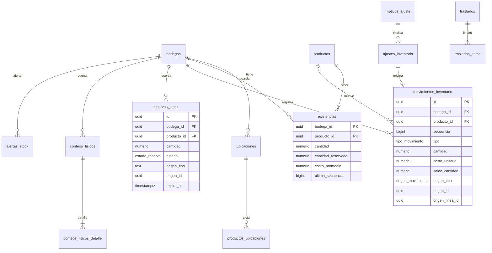

### 7.1 `inventario.bodegas` — `[M]`

| Columna | Tipo | Null | Default | Notas |
|---|---|---|---|---|
| `sede_id` | uuid | NOT NULL | — | → `organizacion.sedes` RESTRICT |
| `codigo` | text | NOT NULL | — | `PRIN`, `MERMA`. |
| `nombre` | text | NOT NULL | — | |
| `es_vendible` | boolean | NOT NULL | `true` | `false` para bodegas de merma/devoluciones en revisión: su stock no cuenta como disponible. |
| `tipo` | text | NOT NULL | `'general'` | (0009) `'general'` \| `'averias'`. `CHECK ck_bodegas_tipo_valido`. |
| `activo` | boolean | NOT NULL | `true` | |

UNIQUE `uq_bodegas (sede_id, codigo)` (cubre listar bodegas de una sede). (0009) `ck_bodegas_averias_no_vendible` (`tipo <> 'averias' OR NOT es_vendible`) y `uq_bodegas_averias_sede (sede_id) WHERE tipo='averias' AND activo`: una bodega de averías activa por sede, nunca vendible; es el destino de las devoluciones defectuosas (su stock no cuenta como disponible).

### 7.2 `inventario.ubicaciones` — `[M]`
`bodega_id → bodegas RESTRICT`, `codigo text NOT NULL` (`A-03-2`), `pasillo text NOT NULL`, `estante text NULL`, `nivel text NULL`, `descripcion text NULL`, `activo boolean NOT NULL DEFAULT true`. UNIQUE `uq_ubicaciones (bodega_id, codigo)`.

### 7.3 `inventario.productos_ubicaciones` — `[L]`
Dónde está físicamente el producto (alistar pedidos, conteos). PK `(producto_id, ubicacion_id)`; `producto_id → catalogo.productos RESTRICT`, `ubicacion_id → ubicaciones RESTRICT`; `es_principal boolean NOT NULL DEFAULT false`. Índice `ix_produb_ubicacion (ubicacion_id)` (conteo por ubicación: "qué hay en el estante A-03"). El stock **no** se lleva por ubicación (decisión D-12): solo por bodega.

### 7.4 `inventario.movimientos_inventario` — `[A]` · **EL KARDEX** · Clase S
**Propósito**: libro mayor de inventario. Solo `INSERT`. El stock es la suma de sus filas.
ENUMs:
`inventario.tipo_movimiento`: `saldo_inicial`, `entrada_compra`, `devolucion_proveedor`, `venta`, `devolucion_venta`, `ajuste_positivo`, `ajuste_negativo`, `traslado_salida`, `traslado_entrada`.
`inventario.origen_movimiento`: `saldo_inicial`, `recepcion`, `devolucion_proveedor`, `venta`, `devolucion_venta`, `traslado`, `ajuste`.

| Columna | Tipo | Null | Default | Notas |
|---|---|---|---|---|
| `bodega_id` | uuid | NOT NULL | — | → `bodegas` RESTRICT |
| `producto_id` | uuid | NOT NULL | — | → `catalogo.productos` RESTRICT |
| `secuencia` | bigint | NOT NULL | — | Contador **por (bodega, producto)**, asignado por el nodo dueño al insertar (`existencias.ultima_secuencia + 1`). Da orden total sin depender de relojes. |
| `tipo` | tipo_movimiento | NOT NULL | — | |
| `cantidad` | numeric(14,3) | NOT NULL | — | **Con signo**: entradas > 0, salidas < 0. |
| `costo_unitario` | numeric(18,4) | NOT NULL | — | Entradas: costo de compra/traslado. Salidas: **costo promedio vigente** en ese instante (snapshot del costo de venta). |
| `costo_estimado` | boolean | NOT NULL | `false` | `true` si se vendió sin stock/costo conocido y se usó el último costo (§7.5). |
| `saldo_cantidad` | numeric(14,3) | NOT NULL | — | Existencia **después** de este movimiento. |
| `costo_promedio_resultante` | numeric(18,4) | NOT NULL | — | Costo promedio móvil después del movimiento. |
| `origen_tipo` | origen_movimiento | NOT NULL | — | Documento que lo causó. |
| `origen_id` | uuid | NOT NULL | — | Id del documento (venta, recepción, traslado, ajuste…). **Sin FK** (referencia polimórfica: el kardex no puede depender de cada módulo, y las FKs hacia schemas posteriores romperían la dirección de dependencias). |
| `origen_linea_id` | uuid | NOT NULL | — | Id de la línea del documento (`ventas_items.id`, `recepciones_items.id`…). Clave de idempotencia. |
| `ocurrido_at` | timestamptz | NOT NULL | — | Instante de negocio (cuando pasó en la tienda); `created_at` es cuando se insertó en **esta** BD (en la nube será posterior). |

CHECKs: `ck_mov_cantidad_signo`: `(tipo IN ('saldo_inicial','entrada_compra','devolucion_venta','ajuste_positivo','traslado_entrada') AND cantidad > 0) OR (tipo IN ('devolucion_proveedor','venta','ajuste_negativo','traslado_salida') AND cantidad < 0)`; `ck_mov_origen_coherente` (tipo `venta` ⇒ `origen_tipo='venta'`, etc.); `costo_unitario >= 0`.
Índices:
- `uq_mov_secuencia (bodega_id, producto_id, secuencia)` — integridad del orden y cobertura de "último movimiento de un producto".
- `uq_mov_idempotencia (origen_tipo, origen_linea_id, tipo, bodega_id)` — **idempotencia**: reintentar una venta, o que la nube reciba dos veces el mismo evento, nunca duplica el movimiento (`INSERT … ON CONFLICT DO NOTHING`). `tipo` y `bodega_id` entran porque un traslado produce dos movimientos con la misma línea.
- `ix_mov_producto_fecha (producto_id, bodega_id, ocurrido_at DESC)` — pantalla de kardex de un producto.
- `ix_mov_origen (origen_tipo, origen_id)` — "¿qué movimientos generó esta venta/recepción?".
- `brin_mov_ocurrido` BRIN `(ocurrido_at)` — reportes por rango de fechas sobre una tabla que solo crece en orden temporal; el BRIN pesa KB, no GB.
Escala: si supera ~50 M filas se particiona por año de `ocurrido_at` (la PK pasaría a `(id, ocurrido_at)`); no se hace de entrada.
**Corrección**: nunca se edita. Un error se corrige con un movimiento inverso (`ajuste_*` con motivo y autorización, o `devolucion_venta`).

### 7.5 `inventario.existencias` — `[L]` mutable · proyección/caché · Clase L
**Propósito**: stock actual por producto y bodega. **Es derivable del kardex**; existe para leerlo en O(1) y para bloquear la fila al vender.

| Columna | Tipo | Null | Default | Notas |
|---|---|---|---|---|
| `bodega_id` | uuid | NOT NULL | — | PK(1). → `bodegas` RESTRICT |
| `producto_id` | uuid | NOT NULL | — | PK(2). → `catalogo.productos` RESTRICT |
| `cantidad` | numeric(14,3) | NOT NULL | `0` | Puede ser **negativa** (política §7.14). |
| `cantidad_reservada` | numeric(14,3) | NOT NULL | `0` | Σ reservas `activa`. `CHECK (cantidad_reservada >= 0)`. |
| `cantidad_disponible` | numeric(14,3) | NOT NULL | — | `GENERATED ALWAYS AS (cantidad - cantidad_reservada) STORED`. |
| `costo_promedio` | numeric(18,4) | NOT NULL | `0` | Promedio móvil ponderado. |
| `ultimo_costo` | numeric(18,4) | NOT NULL | `0` | Último costo de compra (respaldo para vender sin costo). |
| `stock_minimo` | numeric(14,3) | NULL | — | Si no es NULL sobreescribe `productos.stock_minimo` para esta bodega. |
| `ultima_secuencia` | bigint | NOT NULL | `0` | Última `secuencia` del kardex aplicada. |
| `updated_at` | timestamptz | NOT NULL | `now()` | |
| `version` | integer | NOT NULL | `1` | |

**Cálculo del costo promedio** (en la misma transacción que el movimiento): en una entrada con cantidad previa `q ≥ 0`: `prom' = (q·prom + e·costo) / (q + e)`; si `q < 0` (se vendió sin stock): `prom' = costo` (se "reinicia" con el costo real, y las ventas negativas ya quedaron con costo estimado). Las salidas no cambian el promedio.
**Recalculable**: la función `inventario.recalcular_existencias(bodega_id, producto_id)` recorre el kardex por `secuencia` y reescribe la fila; se usa en auditorías, tras restaurar un backup y para verificar (job nocturno compara `existencias` contra `saldo_cantidad` del último movimiento; cualquier diferencia genera alerta).
**En la nube** las filas de bodegas de una sede se actualizan aplicando los movimientos recibidos (`cantidad = saldo_cantidad` del movimiento de mayor `secuencia`); si llega fuera de orden se retiene hasta completar la secuencia o se recalcula.
Índices: PK `(bodega_id, producto_id)` (bloqueo `FOR UPDATE` al vender y consulta del POS); `ix_existencias_producto (producto_id)` — stock del producto en todas las bodegas/sedes (e-commerce: "disponible en tienda X"); `ix_existencias_negativas (bodega_id) WHERE cantidad < 0` — revisión de ventas sin stock; `ix_existencias_bajo_minimo` no se crea: el reporte "bajo mínimo" es de baja frecuencia y se resuelve con `alertas_stock`.

### 7.6 `inventario.reservas_stock` — `[M]` · Clase C
**Propósito**: apartar unidades para un pedido web mientras se paga, alista y entrega. Reduce `cantidad_disponible`, no `cantidad`.
ENUM `inventario.estado_reserva ('activa','consumida','liberada','expirada')`. *(Revisión 2, P-5: la **nube** reserva el stock publicado — disponible menos stock de seguridad —, por eso no existen `solicitada`/`rechazada`; el edge recibe la reserva al sincronizar.)*

| Columna | Tipo | Null | Default | Notas |
|---|---|---|---|---|
| `bodega_id` | uuid | NOT NULL | — | → `bodegas` RESTRICT |
| `producto_id` | uuid | NOT NULL | — | → `catalogo.productos` RESTRICT |
| `cantidad` | numeric(14,3) | NOT NULL | — | `CHECK (cantidad > 0)` |
| `estado` | estado_reserva | NOT NULL | `'activa'` | Ver máquina de estados abajo. |
| `origen_tipo` | text | NOT NULL | `'pedido'` | Polimórfico (el pedido está en un schema posterior). `CHECK (origen_tipo IN ('pedido','manual'))` — `manual` = "apartar para cliente" desde el POS. |
| `origen_id` | uuid | NOT NULL | — | Id del pedido. |
| `origen_linea_id` | uuid | NOT NULL | — | Id de `pedidos_items`. |
| `expira_at` | timestamptz | NOT NULL | — | Pendiente de pago: ahora + `reserva_minutos_pago_pendiente`. Pagado y por recoger: ahora + días de retención. |
| `cerrada_at` | timestamptz | NULL | — | |
| `movimiento_id` | uuid | NULL | — | → `movimientos_inventario` RESTRICT. Al pasar a `consumida`, el movimiento `venta` que descontó el stock. |

**Máquina de estados**: `activa` → `consumida` (se entregó el pedido; la hace el **edge**) | `liberada` (pedido cancelado o pago vencido) | `expirada` (venció `expira_at`; el job corre en la **nube**, dueña de la reserva). La nube crea la reserva contra su réplica de `existencias` (`cantidad_disponible` menos stock de seguridad) y al sincronizar el edge la aplica sumando a su `cantidad_reservada`; si al aplicarla el stock físico del edge ya no alcanza (se vendió la última pieza en mostrador) se registra `alertas_stock(reserva_sin_stock)` y soporte contacta al cliente. Concurrencia entre `consumida` y `liberada/expirada`: gana la más avanzada, `consumida > expirada > liberada > activa` (lo ya entregado nunca se "libera"). Retención tras `listo_para_recoger`: `pedidos.retencion_dias_recoger` (3 días por defecto).
Índices: `uq_reservas_linea (origen_tipo, origen_linea_id) WHERE estado = 'activa'` — idempotencia: una línea no reserva dos veces; `ix_reservas_vencimiento (expira_at) WHERE estado = 'activa'` — el job que expira (parcial: solo las vivas); `ix_reservas_producto (bodega_id, producto_id) WHERE estado='activa'` — recomputar `cantidad_reservada`; `ix_reservas_origen (origen_tipo, origen_id)` — reservas de un pedido.

### 7.7 `inventario.motivos_ajuste` — `[M]` · Clase N
`codigo text NOT NULL` (`merma`, `robo`, `vencimiento`, `error_conteo`, `consumo_interno`, `correccion_ingreso`), `nombre text NOT NULL`, `direccion text NOT NULL CHECK (direccion IN ('positivo','negativo','ambos'))`, `requiere_autorizacion boolean NOT NULL DEFAULT true`, `activo boolean NOT NULL DEFAULT true`. UNIQUE `(codigo)`. Tabla (no ENUM) porque el negocio añade motivos.

### 7.8 `inventario.ajustes_inventario` — `[A]` · Clase S
Documento de ajuste manual o derivado de un conteo. Genera exactamente un movimiento `ajuste_positivo`/`ajuste_negativo`.

| Columna | Tipo | Null | Default | Notas |
|---|---|---|---|---|
| `bodega_id`, `producto_id` | uuid | NOT NULL | — | → `bodegas`, `catalogo.productos` RESTRICT |
| `cantidad` | numeric(14,3) | NOT NULL | — | Con signo, `<> 0`. |
| `motivo_id` | uuid | NOT NULL | — | → `motivos_ajuste` RESTRICT |
| `comentario` | text | NULL | — | |
| `conteo_detalle_id` | uuid | NULL | — | → `conteos_fisicos_detalle` RESTRICT. Si nace de un conteo. |
| `autorizacion_id` | uuid | NULL | — | → `identidad.autorizaciones` RESTRICT. Obligatoria si el motivo lo exige (`inventario.ajustar`). |

Índices: `ix_ajustes_producto (producto_id, created_at DESC)`; `ix_ajustes_bodega (bodega_id, created_at DESC)` (reporte de mermas por sede).

### 7.9 `inventario.conteos_fisicos` — `[M]` · Clase C
ENUM `inventario.estado_conteo ('en_curso','cerrado','cancelado')`, `inventario.tipo_conteo ('total','ciclico')`.

| Columna | Tipo | Null | Default | Notas |
|---|---|---|---|---|
| `bodega_id` | uuid | NOT NULL | — | → `bodegas` RESTRICT |
| `tipo` | tipo_conteo | NOT NULL | `'ciclico'` | |
| `estado` | estado_conteo | NOT NULL | `'en_curso'` | |
| `descripcion` | text | NULL | — | "Estante A, frenos". |
| `iniciado_at` | timestamptz | NOT NULL | `now()` | |
| `cerrado_at` | timestamptz | NULL | — | |
| `responsable_id` | uuid | NOT NULL | — | → `identidad.empleados` RESTRICT |
| `aprobado_por_id` | uuid | NULL | — | → `identidad.empleados` RESTRICT. Quien aprobó los ajustes. |

Índice `ix_conteos_bodega (bodega_id, estado)` (conteos abiertos de la bodega).

### 7.10 `inventario.conteos_fisicos_detalle` — `[M]`
| Columna | Tipo | Null | Default | Notas |
|---|---|---|---|---|
| `conteo_id` | uuid | NOT NULL | — | → `conteos_fisicos` RESTRICT |
| `producto_id` | uuid | NOT NULL | — | → `catalogo.productos` RESTRICT |
| `ubicacion_id` | uuid | NULL | — | → `ubicaciones` RESTRICT |
| `cantidad_contada` | numeric(14,3) | NOT NULL | — | `CHECK (>= 0)` |
| `cantidad_sistema` | numeric(14,3) | NOT NULL | — | Existencia en el instante de contar (snapshot; en la UI el contador no la ve — conteo ciego). |
| `diferencia` | numeric(14,3) | NOT NULL | — | `GENERATED ALWAYS AS (cantidad_contada - cantidad_sistema) STORED` |
| `contado_por_id` | uuid | NOT NULL | — | → `identidad.empleados` RESTRICT |

UNIQUE `uq_conteo_detalle (conteo_id, producto_id, COALESCE(ubicacion_id,'0000…'))`. Al cerrar y aprobar, cada línea con `diferencia <> 0` genera un `ajustes_inventario` ligado por `conteo_detalle_id`.

### 7.11 `inventario.traslados` — `[M]` · Clase C
ENUM `inventario.estado_traslado ('borrador','en_transito','recibido','recibido_con_diferencias','cancelado')`.

| Columna | Tipo | Null | Default | Notas |
|---|---|---|---|---|
| `numero` | text | NOT NULL | — | Legible (`TR-PRI-000123`). |
| `bodega_origen_id`, `bodega_destino_id` | uuid | NOT NULL | — | → `bodegas` RESTRICT. `CHECK (bodega_origen_id <> bodega_destino_id)`. Pueden ser de sedes distintas. |
| `estado` | estado_traslado | NOT NULL | `'borrador'` | |
| `despachado_at`, `recibido_at` | timestamptz | NULL | — | |
| `despachado_por_id`, `recibido_por_id` | uuid | NULL | — | → `identidad.empleados` RESTRICT |
| `notas` | text | NULL | — | |

UNIQUE `uq_traslados_numero (numero)`. Índices: `ix_traslados_destino (bodega_destino_id, estado)` (qué viene en camino a mi bodega); `ix_traslados_origen (bodega_origen_id, estado)`.
**Mecanismo**: al despachar, el nodo de la bodega origen escribe `traslado_salida` (stock sale del origen y queda "en tránsito" = Σ `traslados_items.cantidad_enviada` de traslados `en_transito`). Al recibir, el nodo destino escribe `traslado_entrada` por lo realmente recibido (costo = costo promedio de salida, copiado en el ítem). Diferencias (`enviada ≠ recibida`) quedan en el ítem y generan un ajuste negativo en tránsito. Cada nodo escribe solo en **sus** bodegas, por eso no hay conflicto.

### 7.12 `inventario.traslados_items` — `[M]`
`traslado_id → traslados RESTRICT`, `producto_id → catalogo.productos RESTRICT`, `cantidad_enviada numeric(14,3) NOT NULL CHECK (>0)`, `cantidad_recibida numeric(14,3) NULL CHECK (>=0)`, `costo_unitario numeric(18,4) NOT NULL` (snapshot del costo promedio de origen). UNIQUE `(traslado_id, producto_id)`. Índice `ix_traslados_items_producto (producto_id)` — para calcular la mercancía en tránsito de un producto.

### 7.13 `inventario.alertas_stock` — `[M]` · Clase S
ENUM `inventario.tipo_alerta_stock ('stock_negativo','bajo_minimo','reserva_sin_stock')`, `inventario.estado_alerta ('abierta','reconocida','resuelta')`.

| Columna | Tipo | Null | Default | Notas |
|---|---|---|---|---|
| `tipo` | tipo_alerta_stock | NOT NULL | — | |
| `bodega_id`, `producto_id` | uuid | NOT NULL | — | → `bodegas`, `catalogo.productos` RESTRICT |
| `movimiento_id` | uuid | NULL | — | → `movimientos_inventario` RESTRICT. El movimiento que la disparó. |
| `cantidad_resultante` | numeric(14,3) | NOT NULL | — | |
| `estado` | estado_alerta | NOT NULL | `'abierta'` | |
| `resuelta_at` | timestamptz | NULL | — | |
| `resuelta_por_id` | uuid | NULL | — | → `identidad.empleados` RESTRICT. Se resuelve sola (con `NULL`) cuando una entrada devuelve el stock ≥ 0. |

Índices: `uq_alertas_abierta (bodega_id, producto_id, tipo) WHERE estado <> 'resuelta'` — **una** alerta viva por condición (una venta tras otra sin stock no genera 50 alertas); `ix_alertas_estado (estado, created_at DESC) WHERE estado <> 'resuelta'` — bandeja del backoffice.

### 7.14 Política de stock negativo

Parámetro `inventario.politica_stock_negativo` en `configuracion_sede`, con dos valores:

| Valor | Dónde | Comportamiento |
|---|---|---|
| `permitir_con_alerta` | **EDGE** (por defecto) | La venta **nunca se bloquea** por falta de stock en sistema (el cliente tiene la pieza en la mano; el sistema puede estar desactualizado). Se descuenta, `existencias.cantidad` puede quedar < 0, el movimiento queda con `costo_estimado=true` si no había costo, se crea/actualiza `alertas_stock(stock_negativo)` en la misma transacción y, si el rol no tiene `pos.vender_sin_stock`, se pide autorización (`tipo='venta_sin_stock'`) **solo si hay conexión con el supervisor**; si no, se permite y queda marcada. |
| `bloquear` | **CLOUD** (e-commerce) | El carrito/pedido web valida `cantidad_disponible` de la réplica y rechaza o reserva solo lo disponible. |

La alerta se resuelve sola cuando una `entrada_compra`/`devolucion_venta`/`ajuste_positivo` deja `cantidad ≥ 0`, o la cierra a mano el responsable con un ajuste. El costo de las ventas con `costo_estimado` se **reexpresa en reportes** (no se edita el movimiento) con la recepción posterior.

---
### 7.19 `catalogo.vehiculos_alias` — `[M]` (0008)
Nombres alternos para la búsqueda de texto libre: `alias`, `alias_normalizado` (minúsculas, sin tildes, palabras separadas por un espacio),
`marca_id` **o** `modelo_id` (`CHECK num_nonnulls(marca_id, modelo_id) = 1`), `activo`. Único por `alias_normalizado` entre activos. Ejemplos:
«chevy» → marca Chevrolet; «spark gt», «spark life» → modelo Spark. Las frases más largas ganan («spark gt» antes que «spark»). Marcas y modelos
tienen índices GIN trigram sobre `lower(f_unaccent(nombre))`. CRUD: `/catalogo/vehiculos/alias`; selector del POS: `/catalogo/vehiculos/marcas`,
`/marcas/{id}/modelos`, `/modelos/{id}/anios` y `/versiones?modelo_id=&anio=`.

### 7.15a Tablas de la API de inventario (migración 0007)
**`inventario.importaciones`** — local. Un registro por archivo Excel validado: nombre y hash del archivo, `estado` (validada | aplicada | con_errores | descartada), `datos jsonb` (filas normalizadas), `reporte jsonb` (errores/avisos por fila y hoja), fecha de aplicación y autor. La validación **no toca datos de negocio**: solo escribe este registro. Confirmar reutiliza `datos` en una sola transacción.

**`inventario.entradas_mercancia`** — `[A]` · Clase S, `tg_inmutable`. Entrada simple de mercancía (sin orden de compra; la Fase 2 traerá `compras.recepciones`): bodega, proveedor (opcional), `numero_factura`, observaciones, total. `UNIQUE (tercero_id, numero_factura)` cuando ambos existen (la misma factura no se carga dos veces).

**`inventario.entradas_mercancia_lineas`** — `[A]`, `tg_inmutable`. Entrada, producto, `cantidad > 0`, `costo_unitario` (snapshot) y el movimiento de kardex que generó.

### 7.15 Costo promedio ponderado (CPP) y concurrencia del kardex
Fórmula, calculada por la aplicación en la misma transacción del movimiento, con redondeo `ROUND_HALF_UP` a 4 decimales:

```
CPP_nuevo = (S · CPP_anterior + Q · C) / (S + Q)     S = existencia antes, Q = cantidad que entra, C = costo unitario de la entrada
```
- Si `S ≤ 0` (sin existencia o negativa) el costo nuevo es `C`: no se arrastra un costo sobre un saldo inexistente.
- Las **salidas** se valoran al CPP vigente y **no lo modifican**. Los ajustes positivos usan el costo informado (o el CPP si no se informa); los negativos, el CPP.
- Cada movimiento guarda su `costo_unitario`, `saldo_cantidad` y `secuencia` (snapshot); el kardex nunca se recalcula.

**Concurrencia:** `bloquear_existencia` hace `INSERT … ON CONFLICT DO NOTHING` y luego `SELECT … FOR UPDATE` de la fila `(bodega, producto)`; todo cálculo de saldo, secuencia y costo ocurre con el candado tomado. Con 20 ajustes simultáneos el saldo final es la suma del kardex y la secuencia no tiene huecos. `python -m app.cli inventario verificar [--reparar]` compara `existencias` contra la suma del kardex y su última secuencia; con `--reparar` corrige la proyección (nunca el kardex) y audita cada corrección.

**Stock inicial por importación:** movimiento `saldo_inicial` con `origen_linea_id = producto_id`; el índice de idempotencia del kardex garantiza uno solo por (producto, bodega).

**Ajustes:** motivo obligatorio. Si el valor absoluto (`cantidad × costo`) supera `AJUSTE_UMBRAL_VALOR` (500 000 COP por defecto) se exige `autorizacion_id` de un supervisor (acción `inventario.ajustar`), consumida según §5.12. En backoffice se acepta una autorización emitida al mismo empleado.

### 7.20 `inventario.solicitudes_inventario` — `[M]` · Clase S (0008)
Entrada o ajuste de **backoffice** cuyo valor supera el umbral de la sede: nace `pendiente_aprobacion` y **no toca el kardex ni las
existencias**. Columnas: `tipo` (`entrada`/`ajuste`), `estado` (`pendiente_aprobacion`/`aprobada`/`rechazada`), `sede_id`, `bodega_id`,
`valor`, `umbral` (el vigente al crearla), `payload jsonb` (lo necesario para ejecutarla), `motivo`, `solicitada_por_id`,
`resuelta_por_id`, `resuelta_at`, `motivo_resolucion`, `autoaprobado`, `resultado_tipo/id` (movimiento o entrada generados).
CHECK de segregación: `resuelta_por_id IS NULL OR resuelta_por_id <> solicitada_por_id OR autoaprobado`; el rechazo exige motivo y
`autoaprobado` solo existe en solicitudes aprobadas. Al **aprobar** (otro empleado con `inventario.aprobar`) los movimientos se generan en
la misma transacción; al **rechazar** queda registrado y no se mueve nada. Se conservan siempre (no se borran).

### 7.21 EAN-13 internos determinísticos (0008)
Formato: **`2` + código del nodo (2 dígitos) + consecutivo por nodo (9 dígitos) + dígito verificador GS1** (13 dígitos). `organizacion.nodos.codigo_ean`
(texto de 2 dígitos, único; nube = `00`, sedes `01`, `02`…) identifica al nodo; `catalogo.contadores_ean (nodo_id PK, ultimo)` es el contador
**local** del nodo, incrementado con `UPDATE … RETURNING` en la misma transacción que crea el código: sin huecos (un rollback devuelve el
consecutivo) y sin duplicados (el UPDATE serializa). Capacidad: 999 999 999 por nodo; 100 nodos. Los códigos aleatorios de la versión anterior
**no se tocaron** (pueden estar impresos); si uno coincidiera con un consecutivo nuevo, el generador lo salta.

### 7.16 Permisos del catálogo y el inventario
`catalogo.ver`, `catalogo.editar`, `precios.editar`, `inventario.ver`, `inventario.ajustar`, `inventario.entradas`, `inventario.importar`, `inventario.aprobar` (0008: aprobar/rechazar solicitudes; administrador y supervisor). Rol nuevo **`propietario`** (0008): todos los permisos; es el único que puede autoaprobarse y solo si la sede lo permite (§7.18). Reparto inicial: administrador y supervisor (todos); bodeguero (`catalogo.ver`, `inventario.ver`, `inventario.entradas`, `inventario.importar`); cajero (`catalogo.ver`).

### 7.18 Aprobaciones, umbral por sede y propietario (0008)
* **Umbral por sede:** `organizacion.configuracion_sede`, clave `inventario.umbral_aprobacion` (COP); sin fila rige la global y, si tampoco
  existe, `AJUSTE_UMBRAL_VALOR` (500 000). Se cambia con `PUT /inventario/configuracion/{sede_id}` (permiso `admin.configuracion`, auditado).
* **Autoaprobación del propietario:** clave `inventario.propietario_autoaprueba` (por defecto `false`). Solo un empleado con el rol
  `propietario` puede aprobar su propia solicitud, solo aprobar (no rechazar), y la acción se audita con `autoaprobado = true`.
* **POS:** conserva `autorizacion_id` de un supervisor **distinto** (D-50); backoffice **no** depende de autorizaciones del POS.
* **Autorizaciones (`identidad.autorizaciones`):** `CHECK autorizado_por_id <> solicitado_por_id` (desde 0006) y, desde 0008, el trigger
  `tg_autorizacion_valida` rechaza el INSERT si quien autoriza no está activo o no tiene el permiso de la acción; el servicio valida lo
  mismo antes (mensaje claro) y la BD es la red de seguridad.

### 7.17 Búsqueda de productos (diseño)
`GET /catalogo/productos/buscar` y el escáner `GET /pos/productos/codigo/{codigo}`. La consulta se analiza (sin tildes ni palabras vacías; un año de 4 dígitos entre 1950 y 2100 se separa) y las palabras que son marca o modelo de vehículo se convierten en filtro de compatibilidad (`anios @> año`). Candidatos con puntaje: código de barras exacto 100, SKU exacto 99, referencia normalizada exacta 95, prefijo de referencia 80, texto (`tsvector` simple+español: 10 + `ts_rank`). Solo si no hay resultados se usa el respaldo aproximado: **vecinos más cercanos por trigramas** sobre un índice **GiST** (`ORDER BY :q <<-> texto LIMIT n`, `n` = `BUSQUEDA_DIFUSA_LIMITE`, 20), descartando lo que no llega a `BUSQUEDA_DIFUSA_UMBRAL` (0,3), con `statement_timeout` de `BUSQUEDA_DIFUSA_TIMEOUT_MS` (300) aplicado solo a esa consulta; si se agota se devuelve vacío con `busqueda_aproximada_incompleta = true` (nunca 500). Los vehículos se reconocen como frases (marca, modelo o **alias**), sin tildes ni mayúsculas, y con trigramas para errores leves en nombres de 5+ letras. El precio vigente (el de la sede gana al general) y el stock (suma de `cantidad_disponible` en bodegas vendibles de la sede) se resuelven con `LATERAL` solo para la página devuelta.

---

## 8. Schema `compras`

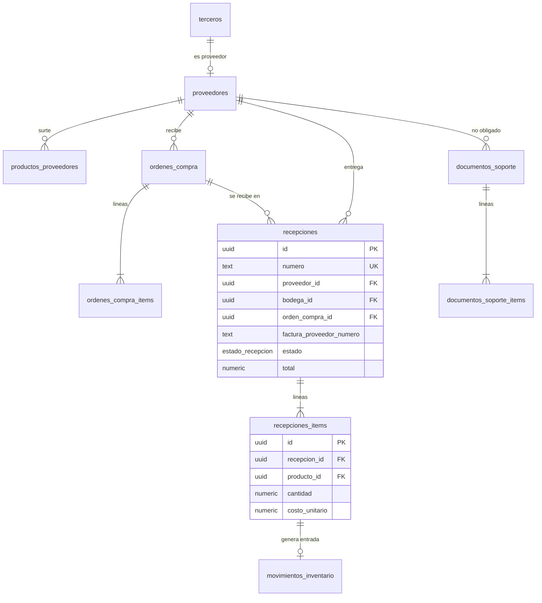

### 8.1 `compras.proveedores` — `[M]` · Clase N
Atributos propios de ser proveedor; la identidad fiscal está en `identidad.terceros` (`es_proveedor=true`).

| Columna | Tipo | Null | Default | Notas |
|---|---|---|---|---|
| `tercero_id` | uuid | NOT NULL | — | → `identidad.terceros` RESTRICT |
| `plazo_pago_dias` | smallint | NOT NULL | `0` | `CHECK (>= 0)` |
| `contacto_nombre`, `contacto_telefono`, `contacto_email` | text | NULL | — | |
| `es_no_obligado_a_facturar` | boolean | NOT NULL | `false` | `true` ⇒ sus compras requieren **documento soporte**. |
| `notas` | text | NULL | — | |
| `activo` | boolean | NOT NULL | `true` | |

UNIQUE `uq_proveedores_tercero (tercero_id)`.

### 8.2 `compras.productos_proveedores` — `[M]`
Qué código usa el proveedor para mi producto y a cuánto me lo vendió la última vez.

`producto_id → catalogo.productos RESTRICT`, `proveedor_id → proveedores RESTRICT`, `codigo_proveedor text NULL`, `ultimo_costo numeric(18,4) NULL`, `ultima_compra_at timestamptz NULL`, `es_preferido boolean NOT NULL DEFAULT false`, `activo boolean NOT NULL DEFAULT true`. UNIQUE `uq_prodprov (proveedor_id, producto_id)`; índice `ix_prodprov_producto (producto_id)` ("¿quién me surte esto?" y sugerir reposición). Índice `ix_prodprov_codigo (proveedor_id, codigo_proveedor) WHERE codigo_proveedor IS NOT NULL` para emparejar renglones de la factura del proveedor al recibir.

### 8.3 `compras.ordenes_compra` — `[M]` · Clase C
ENUM `compras.estado_orden_compra ('borrador','enviada','parcialmente_recibida','recibida','cancelada')`.

| Columna | Tipo | Null | Default | Notas |
|---|---|---|---|---|
| `numero` | text | NOT NULL | — | `OC-PRI-000045`, asignado con un contador por sede (no hay requisito fiscal de continuidad). |
| `proveedor_id` | uuid | NOT NULL | — | → `proveedores` RESTRICT |
| `sede_id` | uuid | NOT NULL | — | → `organizacion.sedes` RESTRICT |
| `bodega_destino_id` | uuid | NOT NULL | — | → `inventario.bodegas` RESTRICT |
| `estado` | estado_orden_compra | NOT NULL | `'borrador'` | |
| `fecha_emision` | date | NOT NULL | `current_date` | |
| `fecha_esperada` | date | NULL | — | |
| `condiciones_pago` | text | NULL | — | |
| `subtotal`, `impuesto_total`, `total` | numeric(18,2) | NOT NULL | `0` | Estimados. |
| `notas` | text | NULL | — | |

UNIQUE `uq_oc_numero (numero)`. Índices: `ix_oc_proveedor (proveedor_id, fecha_emision DESC)`; `ix_oc_abiertas (sede_id, fecha_esperada) WHERE estado IN ('enviada','parcialmente_recibida')` ("qué pedidos debo estar recibiendo").

### 8.4 `compras.ordenes_compra_items` — `[M]`
`orden_compra_id → ordenes_compra RESTRICT`, `producto_id → catalogo.productos RESTRICT`, `cantidad_pedida numeric(14,3) NOT NULL CHECK (>0)`, `cantidad_recibida numeric(14,3) NOT NULL DEFAULT 0` (acumulado, actualizado al confirmar recepciones), `costo_unitario_pactado numeric(18,4) NOT NULL`, `tarifa_iva_pct numeric(7,4) NOT NULL` (snapshot), `total_linea numeric(18,2) NOT NULL`. UNIQUE `(orden_compra_id, producto_id)`. Índice `ix_oci_producto (producto_id)` — "cuánto tengo pedido de este producto" (reposición).

### 8.5 `compras.recepciones` — `[M]` con congelamiento · Clase S
**Propósito**: entrada de mercancía al inventario con su costo real. Al **confirmar** se congela y genera los movimientos `entrada_compra`.
ENUM `compras.estado_recepcion ('borrador','confirmada')`.

| Columna | Tipo | Null | Default | Notas |
|---|---|---|---|---|
| `numero` | text | NOT NULL | — | `RC-PRI-000310` |
| `proveedor_id` | uuid | NOT NULL | — | → `proveedores` RESTRICT |
| `bodega_id` | uuid | NOT NULL | — | → `inventario.bodegas` RESTRICT |
| `orden_compra_id` | uuid | NULL | — | → `ordenes_compra` RESTRICT. NULL = recepción sin orden (compra de mostrador). |
| `factura_proveedor_numero` | text | NOT NULL | — | |
| `factura_proveedor_fecha` | date | NOT NULL | — | |
| `factura_proveedor_cufe` | text | NULL | — | Si el proveedor es facturador electrónico (permite verificar). |
| `estado` | estado_recepcion | NOT NULL | `'borrador'` | |
| `subtotal`, `descuento_total`, `impuesto_total`, `total` | numeric(18,2) | NOT NULL | `0` | `CHECK (total = subtotal + impuesto_total)` |
| `recibida_at` | timestamptz | NULL | — | Obligatoria al confirmar (`ck_recepciones_confirmada`). |
| `recibida_por_id` | uuid | NULL | — | → `identidad.empleados` RESTRICT |
| `notas` | text | NULL | — | |

UNIQUE: `uq_recepciones_numero (numero)`; `uq_recepciones_factura (proveedor_id, factura_proveedor_numero) WHERE estado='confirmada'` — impide recibir dos veces la misma factura (error humano muy común). Índices: `ix_recepciones_oc (orden_compra_id) WHERE orden_compra_id IS NOT NULL`; `ix_recepciones_fecha (bodega_id, recibida_at DESC)`.
Una recepción `confirmada` no se edita (trigger). Si estaba mal: devolución a proveedor (movimiento `devolucion_proveedor`) o ajuste con autorización.

### 8.6 `compras.recepciones_items` — `[M]` con congelamiento
| Columna | Tipo | Null | Default | Notas |
|---|---|---|---|---|
| `recepcion_id` | uuid | NOT NULL | — | → `recepciones` RESTRICT |
| `orden_item_id` | uuid | NULL | — | → `ordenes_compra_items` RESTRICT |
| `producto_id` | uuid | NOT NULL | — | → `catalogo.productos` RESTRICT |
| `cantidad` | numeric(14,3) | NOT NULL | — | `CHECK (> 0)` |
| `costo_unitario` | numeric(18,4) | NOT NULL | — | **Neto sin IVA y después de descuento** = lo que entra al costo del inventario (el IVA de compra es descontable, no costo). |
| `descuento_valor` | numeric(18,2) | NOT NULL | `0` | Informativo (ya está en el costo). |
| `tarifa_iva_pct` | numeric(7,4) | NOT NULL | `0` | Snapshot. |
| `impuesto_valor`, `total_linea` | numeric(18,2) | NOT NULL | — | |

UNIQUE `(recepcion_id, producto_id)`. Índices: `ix_recitems_producto (producto_id)` (historial de costos de un producto); `ix_recitems_orden_item (orden_item_id) WHERE orden_item_id IS NOT NULL`.

### 8.7 `compras.documentos_soporte` — `[M]` con congelamiento · **solo estructura**
Compra a un proveedor **no obligado a facturar**. El documento DIAN en sí es una fila de `fiscal.documentos_fiscales` (tipo `DS`) que referencia a este registro; aquí vive la parte comercial.

| Columna | Tipo | Null | Default | Notas |
|---|---|---|---|---|
| `numero_interno` | text | NOT NULL | — | |
| `proveedor_id` | uuid | NOT NULL | — | → `proveedores` RESTRICT. `CHECK` en la app: `es_no_obligado_a_facturar`. |
| `sede_id` | uuid | NOT NULL | — | → `organizacion.sedes` RESTRICT |
| `recepcion_id` | uuid | NULL | — | → `recepciones` RESTRICT. Si lo comprado entró a inventario. |
| `fecha_operacion` | date | NOT NULL | — | |
| `estado` | `compras.estado_doc_soporte` | NOT NULL | `'borrador'` | ENUM `('borrador','confirmado')` — el estado DIAN vive en `fiscal`. |
| `subtotal`, `impuesto_total`, `retencion_total`, `total` | numeric(18,2) | NOT NULL | `0` | Retenciones (fuente/ICA) a detallar al elegir proveedor tecnológico. |
| `notas` | text | NULL | — | |

UNIQUE `(numero_interno)`. Índice `ix_ds_proveedor (proveedor_id, fecha_operacion DESC)`.

### 8.8 `compras.documentos_soporte_items` — `[M]`
`documento_soporte_id → documentos_soporte RESTRICT`, `linea smallint`, `producto_id → catalogo.productos RESTRICT NULL`, `descripcion text NOT NULL`, `unidad_codigo text NOT NULL → referencia.unidades_medida`, `cantidad numeric(14,3) NOT NULL`, `valor_unitario numeric(18,4) NOT NULL`, `total_linea numeric(18,2) NOT NULL`. UNIQUE `(documento_soporte_id, linea)`.

---

## 9. Schema `cajas`  (Clase S)

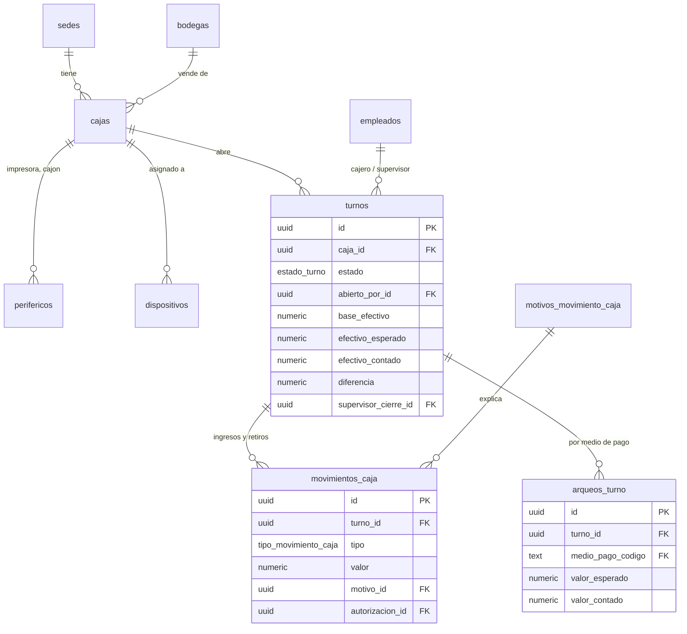

### 9.1 `cajas.cajas` — `[M]`
Puesto físico de cobro. **Su resolución de numeración** está en `fiscal.resoluciones_numeracion.caja_id` (una resolución activa por tipo de documento y caja, garantizado por índice único parcial) y **su impresora** en `perifericos`.

| Columna | Tipo | Null | Default | Notas |
|---|---|---|---|---|
| `sede_id` | uuid | NOT NULL | — | → `organizacion.sedes` RESTRICT |
| `codigo` | text | NOT NULL | — | `C01`; entra en el número interno de venta. |
| `nombre` | text | NOT NULL | — | |
| `bodega_id` | uuid | NOT NULL | — | → `inventario.bodegas` RESTRICT. De qué bodega descuenta esta caja. `CHECK` en la app: la bodega es de la misma sede. |
| `ultimo_numero_interno` | bigint | NOT NULL | `0` | Contador de `ventas.numero_interno` (sin valor fiscal). Se incrementa con la función `cajas.siguiente_numero_interno(caja_id)` (`UPDATE … RETURNING`, lock de fila) en la misma transacción que confirma la venta. |
| `activo` | boolean | NOT NULL | `true` | |

UNIQUE `uq_cajas (sede_id, codigo)`.

### 9.2 `cajas.perifericos` — `[M]`
ENUMs `cajas.tipo_periferico ('impresora_tiquetes','impresora_etiquetas','cajon_monedero','lector_codigos','datafono','pantalla_cliente')`, `cajas.tipo_conexion ('usb','red','serial','bluetooth','via_impresora')`.

| Columna | Tipo | Null | Default | Notas |
|---|---|---|---|---|
| `caja_id` | uuid | NOT NULL | — | → `cajas` RESTRICT |
| `tipo` | tipo_periferico | NOT NULL | — | |
| `nombre` | text | NOT NULL | — | "Epson TM-T20III". |
| `conexion` | tipo_conexion | NOT NULL | — | El cajón normalmente es `via_impresora` (pulso RJ11). |
| `parametros` | jsonb | NOT NULL | `'{}'` | IP/puerto, `ancho_mm: 80`, página de códigos ESC/POS, comando de apertura del cajón, lenguaje de etiquetas (ZPL/TSPL). |
| `activo` | boolean | NOT NULL | `true` | |

Índice `ix_perifericos_caja (caja_id) WHERE activo`. Es config del puesto, no historia: se puede editar.

### 9.3 `cajas.dispositivos` — `[M]`
Terminal registrado (tablet/PC con el POS). Se **empareja** una vez con un código; desde ahí se autentica con un token largo.
ENUMs `cajas.tipo_dispositivo ('pos','bodega')`, `cajas.estado_dispositivo ('pendiente','activo','bloqueado','revocado')`.

| Columna | Tipo | Null | Default | Notas |
|---|---|---|---|---|
| `sede_id` | uuid | NOT NULL | — | → `organizacion.sedes` RESTRICT |
| `caja_id` | uuid | NULL | — | → `cajas` RESTRICT. NULL para dispositivos de bodega. `CHECK (tipo <> 'pos' OR caja_id IS NOT NULL)`. |
| `tipo` | tipo_dispositivo | NOT NULL | `'pos'` | |
| `nombre` | text | NOT NULL | — | |
| `token_hash` | text | NOT NULL | — | SHA-256 del token (≥ 256 bits aleatorios, así que no necesita sal ni KDF lento). **Nunca** el token. |
| `estado` | estado_dispositivo | NOT NULL | `'pendiente'` | |
| `ultimo_acceso_at` | timestamptz | NULL | — | Se actualiza como mucho cada 5 min (evita una escritura por request). |
| `ultima_ip` | inet | NULL | — | |
| `version_cliente` | text | NULL | — | Versión de la PWA/Tauri. |
| `revocado_at` | timestamptz | NULL | — | |

UNIQUE `uq_dispositivos_token (token_hash)` — **es el índice de autenticación en cada request**. `uq_dispositivos_caja_activo (caja_id) WHERE estado='activo' AND tipo='pos'` — una terminal activa por caja (reemplazar un equipo = revocar el anterior). `ix_dispositivos_sede (sede_id, estado)` — panel de dispositivos.

### 9.4 `cajas.turnos` — `[M]` con congelamiento al cerrar
**Propósito**: periodo de responsabilidad de un cajero sobre una caja. Toda venta POS pertenece a un turno abierto.
ENUM `cajas.estado_turno ('abierto','cerrado')`.

| Columna | Tipo | Null | Default | Notas |
|---|---|---|---|---|
| `caja_id` | uuid | NOT NULL | — | → `cajas` RESTRICT |
| `dispositivo_id` | uuid | NULL | — | → `dispositivos` RESTRICT |
| `estado` | estado_turno | NOT NULL | `'abierto'` | |
| `abierto_por_id` | uuid | NOT NULL | — | → `identidad.empleados` RESTRICT. Cajero responsable. |
| `abierto_at` | timestamptz | NOT NULL | `now()` | |
| `base_efectivo` | numeric(18,2) | NOT NULL | — | Efectivo inicial (sencillo). `CHECK (>= 0)` |
| `cerrado_por_id` | uuid | NULL | — | → `identidad.empleados` RESTRICT |
| `supervisor_cierre_id` | uuid | NULL | — | → `identidad.empleados` RESTRICT. Quien autoriza el cierre si hay diferencia. |
| `autorizacion_cierre_id` | uuid | NULL | — | → `identidad.autorizaciones` RESTRICT |
| `cerrado_at` | timestamptz | NULL | — | |
| `efectivo_esperado` | numeric(18,2) | NULL | — | **Snapshot** calculado al cerrar (fórmula abajo). |
| `efectivo_contado` | numeric(18,2) | NULL | — | Lo que el cajero contó. `CHECK (>= 0)` |
| `diferencia` | numeric(18,2) | NULL | — | `GENERATED ALWAYS AS (efectivo_contado - efectivo_esperado) STORED`. Negativo = faltante; positivo = sobrante. |
| `observaciones` | text | NULL | — | |
| `umbral_diferencia` | numeric(18,2) | NULL | — | (0009) **Snapshot** de la tolerancia de la sede aplicada al cerrar. |
| `cierre_forzado` | boolean | NOT NULL | `false` | (0009) Cierre por un supervisor de un turno abandonado (`cajas.cierre_forzado`). |
| `motivo_cierre_forzado` | text | NULL | — | (0009) Obligatorio si `cierre_forzado`: `ck_turnos_forzado_con_motivo`. |

CHECKs: `ck_turnos_cierre_completo` (`estado='abierto' OR (cerrado_at, cerrado_por_id, efectivo_esperado, efectivo_contado) todos NOT NULL`); `ck_turnos_forzado_con_motivo`; `supervisor_cierre_id <> cerrado_por_id`. **0010 elimina `ck_turnos_diferencia_autorizada`** (creado en 0009): la diferencia de arqueo ya NUNCA bloquea el cierre; según `autorizacion.diferencia_arqueo` queda libre o en `auditoria.revisiones` (§14.2). `supervisor_cierre_id`/`autorizacion_cierre_id` solo se llenan hoy en el cierre forzado (supervisor) o quedan NULL. *Corrección documental*: el CHECK `ck_turnos_diferencia_supervisor` que describía una versión anterior de este documento nunca se creó.
Fórmula: `efectivo_esperado = base_efectivo + Σ ventas_pagos(efectivo).valor + Σ movimientos_caja(ingreso) − Σ movimientos_caja(retiro) − Σ devoluciones_pagos(efectivo).valor` (los pagos en efectivo se guardan **netos de cambio**).
Índices: `uq_turnos_abierto_por_caja (caja_id) WHERE estado='abierto'` — **un solo turno abierto por caja** (la BD lo garantiza aunque dos clientes intenten abrir a la vez); `uq_turnos_abierto_por_cajero (abierto_por_id) WHERE estado='abierto'` — un cajero no tiene dos cajas abiertas; `ix_turnos_caja_fecha (caja_id, abierto_at DESC)` — historial y cierre Z.
Cerrado ⇒ inmutable (trigger). Un error de cierre se corrige con una nota en `auditoria`/ajuste contable, no reabriendo el turno.

### 9.5 `cajas.motivos_movimiento_caja` — `[M]` · Clase N
`codigo text NOT NULL` (`retiro_seguridad`, `pago_proveedor`, `gasto_menor`, `reposicion_cambio`, `otro`), `nombre`, `tipo text NOT NULL CHECK (tipo IN ('ingreso','retiro','ambos'))`, `requiere_autorizacion boolean NOT NULL DEFAULT false`, `activo`. UNIQUE `(codigo)`.

### 9.6 `cajas.movimientos_caja` — `[A]`
Entradas y salidas de efectivo **que no son ventas** (retiro de seguridad, pago de flete, reposición de sencillo).
ENUM `cajas.tipo_movimiento_caja ('ingreso','retiro')`.

| Columna | Tipo | Null | Default | Notas |
|---|---|---|---|---|
| `turno_id` | uuid | NOT NULL | — | → `turnos` RESTRICT. La app exige turno `abierto`. |
| `tipo` | tipo_movimiento_caja | NOT NULL | — | |
| `valor` | numeric(18,2) | NOT NULL | — | `CHECK (valor > 0)`; el signo lo da `tipo`. |
| `motivo_id` | uuid | NOT NULL | — | → `motivos_movimiento_caja` RESTRICT |
| `descripcion` | text | NULL | — | Obligatoria si el motivo es `otro`. |
| `autorizacion_id` | uuid | NULL | — | → `identidad.autorizaciones` RESTRICT. Obligatoria si el motivo lo exige o `valor` supera el umbral (`pos.retirar_efectivo`). |

Índice `ix_movcaja_turno (turno_id, created_at)` — suma para el cierre y listado del turno. Un movimiento erróneo se anula con otro de signo contrario (inmutable).

### 9.7 `cajas.arqueos_turno` — `[A]`
Conciliación por medio de pago al cerrar: esperado (sistema) vs contado (cajero: billetes, vouchers del datáfono, comprobantes QR/transferencia).

| Columna | Tipo | Null | Default | Notas |
|---|---|---|---|---|
| `turno_id` | uuid | NOT NULL | — | → `turnos` RESTRICT |
| `medio_pago_codigo` | text | NOT NULL | — | → `referencia.medios_pago` RESTRICT |
| `valor_esperado` | numeric(18,2) | NOT NULL | — | Σ pagos del turno por ese medio (para efectivo, la fórmula completa de §9.4). |
| `valor_contado` | numeric(18,2) | NOT NULL | — | |
| `diferencia` | numeric(18,2) | NOT NULL | — | `GENERATED … (valor_contado - valor_esperado) STORED` |
| `observacion` | text | NULL | — | |

UNIQUE `uq_arqueos (turno_id, medio_pago_codigo)` (cubre la lectura por turno). Se inserta una fila por cada medio con movimiento en el turno **y siempre** la de efectivo; `turnos.efectivo_esperado/contado` repiten la fila de efectivo para poder consultar y restringir el cierre sin JOIN (denormalización deliberada, consistente porque ambos se escriben en la misma transacción de cierre).

---

## 10. Schema `ventas`  (Clase S)

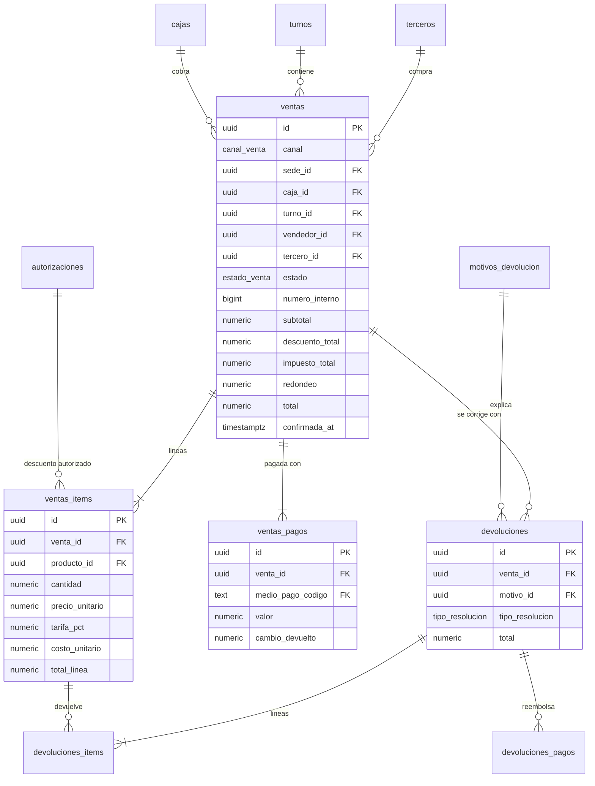

### 10.1 `ventas.ventas` — `[M]`, **congelada al confirmar**
**Propósito**: transacción comercial POS o web. Una venta **nace `borrador`** (venta en espera, sobrevive a un reinicio del POS), pasa a **`confirmada`** (momento en que se numera, descuenta inventario, cobra y genera el documento fiscal) o a `descartada`. Desde `confirmada`/`descartada` ningún `UPDATE` ni `DELETE` es posible (trigger `tg_inmutable` condicional: `WHEN (OLD.estado <> 'borrador')`).
ENUMs `ventas.canal_venta ('pos','web')`, `ventas.estado_venta ('borrador','confirmada','descartada')`.

| Columna | Tipo | Null | Default | Notas |
|---|---|---|---|---|
| `canal` | canal_venta | NOT NULL | — | |
| `sede_id` | uuid | NOT NULL | — | → `organizacion.sedes` RESTRICT |
| `caja_id` | uuid | NULL | — | → `cajas.cajas` RESTRICT |
| `turno_id` | uuid | NULL | — | → `cajas.turnos` RESTRICT |
| `vendedor_id` | uuid | NULL | — | → `identidad.empleados` RESTRICT. Quien ARMÓ la venta (comisión). Si no hubo venta en espera = el cajero. |
| `cajero_id` | uuid | NULL | — | (0010) → `identidad.empleados` RESTRICT. Quien la COBRÓ en su turno. NOT NULL al confirmar una venta POS (`ck_ventas_confirmada_cajero`). |
| `tercero_id` | uuid | NOT NULL | — | → `identidad.terceros` RESTRICT. Cliente fiscal; por defecto el consumidor final. |
| `estado` | estado_venta | NOT NULL | `'borrador'` | |
| `tipo_documento_fiscal_codigo` | text | NOT NULL | `'FE'` | → `referencia.tipos_documento_fiscal` RESTRICT. Hoy siempre `FE`; `POS_E` reservado. `CHECK (… IN ('FE','POS_E'))`. |
| `forma_pago_codigo` | text | NOT NULL | `'1'` | → `referencia.formas_pago` RESTRICT. Hoy solo contado (P-6: crédito). |
| `lista_precio_id` | uuid | NULL | — | → `catalogo.listas_precios` RESTRICT. Lista aplicada. |
| `numero_interno` | bigint | NULL | — | Consecutivo **interno** por caja (sin valor fiscal) para el tiquete y la búsqueda; asignado al confirmar con `cajas.siguiente_numero_interno`. El número fiscal vive en `documentos_fiscales`. |
| `subtotal` | numeric(18,2) | NOT NULL | `0` | Σ `base_gravable` (§1.7). |
| `descuento_total` | numeric(18,2) | NOT NULL | `0` | Informativo. |
| `impuesto_total` | numeric(18,2) | NOT NULL | `0` | |
| `redondeo` | numeric(18,2) | NOT NULL | `0` | |
| `total` | numeric(18,2) | NOT NULL | `0` | |
| `moneda` | text | NOT NULL | `'COP'` | |
| `placa_vehiculo` | text | NULL | — | Placa del cliente (historial por vehículo, útil en repuestos). |
| `confirmada_at` | timestamptz | NULL | — | **Instante de negocio** de la venta (offline: cuando se cobró, no cuando se sincronizó). |
| `notas` | text | NULL | — | |

CHECKs: `ck_ventas_total (total = subtotal + impuesto_total + redondeo)`; `ck_ventas_canal_pos (canal <> 'pos' OR (caja_id IS NOT NULL AND (estado = 'borrador' OR turno_id IS NOT NULL)))` (0010: una venta en espera no necesita turno; se asigna al confirmarla); `ck_ventas_confirmada_cajero (estado <> 'confirmada' OR canal <> 'pos' OR cajero_id IS NOT NULL)` (0010); `ck_ventas_canal_web (canal <> 'web' OR (caja_id IS NULL AND turno_id IS NULL))`; `ck_ventas_confirmada (estado <> 'confirmada' OR (confirmada_at IS NOT NULL AND (canal = 'web' OR numero_interno IS NOT NULL)))`; `ck_ventas_montos_no_negativos`.
Constraint trigger `ctg_ventas_pagos_cuadran` (`DEFERRABLE INITIALLY DEFERRED`): al confirmar, `Σ ventas_pagos.valor = total`.
Índices:
- `uq_ventas_numero_interno (caja_id, numero_interno) WHERE numero_interno IS NOT NULL` — integridad y búsqueda "venta N° 1234 de la caja 1" (reimprimir tiquete).
- `ix_ventas_turno (turno_id) WHERE turno_id IS NOT NULL` — sumas del cierre de turno.
- `ix_ventas_sede_fecha (sede_id, confirmada_at DESC) WHERE estado='confirmada'` — reportes de ventas por sede y día.
- `ix_ventas_tercero (tercero_id, confirmada_at DESC)` — historial del cliente.
- `ix_ventas_borradores (caja_id) WHERE estado='borrador'` — recuperar ventas en espera (parcial: pocas filas).
- `ix_ventas_vendedor (vendedor_id, confirmada_at DESC) WHERE vendedor_id IS NOT NULL` — comisiones.
- `ix_ventas_cajero (cajero_id, confirmada_at DESC) WHERE cajero_id IS NOT NULL` (0010) — ventas por cajero.
- `ix_ventas_placa (placa_vehiculo) WHERE placa_vehiculo IS NOT NULL`.
- FK `lista_precio_id` sin índice (solo se usa en reportes agregados raros).

### 10.2 `ventas.ventas_items` — `[M]`, congelada con su venta
Todo lo histórico es **snapshot**: nada se relee de `productos`, `precios` ni `impuestos`.

| Columna | Tipo | Null | Default | Notas |
|---|---|---|---|---|
| `venta_id` | uuid | NOT NULL | — | → `ventas` RESTRICT |
| `linea` | smallint | NOT NULL | — | Orden en el tiquete. |
| `producto_id` | uuid | NOT NULL | — | → `catalogo.productos` RESTRICT. Trazabilidad; los datos de abajo son la verdad histórica. |
| `bodega_id` | uuid | NOT NULL | — | → `inventario.bodegas` RESTRICT |
| `sku` | text | NOT NULL | — | Snapshot |
| `descripcion` | text | NOT NULL | — | Snapshot del nombre (sale en tiquete y XML). |
| `unidad_codigo` | text | NOT NULL | — | Snapshot del código DIAN de unidad. |
| `cantidad` | numeric(14,3) | NOT NULL | — | `CHECK (> 0)` |
| `precio_lista` | numeric(18,4) | NOT NULL | — | Precio resuelto de la lista (con IVA). |
| `precio_unitario` | numeric(18,4) | NOT NULL | — | Precio realmente cobrado (con IVA); difiere de `precio_lista` si hubo precio manual autorizado. |
| `precio_unitario_base` | numeric(18,4) | NOT NULL | — | Precio antes de IVA (`precio_unitario / (1+tarifa)`, 4 decimales): snapshot de lo mostrado a clientes con NIT (§1.8). Informativo: la base legal es `base_gravable`. |
| `descuento_pct` | numeric(7,4) | NOT NULL | `0` | `CHECK (BETWEEN 0 AND 100)` |
| `descuento_valor` | numeric(18,2) | NOT NULL | `0` | |
| `impuesto_codigo` | text | NOT NULL | — | Snapshot (`IVA_19`) |
| `tributo_codigo` | text | NOT NULL | — | Snapshot (`01`) |
| `tarifa_pct` | numeric(7,4) | NOT NULL | — | **Snapshot del % de IVA.** |
| `bruto_linea` | numeric(18,2) | NOT NULL | — | §1.7 |
| `total_linea` | numeric(18,2) | NOT NULL | — | |
| `base_gravable` | numeric(18,2) | NOT NULL | — | |
| `impuesto_valor` | numeric(18,2) | NOT NULL | — | `CHECK (base_gravable + impuesto_valor = total_linea)` |
| `costo_unitario` | numeric(18,4) | NOT NULL | — | **Costo promedio al vender** (snapshot del kardex). Permite margen exacto histórico. |
| `costo_estimado` | boolean | NOT NULL | `false` | Espejo del movimiento (§7.4). |
| `autorizacion_id` | uuid | NULL | — | → `identidad.autorizaciones` RESTRICT. Obligatoria si `descuento_pct` > umbral o `precio_unitario <> precio_lista` por debajo del permitido. |

CHECKs: `ck_items_total (total_linea = bruto_linea - descuento_valor)`, `ck_items_bruto (bruto_linea = round(cantidad * precio_unitario, 2))`.
UNIQUE `uq_ventas_items_linea (venta_id, linea)` (cubre la lectura por venta). Índice `ix_ventas_items_producto (producto_id, venta_id)` — "ventas de este producto" (rotación, última venta, trazabilidad de una pieza devuelta).

### 10.3 `ventas.ventas_pagos` — `[M]`, congelada con su venta
Una venta admite **pagos mixtos**.
ENUM `ventas.canal_pago ('manual','datafono','qr','pasarela')`.

| Columna | Tipo | Null | Default | Notas |
|---|---|---|---|---|
| `venta_id` | uuid | NOT NULL | — | → `ventas` RESTRICT |
| `medio_pago_codigo` | text | NOT NULL | — | → `referencia.medios_pago` RESTRICT |
| `valor` | numeric(18,2) | NOT NULL | — | Lo aplicado a la venta (**neto de cambio**). `CHECK (> 0)` |
| `valor_recibido` | numeric(18,2) | NULL | — | Efectivo entregado por el cliente. |
| `cambio_devuelto` | numeric(18,2) | NOT NULL | `0` | `CHECK (cambio_devuelto >= 0)`; `CHECK (valor_recibido IS NULL OR valor_recibido - cambio_devuelto = valor)`; solo > 0 si el medio `es_efectivo` (trigger). |
| `canal_pago` | canal_pago | NOT NULL | `'manual'` | `datafono` = integrado/semi-integrado; `qr` = Nequi/Bancolombia/Daviplata; `manual` = el cajero digita la referencia. |
| `referencia` | text | NULL | — | Nº de aprobación / comprobante / referencia QR. Obligatoria si `medios_pago.requiere_referencia`. |
| `terminal` | text | NULL | — | Id del datáfono. |
| `ultimos_digitos` | text | NULL | — | `CHECK (~ '^[0-9]{4}$')`. **Nunca** el PAN completo (PCI). |
| `franquicia` | text | NULL | — | Visa/Mastercard/… |

Índices: `ix_ventas_pagos_venta (venta_id)`; `ix_ventas_pagos_medio (medio_pago_codigo, created_at)` — arqueo por medio y reportes de conciliación con el datáfono. Solo se registran pagos **aprobados**; los intentos rechazados no son parte de la venta (P-7).

### 10.4 `ventas.motivos_devolucion` — `[M]` · Clase N
`codigo` (`pieza_equivocada`, `defectuosa`, `no_compatible`, `cliente_desiste`, `garantia`, `cambio_de_documento`), `nombre`, `reintegra_stock_por_defecto boolean NOT NULL`, `requiere_autorizacion boolean NOT NULL DEFAULT true`, `activo`. UNIQUE `(codigo)`.

### 10.5 `ventas.devoluciones` — `[M]`, congelada al confirmar
**Propósito**: documento comercial que corrige una venta (total o parcial). Es lo que origina la nota crédito / nota de ajuste.
ENUMs `ventas.estado_devolucion ('borrador','confirmada')`, `ventas.tipo_resolucion ('nota_credito','nota_ajuste')`.

| Columna | Tipo | Null | Default | Notas |
|---|---|---|---|---|
| `venta_id` | uuid | NOT NULL | — | → `ventas` RESTRICT. Debe estar `confirmada`. |
| `sede_id` | uuid | NOT NULL | — | → `organizacion.sedes` RESTRICT. Sede donde se recibe la pieza. |
| `turno_id` | uuid | NULL | — | → `cajas.turnos` RESTRICT. Turno que entrega el reembolso. |
| `motivo_id` | uuid | NOT NULL | — | → `motivos_devolucion` RESTRICT |
| `estado` | estado_devolucion | NOT NULL | `'borrador'` | |
| `tipo_resolucion` | tipo_resolucion | NOT NULL | — | Se **deduce** del documento fiscal de la venta: `FE` → `nota_credito` (único caso hoy); `POS_E` → `nota_ajuste` (reservado). |
| `subtotal`, `impuesto_total`, `redondeo`, `total` | numeric(18,2) | NOT NULL | `0` | Mismas fórmulas (`ck_devoluciones_total`). Positivos (la naturaleza "crédito" la da el tipo). |
| `autorizacion_id` | uuid | NULL | — | → `identidad.autorizaciones` RESTRICT |
| `observaciones` | text | NULL | — | |
| `confirmada_at` | timestamptz | NULL | — | |

Índices: `ix_devoluciones_venta (venta_id)` — devoluciones previas de una venta (tope de lo devolvible); `ix_devoluciones_turno (turno_id) WHERE turno_id IS NOT NULL` — cierre de turno; `ix_devoluciones_fecha (sede_id, confirmada_at DESC) WHERE estado='confirmada'`.

### 10.6 `ventas.devoluciones_items` — `[M]`, congelada
| Columna | Tipo | Null | Default | Notas |
|---|---|---|---|---|
| `devolucion_id` | uuid | NOT NULL | — | → `devoluciones` RESTRICT |
| `venta_item_id` | uuid | NOT NULL | — | → `ventas_items` RESTRICT |
| `producto_id` | uuid | NOT NULL | — | Copia (evita JOIN). |
| `cantidad` | numeric(14,3) | NOT NULL | — | `CHECK (> 0)`. Trigger: `Σ devuelto de ese venta_item ≤ cantidad vendida` (bloquea la fila del ítem para que dos devoluciones simultáneas no excedan). |
| `precio_unitario`, `tarifa_pct` | numeric(18,4) / (7,4) | NOT NULL | — | **Copiados del ítem original** (se devuelve al precio y tarifa a que se vendió, no a los actuales). |
| `descuento_valor`, `total_linea`, `base_gravable`, `impuesto_valor` | numeric(18,2) | NOT NULL | — | Proporcionales a la cantidad devuelta; mismas identidades de §1.7. |
| `costo_unitario` | numeric(18,4) | NOT NULL | — | Costo del ítem original: la pieza reingresa a **ese** costo, no al promedio de hoy. |
| `reintegra_stock` | boolean | NOT NULL | — | `true` = la pieza regresa físicamente y genera un movimiento `devolucion_venta` en `bodega_reintegro_id`; `false` = no regresa nada (cambio de documento fiscal, ajuste de precio): **no hay movimiento de kardex**. |
| `bodega_reintegro_id` | uuid | NULL | — | → `inventario.bodegas` RESTRICT. Obligatoria si `reintegra_stock` (puede ser una bodega no vendible de merma/revisión si la pieza vino defectuosa). `CHECK (reintegra_stock = (bodega_reintegro_id IS NOT NULL))`. |

UNIQUE `(devolucion_id, venta_item_id)`. Índice `ix_devitems_venta_item (venta_item_id)` — suma de lo ya devuelto de una línea (la consulta crítica de la validación).

### 10.7 `ventas.devoluciones_pagos` — `[M]`, congelada
`devolucion_id → devoluciones RESTRICT`, `medio_pago_codigo → referencia.medios_pago RESTRICT`, `valor numeric(18,2) CHECK (>0)`, `referencia text NULL`. Índice `ix_devpagos_devolucion (devolucion_id)`. Un reembolso en efectivo entra en la fórmula de `efectivo_esperado` del turno. (Vale/crédito a favor: P-8.)

---
## 11. Schema `pedidos`  (e-commerce; nace en la nube)

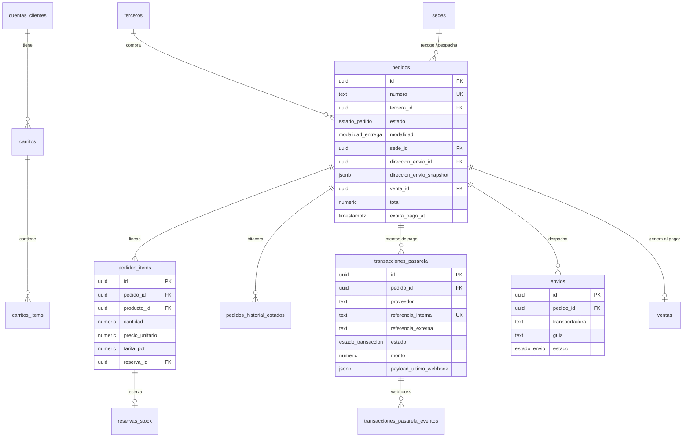

### 11.1 `pedidos.carritos` — `[M]` · Clase N (solo nube; no se replica)
ENUM `pedidos.estado_carrito ('activo','convertido','abandonado')`.

| Columna | Tipo | Null | Default | Notas |
|---|---|---|---|---|
| `cuenta_cliente_id` | uuid | NULL | — | → `identidad.cuentas_clientes` RESTRICT. NULL = anónimo. |
| `token_hash` | text | NULL | — | Hash del token de carrito anónimo (cookie). |
| `sede_recogida_id` | uuid | NULL | — | → `organizacion.sedes` RESTRICT. Sede elegida para ver disponibilidad. |
| `estado` | estado_carrito | NOT NULL | `'activo'` | |
| `expira_at` | timestamptz | NOT NULL | — | Anónimos: 30 días. |

CHECK `ck_carritos_dueno (cuenta_cliente_id IS NOT NULL OR token_hash IS NOT NULL)`. Índices: `uq_carritos_cuenta_activo (cuenta_cliente_id) WHERE estado='activo'` (un carrito vivo por cuenta); `uq_carritos_token (token_hash) WHERE token_hash IS NOT NULL`; `ix_carritos_expiracion (expira_at) WHERE estado='activo'` (limpieza). El carrito **no reserva** stock: la reserva nace al crear el pedido.

### 11.2 `pedidos.carritos_items` — `[M]`
`carrito_id → carritos ON DELETE CASCADE` (dato efímero, sin valor histórico), `producto_id → catalogo.productos RESTRICT`, `cantidad numeric(14,3) CHECK (>0)`, `precio_referencia numeric(18,4)` (solo para mostrar "el precio cambió"; el checkout re-resuelve). UNIQUE `(carrito_id, producto_id)`.

### 11.3 `pedidos.pedidos` — `[M]` · Clase C (ver reglas de estado en §13.5)
ENUMs `pedidos.estado_pedido ('pendiente_pago','pagado','alistando','listo_para_recoger','enviado','entregado','cancelado')`, `pedidos.modalidad_entrega ('envio','recoger_en_tienda')`.

| Columna | Tipo | Null | Default | Notas |
|---|---|---|---|---|
| `numero` | text | NOT NULL | — | Visible al cliente (`MR-000123`). |
| `tercero_id` | uuid | NOT NULL | — | → `identidad.terceros` RESTRICT. Quien compra y será el adquirente de la FE. |
| `cuenta_cliente_id` | uuid | NULL | — | → `identidad.cuentas_clientes` RESTRICT. NULL = compra como invitado. |
| `estado` | estado_pedido | NOT NULL | `'pendiente_pago'` | |
| `modalidad` | modalidad_entrega | NOT NULL | — | |
| `sede_id` | uuid | NOT NULL | — | → `organizacion.sedes` RESTRICT. **Sede que cumple el pedido** (recogida o despacho); de su bodega vendible sale el stock. |
| `direccion_envio_id` | uuid | NULL | — | → `identidad.direcciones` RESTRICT. Referencia; la verdad es el snapshot. |
| `direccion_envio_snapshot` | jsonb | NULL | — | Copia de destinatario, teléfono, municipio (código DIVIPOLA), dirección, indicaciones. |
| `contacto_nombre`, `contacto_telefono`, `contacto_email` | text | NOT NULL | — | |
| `subtotal`, `descuento_total`, `impuesto_total`, `redondeo`, `total` | numeric(18,2) | NOT NULL | `0` | Mismas fórmulas (§1.7). **El envío es una línea** (producto-servicio `FLETE`, `es_inventariable=false`, con IVA), no una columna aparte: así los totales y el XML usan una sola fórmula. |
| `moneda` | text | NOT NULL | `'COP'` | |
| `expira_pago_at` | timestamptz | NULL | — | Fin de la ventana de pago; también expira la reserva. |
| `pagado_at`, `cancelado_at` | timestamptz | NULL | — | |
| `motivo_cancelacion` | text | NULL | — | |
| `venta_id` | uuid | NULL | — | → `ventas.ventas` RESTRICT. Se llena al pagar (§Flujo d). |
| `notas_cliente` | text | NULL | — | |

CHECKs: `ck_pedidos_envio (modalidad <> 'envio' OR direccion_envio_snapshot IS NOT NULL)`; `ck_pedidos_recoger (modalidad <> 'recoger_en_tienda' OR direccion_envio_id IS NULL)`; `ck_pedidos_total`; `ck_pedidos_pagado (estado = 'pendiente_pago' OR estado = 'cancelado' OR (pagado_at IS NOT NULL AND venta_id IS NOT NULL))`.
Índices: `uq_pedidos_numero (numero)`; `uq_pedidos_venta (venta_id) WHERE venta_id IS NOT NULL`; `ix_pedidos_tercero (tercero_id, created_at DESC)` ("mis pedidos"); `ix_pedidos_bandeja (sede_id, estado) WHERE estado IN ('pagado','alistando','listo_para_recoger')` — la bandeja de alistamiento de la tienda (parcial: solo los activos); `ix_pedidos_vencen (expira_pago_at) WHERE estado='pendiente_pago'` — job que cancela y libera reservas.

### 11.4 `pedidos.pedidos_items` — `[M]`, congelada al pasar a `pagado`
Mismas columnas-snapshot que `ventas_items` (sin costo): `pedido_id → pedidos RESTRICT`, `linea smallint`, `producto_id → catalogo.productos RESTRICT`, `sku`, `descripcion`, `unidad_codigo`, `cantidad numeric(14,3) CHECK (>0)`, `precio_unitario numeric(18,4)`, `descuento_valor numeric(18,2) DEFAULT 0`, `impuesto_codigo`, `tributo_codigo`, `tarifa_pct numeric(7,4)`, `bruto_linea`, `total_linea`, `base_gravable`, `impuesto_valor numeric(18,2)` (mismos CHECK), y `reserva_id uuid NULL → inventario.reservas_stock RESTRICT`.
UNIQUE `(pedido_id, linea)`. Índices: `ix_pedidos_items_producto (producto_id)` (demanda por producto); `ix_pedidos_items_reserva (reserva_id) WHERE reserva_id IS NOT NULL`.

### 11.5 `pedidos.pedidos_historial_estados` — `[A]`
Línea de tiempo del pedido (la que ve el cliente y la que resuelve disputas de "yo ya lo recogí").
ENUM `pedidos.actor_tipo ('cliente','empleado','sistema','pasarela','transportadora')`.
Columnas: `pedido_id → pedidos RESTRICT`, `estado_anterior estado_pedido NULL`, `estado_nuevo estado_pedido NOT NULL`, `actor_tipo actor_tipo NOT NULL`, `actor_id uuid NULL` (polimórfico: empleado o cuenta), `motivo text NULL`, `ocurrido_at timestamptz NOT NULL`. Índice `ix_historial_pedido (pedido_id, ocurrido_at)`.

### 11.6 `pedidos.transacciones_pasarela` — `[M]`
Un pedido puede tener **varios intentos** de pago.
ENUM `pedidos.estado_transaccion ('creada','pendiente','aprobada','rechazada','anulada','expirada','error','reembolsada')`.

| Columna | Tipo | Null | Default | Notas |
|---|---|---|---|---|
| `pedido_id` | uuid | NOT NULL | — | → `pedidos` RESTRICT |
| `proveedor` | text | NOT NULL | — | `wompi`, `payu`, `mercadopago`, `epayco`… (texto, no ENUM: aún no está elegido y cambia). |
| `referencia_interna` | text | NOT NULL | — | La que **nosotros** enviamos a la pasarela (`numero` + intento). |
| `referencia_externa` | text | NULL | — | Id de la transacción en la pasarela. |
| `estado` | estado_transaccion | NOT NULL | `'creada'` | |
| `monto` | numeric(18,2) | NOT NULL | — | `CHECK (> 0)`. Debe igualar `pedidos.total` para aprobar (validación de la app; evita el fraude de "pagué menos"). |
| `moneda` | text | NOT NULL | `'COP'` | |
| `metodo` | text | NULL | — | `card`, `pse`, `nequi`… |
| `medio_pago_codigo` | text | NULL | — | → `referencia.medios_pago` RESTRICT. Mapeo a código DIAN al aprobar. |
| `url_checkout` | text | NULL | — | |
| `payload_ultimo_webhook` | jsonb | NULL | — | Último webhook recibido, completo. |
| `ultimo_evento_at` | timestamptz | NULL | — | |
| `codigo_error`, `mensaje_error` | text | NULL | — | |

Índices: `uq_pasarela_ref_interna (referencia_interna)`; `uq_pasarela_ref_externa (proveedor, referencia_externa) WHERE referencia_externa IS NOT NULL` — el webhook llega con la referencia de ellos; este índice lo resuelve y evita duplicados; `ix_pasarela_pedido (pedido_id, created_at DESC)`; `ix_pasarela_pendientes (updated_at) WHERE estado IN ('creada','pendiente')` — conciliación de transacciones colgadas (consultar el estado a la pasarela). `uq_pasarela_una_aprobada (pedido_id) WHERE estado='aprobada'` — un pedido no se cobra dos veces.

### 11.7 `pedidos.transacciones_pasarela_eventos` — `[A]`
Cada webhook, tal cual llegó (las pasarelas reintentan y mandan eventos fuera de orden).
Columnas: `transaccion_id uuid NULL → transacciones_pasarela RESTRICT` (NULL si no se pudo asociar), `proveedor text NOT NULL`, `evento_id_externo text NOT NULL`, `tipo text NOT NULL`, `firma_valida boolean NOT NULL`, `payload jsonb NOT NULL`, `recibido_at timestamptz NOT NULL DEFAULT now()`, `procesado_at timestamptz NULL`, `resultado text NULL`.
UNIQUE `uq_pasarela_evento (proveedor, evento_id_externo)` — **idempotencia del webhook**. Índices: `ix_pasarela_eventos_trx (transaccion_id)`; `ix_pasarela_eventos_pendientes (recibido_at) WHERE procesado_at IS NULL`. Eventos con `firma_valida=false` se guardan pero no se procesan.

### 11.8 `pedidos.envios` — `[M]`
ENUM `pedidos.estado_envio ('pendiente','despachado','en_transito','novedad','entregado','devuelto')`.
Columnas: `pedido_id → pedidos RESTRICT`, `transportadora text NULL`, `servicio text NULL`, `guia text NULL`, `url_rastreo text NULL`, `estado estado_envio NOT NULL DEFAULT 'pendiente'`, `costo_transportadora numeric(18,2) NULL` (lo que **nos** cobra el transportista; lo que se cobró al cliente es la línea FLETE), `peso_kg numeric(10,3) NULL`, `direccion_snapshot jsonb NOT NULL`, `despachado_at`, `entregado_at timestamptz NULL`, `recibido_por text NULL`, `novedad text NULL`.
Índices: `ix_envios_pedido (pedido_id)`; `uq_envios_guia (transportadora, guia) WHERE guia IS NOT NULL`; `ix_envios_abiertos (estado) WHERE estado IN ('despachado','en_transito','novedad')` (seguimiento).

---

## 12. Schema `fiscal`  (Clase S: lo emite el nodo que hizo la venta)

> **Revisión 2 — proveedor inicial FACTUS.** Solo se emiten **FE, NC y ND**; el mostrador también emite FE (no hay POS electrónico en esta etapa). Los tipos `POS_E`, `NA` y `DS` siguen existiendo en `referencia.tipos_documento_fiscal` pero con `activo=false`. En Factus **el número lo asigna el proveedor** según su rango activo (no se puede enviar), así que `prefijo`/`consecutivo` del documento quedan `NULL` hasta que Factus responde. El adapter `ProveedorFiscal` (interfaz de la app) aísla al proveedor para sumar después uno de POS electrónico (p. ej. Alegra) sin cambiar el modelo.

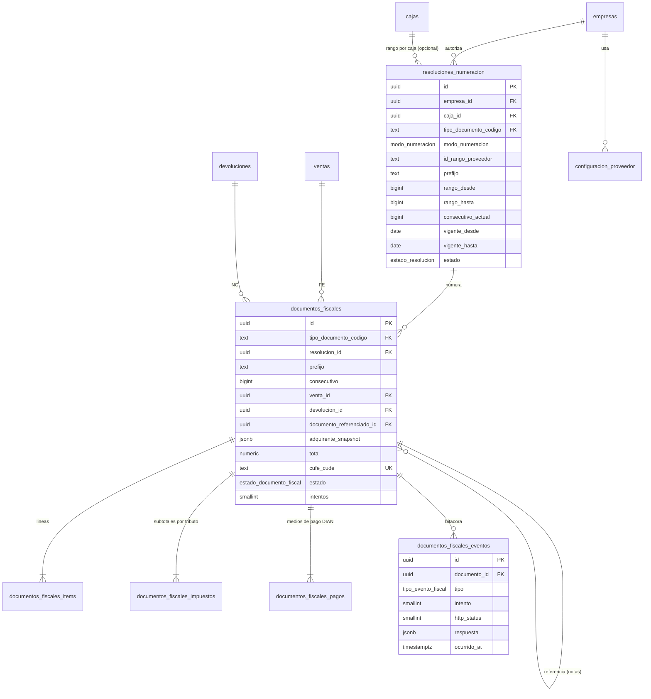

### 12.1 `fiscal.configuracion_proveedor` — `[M]` · Clase N
Qué proveedor tecnológico y ambiente usa la empresa.
ENUM `fiscal.ambiente_dian ('habilitacion','produccion')`.

| Columna | Tipo | Null | Default | Notas |
|---|---|---|---|---|
| `empresa_id` | uuid | NOT NULL | — | → `organizacion.empresas` RESTRICT |
| `proveedor` | text | NOT NULL | — | `factus` (inicial); `alegra`, … en el futuro. Texto, no ENUM: cambia sin migrar. |
| `ambiente` | ambiente_dian | NOT NULL | `'habilitacion'` | |
| `url_base` | text | NOT NULL | — | |
| `credenciales_ref` | text | NOT NULL | — | **Nombre** del secreto en el gestor/variables de entorno de cada nodo. Las credenciales **no** se guardan en la BD. |
| `set_pruebas_id` | text | NULL | — | |
| `parametros` | jsonb | NOT NULL | `'{}'` | |
| `activo` | boolean | NOT NULL | `true` | |

Índice `uq_confprov_activo (empresa_id) WHERE activo` (un proveedor activo por empresa).

### 12.2 `fiscal.resoluciones_numeracion` — `[M]` · Clase S (por columna, ver §13.5)
**Propósito**: rango de numeración autorizado por la DIAN (resolución + prefijo + desde/hasta + vigencia). Dos modos (ENUM `fiscal.modo_numeracion ('proveedor','local')`):

| Modo | Quién asigna el número | Uso |
|---|---|---|
| `proveedor` | El proveedor (Factus), según su rango activo, que identificamos con `id_rango_proveedor` (el `numbering_range_id` de Factus). Los campos `prefijo`, `rango_*`, `vigente_*` y `consecutivo_actual` son **copia informativa** sincronizada desde el proveedor. | **Modo por defecto** de FE, NC y ND. |
| `local` | Nosotros, con el contador de la fila (`UPDATE … RETURNING`, §12.9). | Proveedores que aceptan numeración propia; futuro `DS`/`POS_E`. Se mantiene implementado y probado. |

ENUM `fiscal.estado_resolucion ('borrador','activa','agotada','vencida','anulada')`.

| Columna | Tipo | Null | Default | Notas |
|---|---|---|---|---|
| `empresa_id` | uuid | NOT NULL | — | → `organizacion.empresas` RESTRICT |
| `sede_id` | uuid | NULL | — | → `organizacion.sedes` RESTRICT. NULL = resolución de la nube (web) o de toda la empresa. |
| `caja_id` | uuid | NULL | — | → `cajas.cajas` RESTRICT. Solo si se pidió un rango/prefijo por caja. |
| `modo_numeracion` | modo_numeracion | NOT NULL | `'proveedor'` | |
| `id_rango_proveedor` | text | NULL | — | `numbering_range_id` de Factus. `CHECK (modo_numeracion <> 'proveedor' OR id_rango_proveedor IS NOT NULL)`. |
| `nodo_propietario_id` | uuid | NULL | — | → `organizacion.nodos` RESTRICT. Único nodo autorizado a incrementar el contador. `CHECK (modo_numeracion <> 'local' OR nodo_propietario_id IS NOT NULL)`. |
| `tipo_documento_codigo` | text | NOT NULL | — | → `referencia.tipos_documento_fiscal` RESTRICT |
| `numero_resolucion` | text | NOT NULL | — | Nº de la resolución DIAN. |
| `fecha_resolucion` | date | NOT NULL | — | |
| `prefijo` | text | NOT NULL | `''` | `CHECK (prefijo ~ '^[A-Z0-9]{0,4}$')` |
| `rango_desde`, `rango_hasta` | bigint | NOT NULL | — | `CHECK (rango_desde >= 1 AND rango_hasta >= rango_desde)` |
| `consecutivo_actual` | bigint | NOT NULL | — | Último número usado. Inicia en `rango_desde - 1`. `CHECK (consecutivo_actual BETWEEN rango_desde - 1 AND rango_hasta)`. En modo `local` lo incrementa la función de §12.9; en modo `proveedor` solo se actualiza (monótono) con lo que informa el proveedor. |
| `vigente_desde`, `vigente_hasta` | date | NOT NULL | — | `CHECK (vigente_hasta > vigente_desde)` |
| `clave_tecnica_ref` | text | NULL | — | **Referencia** (nombre del secreto), no la clave. Con proveedor por API la custodia el proveedor. |
| `estado` | estado_resolucion | NOT NULL | `'borrador'` | |

CHECK `ck_resoluciones_alcance (caja_id IS NULL OR sede_id IS NOT NULL)`.
Índices/restricciones:
- `uq_resoluciones_activa_caja (caja_id, tipo_documento_codigo) WHERE estado='activa' AND caja_id IS NOT NULL` — una resolución viva por caja y tipo.
- `uq_resoluciones_activa_sede (sede_id, tipo_documento_codigo) WHERE estado='activa' AND caja_id IS NULL AND sede_id IS NOT NULL` y `uq_resoluciones_activa_empresa (empresa_id, tipo_documento_codigo) WHERE estado='activa' AND sede_id IS NULL` — idem para sede y para empresa/nube. Con ellas, el worker de envío resuelve la resolución a usar por (caja → sede → empresa).
- `ex_resoluciones_sin_solape EXCLUDE USING gist (empresa_id WITH =, tipo_documento_codigo WITH =, prefijo WITH =, int8range(rango_desde, rango_hasta, '[]') WITH &&) WHERE (estado NOT IN ('anulada','borrador'))` — dos rangos que se pisan para el mismo prefijo serían numeración duplicada.
- `ix_resoluciones_propietario (nodo_propietario_id, estado)` — qué contadores gestiona cada nodo.
Alertas (job): `consecutivo_actual >= 90 %` del rango o `vigente_hasta - hoy <= 30` ⇒ alerta al backoffice.

### 12.3 `fiscal.documentos_fiscales` — `[M]` con **congelamiento por columna** · Clase S
**Propósito**: cada documento DIAN: **FE, NC, ND** (hoy), y `POS_E`, `NA`, `DS` en el futuro. Al salir de `borrador` su **contenido es inmutable**; solo cambian las columnas de *transporte*. Lo impone el trigger `fiscal.tg_documentos_congelar`: rechaza cualquier `UPDATE` que cambie una columna fuera de esta lista blanca: `estado, cufe_cude, qr_data, proveedor_documento_id, proveedor_respuesta_codigo, xml_url, pdf_url, intentos, ultimo_error, ultimo_intento_at, proximo_intento_at, enviado_at, aceptado_at, vigente, es_contingencia, contingencia_motivo, prefijo, consecutivo, numero_completo, updated_at, version`. Excepción: `prefijo`/`consecutivo`/`numero_completo` solo pueden cambiar **mientras sean NULL** (se asignan una vez, cuando el proveedor responde). `DELETE` siempre prohibido.
ENUM `fiscal.estado_documento_fiscal ('borrador','pendiente_envio','enviado','aceptado','rechazado','contingencia')`. `contingencia` queda reservado para el procedimiento de contingencia del proveedor (P-19); hoy una venta offline queda en `pendiente_envio`.

| Columna | Tipo | Null | Default | Notas |
|---|---|---|---|---|
| `empresa_id` | uuid | NOT NULL | — | → `organizacion.empresas` RESTRICT |
| `sede_id` | uuid | NOT NULL | — | → `organizacion.sedes` RESTRICT |
| `caja_id` | uuid | NULL | — | → `cajas.cajas` RESTRICT |
| `tipo_documento_codigo` | text | NOT NULL | — | → `referencia.tipos_documento_fiscal` RESTRICT |
| `resolucion_id` | uuid | NOT NULL | — | → `resoluciones_numeracion` RESTRICT. Rango con el que se emite. |
| `prefijo` | text | **NULL** | — | **NULL hasta que el proveedor responda** (modo `proveedor`); en modo `local` se llena al crear. |
| `consecutivo` | bigint | **NULL** | — | Idem. |
| `numero_completo` | text | NULL | — | `GENERATED ALWAYS AS (prefijo \|\| consecutivo::text) STORED` (NULL mientras no haya número). |
| `fecha_emision` | timestamptz | NOT NULL | — | Instante de negocio de la venta (no la hora de sincronización). |
| `venta_id` | uuid | NULL | — | → `ventas.ventas` RESTRICT. FE. |
| `devolucion_id` | uuid | NULL | — | → `ventas.devoluciones` RESTRICT. NC / ND. |
| `documento_referenciado_id` | uuid | NULL | — | → `documentos_fiscales(id)` RESTRICT. Documento que la nota corrige. |
| `concepto_nota_codigo` | text | NULL | — | FK compuesta `(tipo_documento_codigo, concepto_nota_codigo) → referencia.conceptos_nota` RESTRICT. |
| `forma_pago_codigo` | text | NOT NULL | `'1'` | → `referencia.formas_pago` RESTRICT |
| `fecha_vencimiento` | date | NULL | — | Crédito. |
| `emisor_snapshot` | jsonb | NOT NULL | — | NIT, DV, razón social, régimen, responsabilidades, dirección, municipio **al emitir**. |
| `adquirente_tercero_id` | uuid | NULL | — | → `identidad.terceros` RESTRICT. Solo trazabilidad. |
| `adquirente_snapshot` | jsonb | NOT NULL | — | **Copia completa** del adquirente. |
| `adquirente_numero_documento` | text | NOT NULL | — | Duplicado del snapshot para indexar/buscar. |
| `adquirente_nombre` | text | NOT NULL | — | Idem. |
| `moneda` | text | NOT NULL | `'COP'` | |
| `subtotal`, `descuento_total`, `impuesto_total`, `redondeo`, `total` | numeric(18,2) | NOT NULL | — | Snapshot; `ck_documentos_fiscales_total (total = subtotal + impuesto_total + redondeo)`. |
| `estado` | estado_documento_fiscal | NOT NULL | `'borrador'` | |
| `vigente` | boolean | NOT NULL | `true` | `false` cuando una nota total aceptada lo neutraliza. |
| `cufe_cude` | text | NULL | — | CUFE (FE) o CUDE (notas). |
| `qr_data` | text | NULL | — | |
| `proveedor_documento_id` | text | NULL | — | Id del documento en el proveedor. |
| `proveedor_respuesta_codigo` | text | NULL | — | |
| `xml_url`, `pdf_url` | text | NULL | — | |
| `intentos` | smallint | NOT NULL | `0` | |
| `ultimo_error` | text | NULL | — | |
| `ultimo_intento_at`, `proximo_intento_at` | timestamptz | NULL | — | Backoff exponencial. |
| `es_contingencia` | boolean | NOT NULL | `false` | Se emitió por el procedimiento de contingencia del proveedor (P-19). |
| `contingencia_motivo` | text | NULL | — | |
| `enviado_at`, `aceptado_at` | timestamptz | NULL | — | |
| `hash_contenido` | text | NOT NULL | — | SHA-256 del contenido canónico (cabecera + líneas) al crear, **sin** el número (que aún no existe). |

**`reference_code`** que se envía a Factus = `documentos_fiscales.id` (UUIDv7): es la llave de idempotencia con el proveedor. Antes de reintentar un envío con resultado desconocido (timeout) se consulta a Factus por `reference_code`; si ya existe, se adopta su respuesta en vez de crear otro documento. **La respuesta completa de Factus se guarda en `documentos_fiscales_eventos.respuesta`.**

CHECKs: `ck_documentos_fiscales_origen (num_nonnulls(venta_id, devolucion_id) = 1)` *(Fase 2 lo reemplaza para incluir `documento_soporte_id`)*; `ck_documentos_fiscales_nota (tipo_documento_codigo NOT IN ('NC','ND','NA') OR (documento_referenciado_id IS NOT NULL AND concepto_nota_codigo IS NOT NULL))`; `ck_documentos_fiscales_aceptado (estado <> 'aceptado' OR (cufe_cude IS NOT NULL AND aceptado_at IS NOT NULL AND consecutivo IS NOT NULL))`; `ck_documentos_fiscales_numero_par ((prefijo IS NULL) = (consecutivo IS NULL))` — un documento nunca tiene medio número.
Restricciones e índices:
- `uq_documentos_fiscales_numero (empresa_id, tipo_documento_codigo, prefijo, consecutivo) WHERE consecutivo IS NOT NULL` — **candado final contra duplicados**; **parcial**: mientras el número es NULL no aplica.
- `uq_documentos_fiscales_resolucion (resolucion_id, consecutivo) WHERE consecutivo IS NOT NULL`.
- `uq_documentos_fiscales_cufe (cufe_cude) WHERE cufe_cude IS NOT NULL`.
- `uq_documentos_fiscales_proveedor (resolucion_id, proveedor_documento_id) WHERE proveedor_documento_id IS NOT NULL` — un documento del proveedor no se registra dos veces.
- `uq_documentos_fiscales_venta_vigente (venta_id) WHERE vigente AND tipo_documento_codigo IN ('FE','POS_E')` — una venta, **una** factura vigente; cambiar de adquirente exige neutralizar la anterior con una NC total (flujo b).
- `uq_documentos_fiscales_devolucion (devolucion_id) WHERE devolucion_id IS NOT NULL` — una devolución, una nota.
- `ix_documentos_fiscales_cola (proximo_intento_at NULLS FIRST) WHERE estado IN ('pendiente_envio','contingencia','rechazado')` — **la cola** del worker de envío (parcial: casi todos están `aceptado`).
- `ix_documentos_fiscales_referenciado (documento_referenciado_id) WHERE documento_referenciado_id IS NOT NULL` — notas de un documento (y regla "no enviar la nota hasta que el referenciado esté aceptado").
- `ix_documentos_fiscales_fecha (empresa_id, tipo_documento_codigo, fecha_emision DESC)` — libros y reportes.
- `ix_documentos_fiscales_adquirente (adquirente_numero_documento, fecha_emision DESC)` — "todas las facturas del NIT X".
- `ix_documentos_fiscales_sede (sede_id, fecha_emision DESC)`.
- FK `resolucion_id`, `devolucion_id`, `caja_id`, `adquirente_tercero_id`: `resolucion_id` lo cubre el índice único; `devolucion_id` su único; las otras dos son de consulta rara.

### 12.4 `fiscal.documentos_fiscales_items` — `[M]` con congelamiento
Líneas tal como van al XML (snapshot independiente de `ventas_items`, para que el documento sea autosuficiente).
`documento_id → documentos_fiscales RESTRICT`, `linea smallint`, `venta_item_id uuid NULL → ventas.ventas_items RESTRICT`, `devolucion_item_id uuid NULL → ventas.devoluciones_items RESTRICT`, `producto_id uuid NULL → catalogo.productos RESTRICT`, `codigo text NOT NULL` (SKU), `descripcion text NOT NULL`, `unidad_codigo text NOT NULL`, `cantidad numeric(14,3)`, `precio_unitario numeric(18,4)` (con IVA), `valor_unitario_base numeric(18,4)` (antes de IVA, para el XML), `descuento_valor`, `base_gravable`, `impuesto_valor`, `total_linea numeric(18,2)`, `tributo_codigo text`, `tarifa_pct numeric(7,4)`.
UNIQUE `(documento_id, linea)`. Sin otros índices (siempre se lee por documento). Los índices de `venta_item_id`/`devolucion_item_id` no se crean: la trazabilidad inversa es rara.

### 12.5 `fiscal.documentos_fiscales_impuestos` — `[A]`
Subtotales por tributo/tarifa (`TaxSubtotal`): `documento_id → documentos_fiscales RESTRICT`, `tributo_codigo → referencia.tributos RESTRICT`, `tarifa_pct numeric(7,4)`, `base_gravable numeric(18,2)`, `impuesto_valor numeric(18,2)`. UNIQUE `(documento_id, tributo_codigo, tarifa_pct)`. La app verifica `Σ impuesto_valor = documentos_fiscales.impuesto_total`.

### 12.6 `fiscal.documentos_fiscales_pagos` — `[A]` (relación documento ↔ medios de pago DIAN)
`documento_id → documentos_fiscales RESTRICT`, `linea smallint`, `medio_pago_codigo → referencia.medios_pago RESTRICT`, `valor numeric(18,2) CHECK (>0)`, `referencia text NULL`. UNIQUE `(documento_id, linea)`. Se copia de `ventas_pagos` (netos de cambio). Para notas, de `devoluciones_pagos`.

### 12.7 `fiscal.documentos_fiscales_eventos` — `[A]` · bitácora de intentos y respuestas
ENUM `fiscal.tipo_evento_fiscal ('creado','envio_solicitado','respuesta_proveedor','respuesta_dian','error_tecnico','reintento_programado','contingencia_activada','contingencia_transmitida','estado_consultado','webhook_proveedor')`.

| Columna | Tipo | Null | Default | Notas |
|---|---|---|---|---|
| `documento_id` | uuid | NOT NULL | — | → `documentos_fiscales` RESTRICT |
| `tipo` | tipo_evento_fiscal | NOT NULL | — | |
| `intento` | smallint | NULL | — | Nº de intento al que pertenece. |
| `estado_resultante` | estado_documento_fiscal | NULL | — | |
| `http_status` | smallint | NULL | — | |
| `codigo_respuesta` | text | NULL | — | Código del proveedor/DIAN. |
| `mensaje` | text | NULL | — | Errores de validación DIAN (regla + texto). |
| `request_resumen` | jsonb | NULL | — | Sin credenciales; cuerpo omitido si es grande (se guarda hash). |
| `respuesta` | jsonb | NULL | — | **Respuesta completa del proveedor** (incluye número asignado, CUFE, QR, URLs). |
| `duracion_ms` | integer | NULL | — | |
| `ocurrido_at` | timestamptz | NOT NULL | `now()` | |

Índices: `ix_documentos_fiscales_eventos_documento (documento_id, ocurrido_at)` — historial de un documento; `brin_documentos_fiscales_eventos_ocurrido (ocurrido_at)`. Retención de payloads pendiente (P-12); las filas no se borran.

### 12.8 Estados

```
borrador ─► pendiente_envio ──(POST Factus, reference_code = id)──► enviado ──► aceptado
 (opcional)       │ ▲                                          └──► rechazado ──(reintento del worker)──► pendiente_envio
                  │ └── sin conexión: se queda aquí; el worker lo emite cuando haya internet
                  └── contingencia (reservado: procedimiento del proveedor, P-19)
```
La venta **nunca espera** al documento: se confirma localmente y su FE queda `pendiente_envio` (sin número). Un `rechazado` por error del contenido no se "edita" (está congelado): si nunca fue aceptado por la DIAN se crea un documento nuevo que lo reemplaza (el anterior queda `vigente=false`); si fue aceptado, se corrige con nota.

### 12.9 Numeración: modo `proveedor` (Factus) y modo `local`

**Modo `proveedor` (el que se usa)**
1. El documento nace con `prefijo`, `consecutivo` y `numero_completo` en `NULL`. El tiquete impreso lleva `ventas.numero_interno` y la leyenda "factura electrónica pendiente de validación".
2. El worker toma documentos de `ix_documentos_fiscales_cola`, arma la FE con `reference_code = documentos_fiscales.id` y `numbering_range_id = resoluciones_numeracion.id_rango_proveedor`, y la envía.
3. Factus asigna el número (secuencia atómica propia, sin colisión entre cajas ni entre nube y edge). Respuesta completa → `documentos_fiscales_eventos.respuesta`; transacción: `UPDATE documentos_fiscales SET prefijo, consecutivo, cufe_cude, qr_data, xml_url, pdf_url, estado…` (columnas de la lista blanca) y `UPDATE resoluciones_numeracion SET consecutivo_actual = GREATEST(consecutivo_actual, :n)`.
4. **Concurrencia**: no hay nada que serializar en nuestra BD; la unicidad la da el proveedor y la reflejan `uq_documentos_fiscales_numero` y `uq_documentos_fiscales_proveedor`. La **idempotencia** del envío la da `reference_code`.
5. **Offline**: nada depende de la nube ni del proveedor para vender. El número fiscal aparece cuando haya conexión. Orden de emisión: por `fecha_emision`; una nota espera a que su documento referenciado esté `aceptado`.
6. **Contador por caja con valor interno, sin valor fiscal**: `ventas.numero_interno`, generado con la función `cajas.siguiente_numero_interno(caja_id)` (`UPDATE cajas SET ultimo_numero_interno = ultimo_numero_interno + 1 … RETURNING`) en la misma transacción que confirma la venta. Mismo mecanismo que el modo local (lock de fila, sin huecos ante rollback), pero sin consecuencias fiscales.

**Modo `local` (implementado, no usado por Factus)** — función `fiscal.siguiente_consecutivo(resolucion_id, nodo_id)`:

```sql
BEGIN;
  UPDATE fiscal.resoluciones_numeracion
     SET consecutivo_actual = consecutivo_actual + 1
   WHERE id = :resolucion_id
     AND modo_numeracion = 'local'
     AND nodo_propietario_id = :mi_nodo_id
     AND estado = 'activa'
     AND current_date BETWEEN vigente_desde AND vigente_hasta
     AND consecutivo_actual < rango_hasta
  RETURNING consecutivo_actual, prefijo;        -- 0 filas => agotada / vencida / ajena / modo proveedor: se aborta

  INSERT INTO fiscal.documentos_fiscales (..., prefijo, consecutivo, ...) VALUES (..., :prefijo, :consecutivo_actual, ...);
COMMIT;
```
- El `UPDATE` toma un lock de fila: transacciones concurrentes sobre la misma resolución se serializan; la segunda ve el valor ya incrementado.
- Si la transacción falla, el `ROLLBACK` deshace el incremento: **sin huecos** (una `SEQUENCE` sí los deja).
- Propietario único (`nodo_propietario_id`); al sincronizar, el contador viaja edge→nube con regla `GREATEST`; la nube nunca lo baja. El arranque del agente reconcilia `GREATEST(local, MAX(consecutivo) propio)` antes de aceptar ventas; `uq_documentos_fiscales_numero` es la red de seguridad.

**Configuración por sede (P-2/P-3 pendientes con el contador)** — no es lógica fija; viven en `configuracion_sede`: `fiscal.modo_contingencia` (`pendiente_envio` | `contingencia_proveedor`), `fiscal.politica_cambio_adquirente` (`nota_credito_y_refacturar` | `no_permitir`), `fiscal.momento_facturacion_web` (`pago` | `entrega`).

---

## 13. Schema `sync`  (Clase L: nunca se replica)

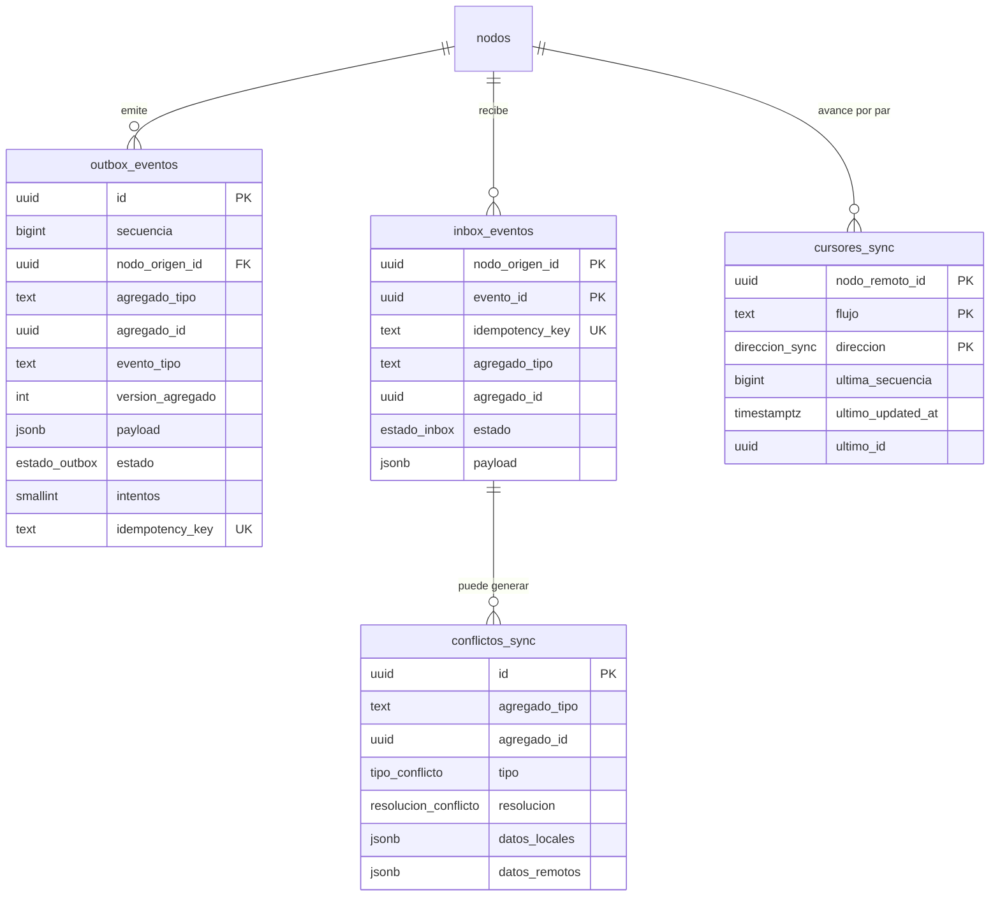

**Patrón**: *transactional outbox* + *idempotent inbox* + *cursor de maestros*.
- **Eventos (ventas, kardex, turnos, documentos fiscales, pedidos, auditoría)**: la app escribe el cambio de negocio y la fila de `outbox_eventos` en la **misma transacción**. El agente lee el outbox en orden de `secuencia`, lo envía por HTTPS a la contraparte (lotes), y la contraparte responde con ack por `idempotency_key`. Entrega *at-least-once*, aplicación *exactly-once efectiva* gracias al inbox.
- **Maestros (catálogo, precios, empleados, configuración)**: el edge hace *pull* desde la nube con un cursor `(updated_at, id)` por flujo (keyset: no se pierden filas con el mismo `updated_at`).
- **Reloj**: `updated_at` no se usa para decidir ganadores entre nodos (relojes desalineados); se usa `version` y el orden de llegada. Los edges sincronizan hora por NTP.

### 13.1 `sync.outbox_eventos` — `[A]`-like (cola operativa: solo la fila avanza de estado, y se purga tras la retención)
ENUM `sync.estado_outbox ('pendiente','enviado','confirmado','fallido')`.

| Columna | Tipo | Null | Default | Notas |
|---|---|---|---|---|
| `id` | uuid | NOT NULL | — | PK, UUIDv7. Es el `evento_id` que viaja. |
| `secuencia` | bigint | NOT NULL | `GENERATED ALWAYS AS IDENTITY` | Orden local de emisión. **Excepción a "sin autoincrementales":** no es identidad de entidad, solo orden de cola local (nunca sale del nodo ni se referencia). |
| `nodo_origen_id` | uuid | NOT NULL | — | → `organizacion.nodos` RESTRICT |
| `nodo_destino_id` | uuid | NULL | — | → `organizacion.nodos` RESTRICT. NULL = todos los demás. |
| `agregado_tipo` | text | NOT NULL | — | `venta`, `movimiento_inventario`, `turno`, `documento_fiscal`, `pedido`… |
| `agregado_id` | uuid | NOT NULL | — | |
| `evento_tipo` | text | NOT NULL | — | `venta.confirmada`, `inventario.movimiento_registrado`, `documento_fiscal.estado_cambiado`… |
| `version_agregado` | integer | NOT NULL | — | Versión del agregado tras el cambio (para ordenar por agregado y detectar huecos). |
| `payload_version` | smallint | NOT NULL | `1` | Versión del esquema del payload (evolución sin romper nodos viejos). |
| `payload` | jsonb | NOT NULL | — | El agregado completo o el delta; autosuficiente. |
| `estado` | estado_outbox | NOT NULL | `'pendiente'` | |
| `intentos` | smallint | NOT NULL | `0` | |
| `proximo_intento_at` | timestamptz | NOT NULL | `now()` | Backoff exponencial con tope. |
| `ultimo_error` | text | NULL | — | |
| `idempotency_key` | text | NOT NULL | — | `{nodo_origen}:{agregado_tipo}:{agregado_id}:{evento_tipo}:{version_agregado}`. Determinista: regenerar el evento produce la misma clave. |
| `created_at` | timestamptz | NOT NULL | `now()` | |
| `enviado_at`, `confirmado_at` | timestamptz | NULL | — | |

Índices: `uq_outbox_idempotency (idempotency_key)`; `ix_outbox_cola (proximo_intento_at, secuencia) WHERE estado IN ('pendiente','fallido')` — lo único que el agente consulta continuamente (parcial: la cola viva es pequeña aunque la tabla tenga millones); `ix_outbox_agregado (agregado_tipo, agregado_id, version_agregado)` — diagnóstico y reconstrucción. Purga: `confirmado` con más de 30 días → archivo/borrado (única tabla donde el borrado es política).

### 13.2 `sync.inbox_eventos` — `[L]`
Registro de lo recibido; **garantiza que un evento no se aplica dos veces**.
ENUM `sync.estado_inbox ('recibido','aplicado','en_espera','conflicto','error')`.

| Columna | Tipo | Null | Default | Notas |
|---|---|---|---|---|
| `nodo_origen_id` | uuid | NOT NULL | — | PK(1). → `organizacion.nodos` RESTRICT |
| `evento_id` | uuid | NOT NULL | — | PK(2). El `id` del outbox del emisor. |
| `idempotency_key` | text | NOT NULL | — | |
| `agregado_tipo`, `evento_tipo` | text | NOT NULL | — | |
| `agregado_id` | uuid | NOT NULL | — | |
| `version_agregado` | integer | NOT NULL | — | |
| `payload` | jsonb | NOT NULL | — | |
| `estado` | estado_inbox | NOT NULL | `'recibido'` | `en_espera` = falta una dependencia (p. ej. llegó la venta antes que el tercero; se reintenta). |
| `intentos` | smallint | NOT NULL | `0` | |
| `error` | text | NULL | — | |
| `recibido_at` | timestamptz | NOT NULL | `now()` | |
| `aplicado_at` | timestamptz | NULL | — | |

Aplicación: `BEGIN; INSERT INTO inbox … ON CONFLICT DO NOTHING; -- 0 filas ⇒ duplicado: responder ack y terminar; … aplicar al negocio …; UPDATE inbox SET estado='aplicado'; COMMIT;` — insertar el inbox y aplicar el cambio en **una sola transacción**: o ambos o ninguno.
Índices: PK `(nodo_origen_id, evento_id)` (dedupe); `uq_inbox_idempotency (idempotency_key)`; `ix_inbox_pendientes (recibido_at) WHERE estado IN ('recibido','en_espera','error')`; `ix_inbox_agregado (agregado_tipo, agregado_id, version_agregado)` (ordenar y detectar huecos por agregado).

### 13.3 `sync.cursores_sync` — `[L]`
Hasta dónde llegó la sincronización con cada contraparte, por flujo.
ENUM `sync.direccion_sync ('envio','recepcion')`.
PK `(nodo_remoto_id, flujo, direccion)`. Columnas: `nodo_remoto_id uuid → organizacion.nodos RESTRICT`, `flujo text` (`outbox`, `catalogo`, `precios`, `empleados`, `configuracion`…), `direccion direccion_sync`, `ultima_secuencia bigint NULL` (flujos de eventos), `ultimo_updated_at timestamptz NULL` y `ultimo_id uuid NULL` (flujos de maestros, keyset), `ultimo_exito_at timestamptz NULL`, `ultimo_error text NULL`, `updated_at timestamptz NOT NULL DEFAULT now()`. Índice: PK suficiente.

### 13.4 `sync.conflictos_sync` — `[M]`
Todo conflicto que la política automática resolvió "con rastro" o que requiere decisión humana.
ENUMs `sync.tipo_conflicto ('edicion_concurrente','clave_natural_duplicada','estado_incompatible','dependencia_faltante','violacion_restriccion')`, `sync.resolucion_conflicto ('pendiente','gano_nube','gano_edge','fusionado','manual','descartado')`.
Columnas: `nodo_origen_id`, `evento_id` (referencia lógica al inbox), `agregado_tipo`, `agregado_id`, `tipo tipo_conflicto NOT NULL`, `version_local integer NULL`, `version_remota integer NULL`, `datos_locales jsonb NOT NULL`, `datos_remotos jsonb NOT NULL`, `resolucion resolucion_conflicto NOT NULL DEFAULT 'pendiente'`, `resuelto_por_id uuid NULL → identidad.empleados RESTRICT`, `resuelto_at timestamptz NULL`, `notas text NULL`.
Índices: `ix_conflictos_pendientes (created_at) WHERE resolucion = 'pendiente'` — bandeja de soporte; `ix_conflictos_agregado (agregado_tipo, agregado_id)`.

### 13.5 Política de conflictos por tabla

**Dos etapas.** *Etapa 1* (hoy): no hay nube; el nodo EDGE de la tienda es el dueño de escritura de TODO (catálogo, precios, terceros, empleados, organización…), no hay sincronización con nadie y las tablas de e-commerce no existen. *Etapa 2*: aparece la nube y los maestros pasan a ser suyos según las columnas de la derecha; el paso de una a otra es la **promoción** descrita en §13.6. La columna «etapa 2» es la política de conflictos definitiva.

Regla general: **toda fila tiene un solo dueño de escritura** (§1.5); la mayoría de los "conflictos" se evitan por diseño (IDs únicos, tablas de solo-agregar, dueño por columna). Lo que sigue es lo que queda.

| Tabla(s) | Dueño **etapa 1** (solo EDGE, sin nube) | Dueño **etapa 2** (nube + edge) | Dirección (etapa 2) | Quién gana y por qué (etapa 2) |
|---|---|---|---|---|
| `referencia.*` | Código | Código | — (migraciones) | No hay datos de usuario que sincronizar; el esquema/semilla se versionan juntos. |
| `organizacion.empresas`, `sedes`, `configuracion_sede` | **Edge** | Nube | nube → edge | **Nube.** Son decisiones administrativas; el edge nunca las edita. |
| `organizacion.nodos` | **Edge** (registro de nodos); cada nodo su latido | Nube (definición) / cada nodo (su propio latido) | ambos | Nube gana en definición. Cada edge gana **solo** en `ultimo_latido_at`, `version_app`, `version_esquema` de **su** fila. |
| `identidad.empleados`, `roles`, `permisos`, `roles_permisos`, `empleados_roles`, `empleados_sedes` | **Edge** | Nube | nube → edge | **Nube.** Un despido o cambio de permisos debe aplicarse sin discusión. El bloqueo por intentos se deriva de la bitácora local (`auditoria.log_acciones`), no de columnas del empleado. |
| `identidad.terceros`, `terceros_responsabilidades` | **Edge** | Ambos (**C**) | ambos | Edición del mismo id: se aplica si `version_base` coincide; si no, **campo a campo**, gana el cambio **más reciente por orden de llegada a la nube**, empate → nube; queda en `conflictos_sync` como `gano_*`. **Duplicado por clave natural** (dos nodos crearon el mismo NIT/cédula offline): gana el de menor `created_at` recibido primero en la nube; el otro queda con `fusionado_en_id` apuntando al ganador (nada se borra; documentos ya emitidos siguen válidos por snapshot). Las FKs en borradores se reapuntan. |
| `identidad.cuentas_clientes`, `carritos*`, `transacciones_pasarela*` | No existen (sin e-commerce) | Nube | no se replica | Solo existen en la nube (el edge no necesita credenciales web, carritos ni pasarela). |
| `identidad.direcciones` | **Edge** | Ambos | ambos | Por fila: gana la `version` mayor; empate → nube. Los pedidos usan snapshot, no se afectan. |
| `identidad.autorizaciones` | **Edge** | Sede | edge → nube | Solo agregar; ids únicos; sin conflicto. |
| `catalogo.*` (productos, categorías, marcas, códigos, referencias, vehículos, compatibilidades, imágenes, impuestos, listas, precios) | **Edge** (backoffice sobre el edge) | Nube | nube → edge | **Nube, siempre.** El POS no crea ni edita catálogo en v1 (P-4). El edge aplica en orden de cursor; las ventas ya hechas están protegidas por snapshot. Columnas derivadas (`busqueda`, `nombre_busqueda`) **no viajan**: cada nodo las recalcula. |
| `inventario.bodegas` | **Edge** | Nube (definición) | nube → edge | Nube. |
| `inventario.ubicaciones`, `productos_ubicaciones` | **Edge** | Sede | edge → nube | **Edge**: quien camina la bodega sabe dónde está la pieza. |
| `inventario.movimientos_inventario` | **Edge** | Sede (dueña de **sus** bodegas) | edge → nube | **Sin conflicto**: solo agregar, `id` único, idempotente por `uq_mov_idempotencia`. La nube **no** genera movimientos en bodegas de una sede: pide al edge (p. ej. reservas). |
| `inventario.existencias` | Derivada (local) | Derivada | no se replica como estado | La nube la **recalcula** aplicando los movimientos recibidos (máx. `secuencia` por producto/bodega). Si difiere de lo que informa el edge, **gana el kardex del edge**. |
| `inventario.reservas_stock` | No existen (sin pedidos web) | Nube (crea/expira/libera) y edge (consume) (**C**) | ambos | La nube crea la reserva `activa` contra su réplica (stock publicado − stock de seguridad) y la expira; el edge la aplica al sincronizar y la marca `consumida` al entregar. Concurrencia: precedencia `consumida > expirada > liberada > activa`. Lo ya entregado nunca se "libera". |
| `inventario.conteos_fisicos*`, `ajustes_inventario`, `alertas_stock` | **Edge** | Sede | edge → nube | Edge. Excepción alertas: la nube puede marcar `reconocida` (evento al edge); `resuelta` (edge) prevalece. |
| `inventario.traslados`, `traslados_items` | **Edge** | Ambos (**C**, por columna) | ambos | Cada nodo escribe solo su tramo: el nodo origen `despachado_*` y `cantidad_enviada`; el destino `recibido_*` y `cantidad_recibida`. Estados avanzan en orden `borrador < en_transito < recibido*`; `cancelado` solo es válido desde `borrador`/`en_transito` y pierde frente a `recibido`. |
| `compras.proveedores`, `productos_proveedores` | **Edge** | Nube | nube → edge | Nube. |
| `compras.ordenes_compra*` | **Edge** | Creador | ambos | Quien la crea la edita hasta `enviada`; luego avanza por estado (`enviada < parcialmente_recibida < recibida`), gana el más avanzado; `cancelada` pierde ante `recibida`. `cantidad_recibida` es derivada de las recepciones. |
| `compras.recepciones*`, `documentos_soporte*` | **Edge** | Sede | edge → nube | Edge (la mercancía llega a la tienda). Inmutables al confirmar; sin conflicto. |
| `cajas.cajas`, `perifericos` | **Edge** | Nube (definición) / Sede (contadores) | ambos | Nube gana en definición; `ultimo_numero_interno` es del edge, regla `GREATEST`. `perifericos`: el edge gana (hardware local). |
| `cajas.dispositivos` | **Edge** | Sede | edge → nube | **Edge** (el emparejamiento debe funcionar offline). Excepción de seguridad: `estado='revocado'`/`bloqueado` puesto por la nube **prevalece siempre**. |
| `cajas.turnos`, `movimientos_caja`, `arqueos_turno`, `motivos_movimiento_caja` | **Edge** | Sede (motivos: nube) | edge → nube | Edge; sin conflicto. Motivos: nube. |
| `ventas.ventas*`, `devoluciones*` | **Edge** | Nodo que las creó | origen → resto | **Sin conflicto**: un único escritor por fila (el `nodo_origen_id`) y congeladas tras confirmar. Ventas POS nacen en el edge; ventas `web` en la nube. `motivos_devolucion`: nube. |
| `pedidos.pedidos`, `pedidos_items` | No existen (sin e-commerce) | Ambos (**C**, máquina de estados) | ambos | Nube posee `pendiente_pago → pagado/cancelado` y los datos de cliente/pago; el edge posee `alistando → listo_para_recoger → entregado` (y `enviado` si despacha la tienda); la transportadora (webhook a la nube) mueve `enviado/entregado` en envíos. Concurrencia: gana el estado **más avanzado**; excepción: **`entregado` gana a `cancelado`** (la pieza ya salió; el reembolso es una devolución). |
| `pedidos.pedidos_historial_estados`, `envios` | No existen (sin e-commerce) | Quien registra | ambos | Solo agregar / por fila (`envios`: nube si lo mueve la transportadora, edge si despacha la tienda; gana el estado más avanzado). |
| `fiscal.configuracion_proveedor` | **Edge** | Nube | nube → edge | Nube. Las credenciales **no** viajan (cada nodo las tiene en su entorno). |
| `fiscal.resoluciones_numeracion` | **Edge** | Nube (definición y rango) / quien emite (contador) | ambos | Rango, vigencia y `id_rango_proveedor`: **nube**. `consecutivo_actual`: regla `GREATEST` (monótono) — en modo `proveedor` lo informa el proveedor; en modo `local` el dueño es `nodo_propietario_id` y la nube jamás lo baja. El edge solo puede pasar a `agotada`/`vencida` (derivado). |
| `fiscal.documentos_fiscales*` | **Edge** | Nodo emisor | origen → resto | Quien crea el documento también lo transmite a Factus. La contraparte recibe los cambios de **estado/número** y adopta el de mayor "rango" (`borrador < pendiente_envio < enviado < rechazado/aceptado`); `aceptado` es terminal. Contenido inmutable → sin conflicto. Un documento sin número (`prefijo`/`consecutivo` NULL) puede recibirlo una sola vez. |
| `sync.*` | Local | Local | — | No se replica. |
| `auditoria.log_acciones` | **Edge** | Nodo que registra | origen → nube | Solo agregar. |


### 13.6 Promoción a la etapa 2: la nube pasa a ser dueña de los maestros (solo diseño, NO implementado)

**Tablas que cambian de dueño (edge → nube):** `organizacion.empresas`, `sedes`, `configuracion_sede`, `nodos` (definición),
`identidad.empleados`, `roles`, `permisos`, `roles_permisos`, `empleados_roles`, `empleados_sedes`, `catalogo.*`
(productos, categorías, marcas, códigos, referencias, vehículos, alias, compatibilidades, imágenes, impuestos, listas y precios),
`inventario.bodegas`, `compras.proveedores`, `productos_proveedores`, `fiscal.configuracion_proveedor` y la definición de
`fiscal.resoluciones_numeracion` y `cajas.cajas`. `identidad.terceros` y `direcciones` pasan a ser de dueño compartido (**C**).
NO cambian: movimientos, existencias, ventas, turnos, documentos fiscales (siguen siendo de la sede) ni las tablas locales (§13.7).

**Procedimiento (ventana de mantenimiento corta; el POS sigue vendiendo con su caché local):**
1. **Congelar.** Se activa en el edge el modo `maestros_solo_lectura` (bandera en `organizacion.configuracion_sede`, clave
   `sync.maestros_solo_lectura = true`): los endpoints de escritura de las tablas de arriba responden 409 `maestros_en_promocion`
   y un trigger `tg_maestros_solo_lectura` (creado en la migración de la etapa 2) rechaza `INSERT/UPDATE/DELETE` en esas tablas
   para cualquier rol distinto del agente de sync. Así el edge **no puede seguir escribiendo** aunque un cliente viejo lo intente.
2. **Exportar.** El agente de sync del edge recorre las tablas en orden de dependencias (referencia → organizacion → identidad →
   catalogo → inventario → compras → fiscal) y publica en el outbox un evento `*.promovida` por fila con su `version` actual y
   `nodo_origen_id` (los ids son UUIDv7: no cambian).
3. **Importar en la nube** (idempotente, `inbox_eventos`): inserta o ignora por id; las filas llegan con `nodo_origen_id` = edge.
   Se compara conteo y suma de verificación (`md5` de ids+versiones) por tabla; la promoción **no avanza** si no coinciden.
4. **Transferir la propiedad.** La nube registra un cursor `cursores_sync (tabla, dueno = 'nube', desde_version)` y desde ese
   instante sus escrituras llevan `nodo_origen_id` = nube. El edge pasa a ser réplica: `maestros_solo_lectura` queda ACTIVO
   de forma permanente para esas tablas y solo el agente de sync (aplicando eventos de la nube) puede escribirlas.
5. **Reabrir.** El backoffice se apunta a la nube; el edge sigue aceptando solo escrituras de su dominio (ventas, kardex, turnos…).
6. **Reversa.** Antes del paso 4 se descarta la importación y se desactiva el congelamiento (el edge nunca perdió su propiedad).
   Después del paso 4 la reversa es otra promoción en sentido contrario (nube → edge).

**Cómo se evita la doble escritura:** (a) trigger de solo lectura por tabla en el edge, (b) la columna `nodo_origen_id` de cada
fila decide quién puede modificarla (un nodo solo aplica cambios de la nube si `nodo_origen_id` ≠ él) y (c) los EAN-13 internos
llevan el código del nodo (`organizacion.nodos.codigo_ean`), así que dos nodos nunca generan el mismo código.

### 13.7 Tablas locales de cada nodo (NO se sincronizan)
`identidad.sesiones_refresh`, `identidad.autorizaciones_consumos`, `sync.*`, `catalogo.contadores_ean` y
**`inventario.importaciones`**: son estado operativo del nodo. En particular las importaciones Excel validadas que nunca se
confirmaron se **purgan solas** con `python -m app.cli importaciones limpiar --dias N` (por defecto 7; programar a diario): conservan
las filas completas del archivo y no deben acumularse. Las confirmadas se conservan como evidencia. Las tablas quedan marcadas con
`COMMENT ON TABLE … 'LOCAL del nodo: no se sincroniza'` para que el agente de sync las excluya.

---

## 14. Schema `auditoria`  (Clase S, solo agregar)

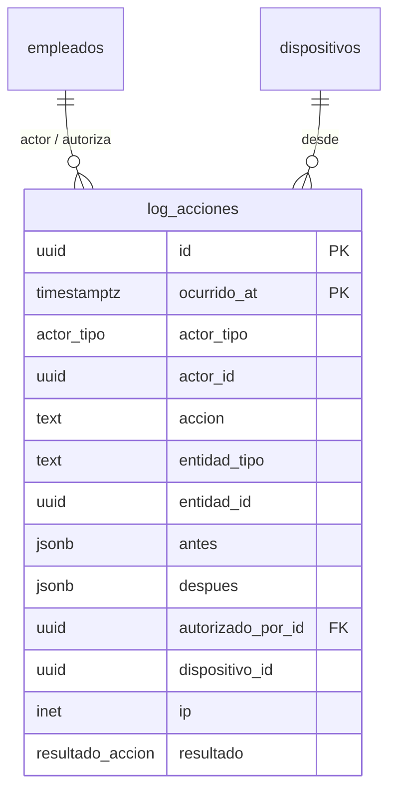

### 14.2 `auditoria.revisiones` — `[M]` · Clase S (0010)
**Propósito**: acciones ejecutadas bajo la política `revision_posterior`: no se bloquean y quedan pendientes de revisión en el backoffice (`GET /revisiones`, `POST /revisiones/{id}/revisar` con comentario obligatorio, `GET /revisiones/reporte-diario?fecha=`; permiso `revisiones.gestionar`).

| Columna | Tipo | Null | Default | Notas |
|---|---|---|---|---|
| `sede_id` | uuid | NOT NULL | — | → `organizacion.sedes` RESTRICT |
| `accion` | text | NOT NULL | — | `devolucion`, `retiro_caja`, `diferencia_arqueo`, `descuento_mayor`, `cambiar_precio` |
| `entidad_tipo`, `entidad_id` | text, uuid | NOT NULL, NULL | — | Documento que originó la revisión |
| `monto` | numeric(18,2) | NULL | — | |
| `empleado_id` | uuid | NULL | — | → `empleados` RESTRICT. Quien ejecutó la acción |
| `dispositivo_id` | uuid | NULL | — | |
| `detalle` | jsonb | NOT NULL | `'{}'` | |
| `estado` | text | NOT NULL | `'pendiente'` | `pendiente|revisada` |
| `revisada_por_id`, `revisada_at`, `comentario` | | NULL | — | Obligatorios al revisar (`ck_revisiones_revisada_completa`) |

CHECKs: `ck_revisiones_estado_valido`, `ck_revisiones_revisada_completa`. Índices: `uq_revisiones_accion_entidad (accion, entidad_id) WHERE entidad_id IS NOT NULL` (idempotencia: una revisión por acción y documento), `ix_revisiones_sede_estado`. El «día» del reporte es el día calendario de `America/Bogota`.

### 14.1 `auditoria.log_acciones` — `[A]`, tabla normal (sin particionar)
> Desde la 0006 también es la fuente del bloqueo por intentos fallidos (§5.14) y tiene el índice `ix_log_acciones_dispositivo`. Convención de `accion`: `modulo.verbo` (`identidad.login_ok`, `pos.pin_fallido`, `cajas.dispositivo_creado`, `identidad.roles_cambiados`…). Nunca se registran contraseñas, PIN ni tokens.
**Propósito**: quién hizo qué, cuándo, desde dónde y con qué autorización, para las acciones sensibles (descuentos grandes, anulaciones, devoluciones, ajustes de inventario, cierres con diferencia, cambios de precio, reenvíos fiscales, cambios de permisos/PIN, accesos denegados).
ENUMs `auditoria.actor_tipo ('empleado','cliente','sistema','dispositivo')`, `auditoria.resultado_accion ('exito','denegado','error')`.

| Columna | Tipo | Null | Default | Notas |
|---|---|---|---|---|
| `id` | uuid | NOT NULL | — | PK. UUIDv7. |
| `created_at`, `created_by`, `nodo_origen_id` | — | — | — | Plantilla `[A]` (`created_by` = actor si es empleado). |
| `ocurrido_at` | timestamptz | NOT NULL | `now()` | Instante del hecho (puede ser anterior a `created_at` si llega por sync). |
| `actor_tipo` | actor_tipo | NOT NULL | — | |
| `actor_id` | uuid | NULL | — | Polimórfico (empleado o cuenta de cliente): **sin FK** a propósito. |
| `sede_id` | uuid | NULL | — | → `organizacion.sedes` RESTRICT |
| `accion` | text | NOT NULL | — | `venta.descuento_autorizado`, `devolucion.confirmada`, `inventario.ajuste`, `turno.cierre_con_diferencia`, `precio.modificado`, `fiscal.reenviado`, `empleado.pin_restablecido`, `auth.denegado`… `CHECK (accion ~ '^[a-z_]+\.[a-z_]+$')` |
| `entidad_tipo` | text | NULL | — | |
| `entidad_id` | uuid | NULL | — | |
| `antes`, `despues` | jsonb | NULL | — | Estado previo/posterior de los campos relevantes. La app **elimina** contraseñas, hashes, tokens y PAN antes de escribir. |
| `autorizado_por_id` | uuid | NULL | — | → `identidad.empleados` RESTRICT |
| `autorizacion_id` | uuid | NULL | — | → `identidad.autorizaciones` RESTRICT |
| `dispositivo_id` | uuid | NULL | — | Referencia lógica a `cajas.dispositivos` (sin FK: el log debe sobrevivir a depuraciones de dispositivos). |
| `ip` | inet | NULL | — | |
| `user_agent` | text | NULL | — | |
| `resultado` | resultado_accion | NOT NULL | `'exito'` | |
| `motivo` | text | NULL | — | |
| `request_id` | uuid | NULL | — | Correlación con logs de la API. |

Índices:
- `ix_log_acciones_entidad (entidad_tipo, entidad_id)` — "historia de esta venta/producto".
- `ix_log_acciones_actor (actor_id, ocurrido_at DESC)` — "qué hizo esta persona y cuándo".
- `ix_log_acciones_ocurrido (ocurrido_at DESC)` — consulta por rango de fechas y "lo último que pasó".
- FKs `sede_id`, `autorizado_por_id`, `autorizacion_id`: sin índice propio (consulta ocasional; la tabla es solo de agregar y se filtra por los índices de arriba).

**Particionado futuro**: hoy es una tabla normal. Si llegara a decenas de millones de filas se puede convertir a `PARTITION BY RANGE (ocurrido_at)` mensual: implicaría PK `(id, ocurrido_at)` y migrar con `CREATE TABLE … PARTITION OF` + copia por lotes. Nada del modelo actual lo impide (ninguna tabla tiene FK hacia `log_acciones`). `app_rw` solo tiene `INSERT`/`SELECT`.

---

## 14A. Schema `cartera`  (diseño mínimo — **Fase 3**, no se implementa ahora)

**Propósito**: ventas a crédito (talleres, flotas): cupo y plazo por cliente, cuentas por cobrar, abonos (recibos de caja) y su aplicación. Depende de `identidad`, `cajas` y `ventas`; va después de `ventas` en la cadena de dependencias.

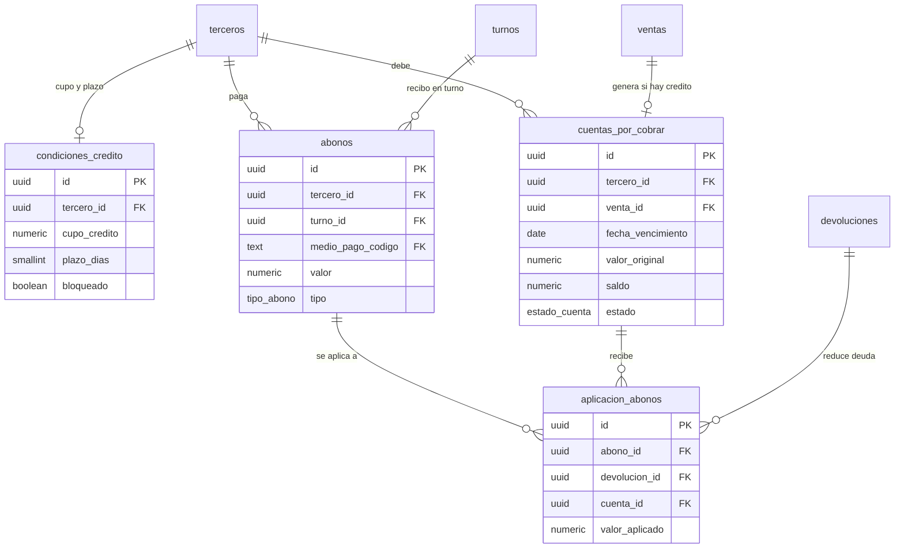

### 14A.1 `cartera.condiciones_credito` — `[M]` · Clase N
| Columna | Tipo | Null | Default | Notas |
|---|---|---|---|---|
| `tercero_id` | uuid | NOT NULL | — | → `identidad.terceros` RESTRICT |
| `cupo_credito` | numeric(18,2) | NOT NULL | — | `CHECK (>= 0)` |
| `plazo_dias` | smallint | NOT NULL | — | `CHECK (>= 0)`. Fija `fecha_vencimiento` de cada venta a crédito. |
| `bloqueado` | boolean | NOT NULL | `false` | Mora o decisión comercial: no se vende a crédito. |
| `motivo_bloqueo`, `notas` | text | NULL | — | |
| `aprobado_por_id` | uuid | NULL | — | → `identidad.empleados` RESTRICT |
| `aprobado_at` | timestamptz | NULL | — | |
| `activo` | boolean | NOT NULL | `true` | |

UNIQUE `uq_condiciones_credito_tercero (tercero_id)`. **Cupo disponible** = `cupo_credito − Σ saldo` de sus cuentas abiertas. En el edge offline se calcula con lo sincronizado (puede estar desfasado respecto a ventas en otra sede): la política es advertir al superar el cupo y exigir autorización de supervisor (`identidad.autorizaciones`), no bloquear en seco.

### 14A.2 `cartera.cuentas_por_cobrar` — `[M]` · Clase S
ENUM `cartera.estado_cuenta ('abierta','pagada','castigada')`.

| Columna | Tipo | Null | Default | Notas |
|---|---|---|---|---|
| `tercero_id` | uuid | NOT NULL | — | → `identidad.terceros` RESTRICT. Copia del cliente de la venta. |
| `venta_id` | uuid | NOT NULL | — | → `ventas.ventas` RESTRICT. **Una cuenta por venta.** |
| `sede_id` | uuid | NOT NULL | — | → `organizacion.sedes` RESTRICT |
| `fecha_emision`, `fecha_vencimiento` | date | NOT NULL | — | `CHECK (fecha_vencimiento >= fecha_emision)` |
| `valor_original` | numeric(18,2) | NOT NULL | — | = `ventas.valor_credito`. `CHECK (> 0)` |
| `saldo` | numeric(18,2) | NOT NULL | — | Caché de `valor_original − Σ aplicaciones`; recalculable. `CHECK (saldo BETWEEN 0 AND valor_original)`. |
| `estado` | estado_cuenta | NOT NULL | `'abierta'` | `CHECK (estado <> 'pagada' OR saldo = 0)` |

Índices: `uq_cuentas_por_cobrar_venta (venta_id)`; `ix_cuentas_por_cobrar_tercero_abiertas (tercero_id, fecha_vencimiento) WHERE estado = 'abierta'` — estado de cuenta del cliente y cupo usado; `ix_cuentas_por_cobrar_vencimiento (fecha_vencimiento) WHERE estado = 'abierta'` — reporte de mora y recordatorios.

### 14A.3 `cartera.abonos` — `[A]` · recibo de caja · Clase S
ENUM `cartera.tipo_abono ('abono','reverso')`.

| Columna | Tipo | Null | Default | Notas |
|---|---|---|---|---|
| `numero_recibo` | text | NOT NULL | — | `RC-<caja>-<n>`, contador por caja (`cajas.ultimo_numero_recibo`, columna añadida en Fase 3). |
| `tipo` | tipo_abono | NOT NULL | `'abono'` | Un abono mal registrado no se edita: se anula con un `reverso`. |
| `reversa_de_id` | uuid | NULL | — | → `abonos` RESTRICT. Solo si `tipo='reverso'`. |
| `tercero_id` | uuid | NOT NULL | — | → `identidad.terceros` RESTRICT |
| `sede_id`, `caja_id`, `turno_id` | uuid | NOT NULL | — | → sedes / `cajas.cajas` / `cajas.turnos` RESTRICT. **Ligado al turno**: el efectivo recibido entra en el arqueo. |
| `medio_pago_codigo` | text | NOT NULL | — | → `referencia.medios_pago` RESTRICT |
| `valor` | numeric(18,2) | NOT NULL | — | `CHECK (> 0)`; el signo lo da `tipo`. |
| `referencia` | text | NULL | — | |
| `autorizacion_id` | uuid | NULL | — | → `identidad.autorizaciones` RESTRICT (reversos) |

Índices: `uq_abonos_recibo (numero_recibo)`; `ix_abonos_turno (turno_id)` — suma para el cierre; `ix_abonos_tercero (tercero_id, created_at DESC)`. La fórmula de `efectivo_esperado` (§9.4) suma `abonos(efectivo, tipo='abono')` y resta los reversos en efectivo. El recibo no es un documento fiscal DIAN.

### 14A.4 `cartera.aplicacion_abonos` — `[A]`
Un abono puede pagar **varias cuentas**; una devolución sobre una venta a crédito también reduce la deuda.

| Columna | Tipo | Null | Default | Notas |
|---|---|---|---|---|
| `abono_id` | uuid | NULL | — | → `abonos` RESTRICT |
| `devolucion_id` | uuid | NULL | — | → `ventas.devoluciones` RESTRICT |
| `cuenta_id` | uuid | NOT NULL | — | → `cuentas_por_cobrar` RESTRICT |
| `valor_aplicado` | numeric(18,2) | NOT NULL | — | `CHECK (<> 0)` (negativo en reversos). |

CHECK `ck_aplicacion_abonos_origen (num_nonnulls(abono_id, devolucion_id) = 1)`. UNIQUE parciales `uq_aplicacion_abonos_abono_cuenta (abono_id, cuenta_id) WHERE abono_id IS NOT NULL` y `uq_aplicacion_abonos_devolucion_cuenta (devolucion_id, cuenta_id) WHERE devolucion_id IS NOT NULL`. Índice `ix_aplicacion_abonos_cuenta (cuenta_id)` — movimientos de una cuenta. Trigger: mantiene `cuentas_por_cobrar.saldo` y `estado` y verifica `Σ aplicado(abono) ≤ abonos.valor`; el excedente es **saldo a favor** sin aplicar (tratamiento en P-8).
**Sincronización**: como `saldo` es derivable y las aplicaciones solo se agregan, un conflicto entre nodos se resuelve **recalculando `saldo` a partir de la unión de aplicaciones**.

### 14A.5 Ajustes a `ventas` para crédito (se aplican con una migración de Fase 3)
- `ventas.valor_credito numeric(18,2) NOT NULL DEFAULT 0` y `ventas.fecha_vencimiento date NULL`.
- Cuadre: `Σ ventas_pagos.valor + valor_credito = total` (reemplaza `Σ pagos = total`). Una venta puede quedar **total** (sin pagos) o **parcialmente** a crédito (el resto en `ventas_pagos`, p. ej. un anticipo).
- CHECKs: `forma_pago_codigo = '1'` ⇔ `valor_credito = 0` (con crédito → `'2'`); `valor_credito = 0 OR fecha_vencimiento IS NOT NULL`; `valor_credito = 0 OR NOT es_consumidor_final` (trigger; el consumidor final no compra a crédito).
- Al confirmar una venta con `valor_credito > 0` se crea la `cuenta_por_cobrar` en la misma transacción; la FE sale con forma de pago "crédito" y `fecha_vencimiento`; `documentos_fiscales_pagos` solo lista lo pagado en el acto.
- `ventas_pagos` no cambia de estructura: el crédito **no es un medio de pago** sino la parte no pagada.

---

## 15. Decisiones de diseño

Cada decisión con la alternativa descartada y por qué.

| # | Decisión | Alternativa descartada | Por qué |
|---|---|---|---|
| D-1 | **PK `uuid` UUIDv7 generado por la app**, sin default en BD. | `bigserial`; UUIDv4 (`gen_random_uuid()`); UUID con default en BD. | Con dos clases de nodo que insertan offline, un contador autoincremental colisiona al sincronizar. UUIDv4 resuelve la colisión pero es aleatorio: fragmenta los índices B-tree y degrada las inserciones masivas. UUIDv7 es único globalmente y ordenado por tiempo (localidad de índice, orden cronológico gratis). PG16 no trae `uuidv7()`; generarlo en la app además permite conocer el `id` antes del `INSERT` (outbox, idempotencia). |
| D-2 | **Un schema de PostgreSQL por módulo** + `referencia`. | Todo en `public` con prefijos; una BD por módulo. | Los schemas hacen visible y verificable (por permisos y por lint de FKs) la frontera del monolito modular y facilitan extraer un módulo después. Una BD por módulo rompería las FKs y las transacciones atómicas que necesita el POS (venta + kardex + documento fiscal + outbox). `referencia` evita dependencias circulares entre módulos. |
| D-3 | **ENUM nativo para máquinas de estado cerradas; tabla de referencia para códigos DIAN y listas editables por el negocio.** | Todo ENUM; todo tabla; `text + CHECK`. | Ver §1.4. ENUM = compacto y validado, pero `ADD VALUE` es irreversible y requiere esquemas alineados entre nodos (se mitiga con el handshake de `version_esquema`). Las tablas permiten atributos (código DIAN) y alta sin despliegue. `text + CHECK` obliga a reescribir el CHECK en cada cambio y no documenta. |
| D-4 | **Kardex append-only con cantidad con signo + `existencias` como proyección recalculable.** | Guardar solo el stock y modificarlo; guardar solo el kardex y sumar siempre. | Solo-stock pierde la historia y no es idempotente al sincronizar (¿aplicaste ya este −3?). Solo-kardex hace la lectura del POS O(n). Con ambos: auditable, idempotente (`uq_mov_idempotencia`), verificable (job compara) y lectura O(1). |
| D-5 | **Costo promedio móvil ponderado**, por bodega. | FIFO/PEPS por lotes; costo estándar; último costo. | Es el método habitual del comercio de repuestos, aceptado fiscalmente y no exige trazabilidad por lote. FIFO exigiría capas de costo y complica ventas sin stock (stock negativo). Se deja P-15 por si baterías/llantas necesitan lote/serial. |
| D-6 | **Snapshots** de precio, % IVA, costo, descuento, descripción y datos del adquirente en líneas y documentos. | Referenciar maestros y recalcular. | Un cambio de precio, de tarifa o de razón social de un cliente reescribiría la historia y descuadraría contra lo ya reportado a la DIAN. Costo: algo de duplicación; beneficio: documentos autosuficientes (el XML se regenera sin tocar maestros). |
| D-7 | **Ventas/devoluciones congeladas por trigger al confirmar**; corrección por documentos nuevos; **`borrador` persistido en BD**. | Permitir `UPDATE` con auditoría; mantener borradores solo en el cliente. | La inmutabilidad se garantiza en el motor, no en la disciplina de la app. Los borradores en BD sobreviven a un apagón del POS y se ven desde otro terminal; su costo (filas que se descartan) es trivial. |
| D-8 | **Numeración fiscal: modo `proveedor` por defecto (Factus asigna el número); modo `local` implementado y probado** (contador en la fila de la resolución con `UPDATE … RETURNING` en la misma transacción, propietario único). | `SEQUENCE` de PostgreSQL; servicio central de numeración en la nube; bloques pre-asignados por edge. | Factus no acepta número propio, así que lo único que garantizamos es la **idempotencia** (`reference_code`). El modo local se conserva por si un proveedor futuro acepta numeración propia: una `SEQUENCE` deja huecos al hacer rollback, un servicio en la nube rompe el offline y los bloques pre-asignados añaden lógica de reparto. *(Revisado en la revisión 2; ver D-28.)* |
| D-9 | **`marcas` (del repuesto) y `vehiculos_marcas` separadas**; Chevrolet puede estar en ambas. | Una sola tabla `marcas` con banderas. | Son conceptos distintos con ciclos de vida distintos (la marca del repuesto se cura a mano; las de vehículos suelen venir de un catálogo externo y tienen modelos/versiones). Se acepta la duplicación de nombres de OEM a cambio de no mezclar `Bosch` con `Bosch (modelo)`; `es_fabricante_oem` cubre las referencias OEM. |
| D-10 | **Precios con IVA incluido; vigencias con restricción de exclusión (`btree_gist`).** | Precio sin IVA y sumar IVA al final; vigencias validadas solo en la app. | El cliente colombiano ve precios con IVA y el tiquete debe cuadrar al peso; se parte del precio final y se **extrae** el IVA (§1.7). La exclusión garantiza en BD que no existan dos precios vigentes simultáneos, incluso con dos escritores. |
| D-11 | **`terceros` unificado** (cliente fiscal + proveedor + consumidor final); **`cuentas_clientes` separada de `empleados`**. | Tablas `clientes` y `proveedores` independientes; un solo `usuarios` para empleados y clientes web. | Un taller suele ser a la vez cliente y proveedor; duplicarlo desalinea datos fiscales. Mezclar usuarios de tienda y clientes web exige permisos por fila para no filtrar acceso: se prefiere separación física (distintos hashes, tokens, superficies de ataque). |
| D-12 | **Stock por (bodega, producto)**, no por ubicación. | Stock por ubicación física. | Maneja la realidad de un local (la pieza "está en el estante A-03" es información de apoyo). El stock por ubicación multiplica movimientos y errores de captura sin que el negocio lo pida hoy. `productos_ubicaciones` guía el alistamiento. Reversible: se añade `ubicacion_id` al kardex más adelante. |
| D-13 | **Reservas fuera del kardex**, en `reservas_stock` con máquina de estados; **la nube reserva el stock publicado** (disponible − stock de seguridad) y el edge la aplica al sincronizar. | Reservar como movimiento de kardex; que el edge arbitre cada reserva (versión original). | Reservar no cambia el stock físico: meterlo en el kardex ensucia costo y saldos. Que el edge arbitre exigía conexión para vender en línea o dejar reservas en limbo; con el colchón de **stock de seguridad** la nube puede reservar sola y el riesgo residual (se vende la última pieza en mostrador) se atiende con `alertas_stock(reserva_sin_stock)`. *(Revisado: P-5.)* |
| D-14 | **Origen polimórfico `(origen_tipo, origen_id, origen_linea_id)` sin FK** en kardex y reservas. | Una FK nullable por cada tipo de documento. | Mantiene la dirección de dependencias entre schemas (el kardex no puede depender de `ventas`, que va después) y evita una columna por cada documento nuevo. Costo: sin integridad referencial en BD → la compensa un job de verificación y la unicidad de idempotencia. |
| D-15 | **Pedido web pagado ⇒ se crea la `venta` (canal web) y se emite la FE al confirmar el pago**; el **envío es una línea** de servicio; el kardex se mueve **al entregar**. | Crear la venta al entregar; columna separada `costo_envio`. | Hay un hecho económico (pago recibido) que debe quedar facturado y la nube puede hacerlo sin depender de la tienda. Mover el kardex al entregar evita descontar stock de piezas aún en estante pero reservadas. La línea de flete usa las mismas fórmulas e IVA que cualquier ítem. Costo: el `costo_unitario` del ítem web es estimado al pagar (la verdad de costo es el movimiento de kardex). Momento de facturación a confirmar con contador (P-3). |
| D-16 | **Outbox/inbox en PostgreSQL** (transaccional) sobre HTTPS. | Replicación lógica bidireccional (pglogical/BDR); broker (Kafka/RabbitMQ); sync por `updated_at`. | La replicación bidireccional no ofrece resolución de conflictos con semántica de negocio ni tolera esquemas desalineados. Un broker agrega infraestructura que operar en una mini-PC en una tienda. Outbox en la misma transacción da atomicidad "cambio + evento" sin 2PC. |
| D-17 | **Stock negativo permitido en el edge (con alerta), bloqueado en la nube.** | Bloquear siempre; permitir siempre sin alerta. | En mostrador, el cliente tiene la pieza en la mano: bloquear la venta por un descuadre del sistema pierde ventas y obliga a operar fuera del sistema. Permitir sin alerta oculta errores. La web sí bloquea porque no hay pieza física. |
| D-18 | **Documento fiscal: contenido inmutable, columnas de transporte mutables (lista blanca por trigger).** | Tabla de estado separada; documento 100 % inmutable con tabla de estados aparte. | Una sola fila con el estado actual simplifica las consultas ("pendientes de envío") y el hash de contenido prueba que lo emitido no cambió. La bitácora (`_eventos`) conserva la historia completa de cada transición. |
| D-19 | **`version` entera para bloqueo optimista y detección de conflictos**; `updated_at` solo informativo. | LWW por `updated_at`. | Los relojes de varios nodos no son confiables (mini-PC sin NTP, zonas); `version` detecta ediciones concurrentes sobre la misma base de forma determinista. |
| D-20 | **Sin particionado por ahora**: `auditoria.log_acciones` es una tabla normal con índices por (entidad, entidad_id), (actor, fecha) y fecha; kardex con BRIN. Particionar queda anotado como evolución futura (§14.1). | Particionar el log mensualmente desde el día 1 (versión original). | Una tienda no justifica la complejidad operativa (creación de particiones, PK compuesta) hasta decenas de millones de filas; convertir después es posible porque nada referencia al log. *(Revisado en la revisión 2; ver D-25.)* |
| D-21 | **Los datos de empleados y los hashes de PIN se replican al edge** para validar PIN/carné sin internet; los intentos fallidos son locales (bitácora, no columnas del empleado). | Autenticar siempre contra la nube. | El POS debe funcionar offline. Riesgo: robo del equipo local expone hashes → argon2id, disco cifrado y revocación por sync cuando haya red. Actualizado en 0006: el PIN vive en `empleados_sedes` (§5.6). |
| D-22 | **Datos derivados (`productos_busqueda`, `existencias`) no se sincronizan**: cada nodo las recalcula. | Replicarlas. | Son baratas de recalcular, pesan, y su definición puede cambiar (diccionario, pesos) sin migrar datos de otro nodo. |
| D-23 | **`autorizaciones` vive en `identidad`**, no en `ventas`. | En `ventas` como pedía la lista inicial. | La usan cajas (retiros, cierre), inventario (ajustes) y ventas (descuentos); en `ventas` crearía FKs hacia atrás. Es, además, un hecho sobre personas y permisos. |
| D-24 | **Reglas de integridad críticas en la BD** (CHECK, UNIQUE parciales, EXCLUDE, triggers de inmutabilidad), no solo en la app. | Validar solo en Python. | Hay varios escritores (API, agente de sync, scripts de soporte) y varios nodos con versiones de la app distintas durante una actualización; la BD es el único punto que todos atraviesan. |
| D-25 | **Auditoría sin particionado** (cambio pedido en la revisión 2). | Tabla particionada mensual. | Ver D-20. Menos piezas móviles; índices (entidad), (actor, fecha), (fecha). |
| D-26 | **Módulo `cartera` mínimo** (cupo/plazo por tercero, cuentas por cobrar, abonos ligados a turno y medio de pago, aplicación de abonos); `ventas.valor_credito` + `fecha_vencimiento`. Solo diseño, **Fase 3**. | Tratar el crédito como un medio de pago más; sin cartera. | El crédito no es un medio de pago: es la parte **no pagada**; modelarlo como pago ensucia arqueos y la FE. Las aplicaciones solo se agregan, así que el `saldo` se recalcula y no hay conflicto de sync. |
| D-27 | **Precio antes de IVA como vista derivada** para clientes con NIT (+ snapshot `precio_unitario_base`); algoritmo de redondeo por línea con ejemplo (§1.8). | Guardar dos listas (con y sin IVA); calcular el IVA sobre el total. | Una sola fuente de verdad; evita descuadres de centavos entre tiquete y XML. Las listas B2B sin IVA siguen siendo posibles (`precios_incluyen_impuesto=false`). |
| D-28 | **Proveedor fiscal inicial: Factus (FE, NC, ND)**; el proveedor asigna el número → `prefijo`/`consecutivo` NULL hasta su respuesta, índice único parcial, `reference_code = documentos_fiscales.id`, respuesta completa en `documentos_fiscales_eventos`, `resoluciones.modo_numeracion` + `id_rango_proveedor`. | Numerar nosotros y enviar el número; esperar la respuesta del proveedor para confirmar la venta. | Factus no permite enviar el número. Confirmar la venta sin esperar al proveedor es lo que permite vender offline; el documento queda `pendiente_envio`. |
| D-29 | **Mostrador emite FE; POS electrónico, NA y DS reservados** (`activo=false`) tras el adapter `ProveedorFiscal`. | Modelar ya el POS electrónico. | No hay proveedor de POS electrónico aún; el modelo no cambia al añadirlo (los tipos y estados ya existen). |
| D-30 | **`ventas.numero_interno`**: consecutivo por caja sin valor fiscal, generado con `UPDATE … RETURNING` sobre `cajas.ultimo_numero_interno`. | Usar el número fiscal para el tiquete; UUID legible. | El número fiscal puede no existir al imprimir (offline). El contador por caja es corto, legible y sin huecos (mismo mecanismo que el modo `local`). |
| D-31 | **Reservas web: la nube reserva con stock de seguridad**; retención por defecto 3 días (P-5 provisional). | Arbitraje del edge. | Ver D-13. |
| D-32 | **Catálogo: carga manual + importación Excel/CSV** con `codigo_externo` y `sku` únicos para upsert (P-10 provisional). | Esperar un catálogo externo completo (TecDoc/ACES). | Permite empezar con datos propios sin bloquear por una fuente externa. |
| D-33 | **`tg_tocar` fuerza `version = OLD.version + 1`** en lugar de rechazar el valor del cliente. | Trigger que rechaza `version` ajena. | Compatible con `version_id_col` de SQLAlchemy (que envía el valor correcto) y protege SQL directo. |
| D-34 | **FKs `created_by` y `nodo_origen_id` `DEFERRABLE INITIALLY DEFERRED`, creadas al final de la migración 0002.** | Ordenar las tablas para evitar ciclos; omitir las FKs. | Hay un ciclo real (nodos → empleados → nodos…). Crear las tablas sin esas FKs y añadirlas después mantiene la integridad y permite sembrar el nodo raíz. |
| D-35 | **Reglas fiscales, P-2 y P-3, como configuración por sede**, no lógica fija. | Codificar un comportamiento. | El contador aún no responde; cambiar una clave es más barato que redesplegar. |
| D-36 | **Fases:** F1 (84 tablas, implementada), F2 (14), F3 (12) — §19. | Implementar todo de una vez. | Las columnas que apuntan a tablas de fases posteriores (`documento_soporte_id`, `venta_id` de pedidos…) se añaden con su fase para no crear FKs a tablas inexistentes. |
| D-37 | **Columnas generadas, EXCLUDE, GIN/GiST y triggers van en la migración 0003**, fuera de `alembic check`. | Declararlos todos en los modelos. | Alembic no compara exclusiones ni índices de expresión de forma fiable; así `alembic check` detecta solo diferencias reales de tablas/columnas. Los índices especiales se registran en `app/core/especiales.py` para que el comparador los ignore. |
| D-38 | **La búsqueda de productos vive en `catalogo.productos_busqueda`** (derivada, local), mantenida por triggers (migración 0005). | Columnas `busqueda`/`nombre_busqueda` en `productos`. | Recalcular la búsqueda en `productos` disparaba `tg_tocar` (`version`+1, `updated_at`), lo que generaría eventos de sync y falsos conflictos; en tabla aparte no toca el maestro. |
| D-39 | **PIN por sede en `empleados_sedes`** con índice HMAC (`pin_lookup`, único por sede) + argon2id (`pin_hash`). | PIN global en `empleados`; hash salado sin índice y recorrer a los empleados de la sede. | El PIN debe identificar al empleado y ser único por sede; un PIN global chocaría entre sedes y un hash salado no se puede indexar. Costo: asignar una sede nueva exige fijar el PIN allí. |
| D-40 | **Fuerza bruta derivada de `auditoria.log_acciones`** (sin contadores en filas maestras). | `pin_intentos_fallidos` en `empleados`. | `empleados` es de la nube y sincroniza: escribir contadores desde el edge generaría versiones y conflictos. La bitácora ya existe, es local y es la evidencia pedida ("cada intento auditado"). |
| D-41 | **Refresh tokens opacos con familia y rotación**; reutilización ⇒ revocar la familia. | JWT largo sin estado. | Permite logout real y detectar robo de tokens; el access token (15 min) sigue siendo sin estado. |
| D-42 | **Consumo de autorizaciones en tabla aparte con PK = `autorizacion_id`.** | `UPDATE autorizaciones SET consumida`; `SELECT FOR UPDATE`. | `autorizaciones` es inmutable (D-7/D-24); la PK da exclusión mutua atómica y deja el consumo auditable. |
| D-43 | **Costo promedio ponderado** calculado por la aplicación dentro de la transacción del movimiento, con la fila de `existencias` bloqueada (§7.15). | Triggers en la BD; FIFO; recalcular desde el kardex. | El saldo y el costo dependen del orden; el candado por (bodega, producto) los serializa sin triggers difíciles de probar, y cada movimiento guarda su snapshot. |
| D-44 | **`sesiones_refresh` y `autorizaciones_consumos` son locales del nodo y no se sincronizan.** | Replicarlas por outbox. | Son estado de sesión/uso de un nodo; replicarlas generaría conflictos y el edge debe autenticar sin internet. |
| D-45 | **PIN de exactamente 6 dígitos; choque en la misma sede = «PIN no disponible».** Se eliminaron las columnas `pin_*` de `empleados`. | 4–6 dígitos; un mensaje que indique quién lo tiene. | Más espacio contra fuerza bruta y no filtrar el PIN de otra persona. |
| D-46 | **Toda escritura de catálogo/inventario publica su evento en `sync.outbox_eventos` en la misma transacción** (`publicar_evento`). | Publicar después del commit. | Sin evento perdido si el proceso muere entre el commit y la publicación. |
| D-47 | **Importación Excel en dos pasos** (validar sin escribir negocio, luego confirmar en una transacción), idempotente por SKU. | Importar directo fila a fila. | El usuario ve todos los errores antes de aplicar nada; reintentar no duplica. |
| D-48 | **Búsqueda aproximada = KNN con GiST** (`ORDER BY q <<-> texto LIMIT n`) con `statement_timeout` solo para esa consulta; al agotarse: vacío + `busqueda_aproximada_incompleta`. Umbral, `n` y tiempo en configuración. | Filtrar todas las coincidencias con `<%` (GIN) | El costo del filtro crece con el número de coincidencias (palabras comunes ⇒ miles de filas); el KNN con límite acota el trabajo y el timeout garantiza respuesta. Se usa `<<->` (distancia de *word similarity*) y no `<->` porque la consulta es una palabra corta frente a un texto largo. |
| D-49 | **Importaciones sin confirmar se purgan** (`importaciones limpiar --dias 7`) y son tablas **locales** (no se sincronizan). | Conservarlas siempre | Guardan el Excel completo en `datos`; sin purga crecen sin límite y no aportan evidencia (la confirmada sí se conserva). |
| D-50 | **Segregación de funciones:** quien autoriza es SIEMPRE otro empleado con el permiso (servicio + CHECK + trigger). Backoffice: solicitud `pendiente_aprobacion` y `inventario.aprobar`; POS: `autorizacion_id`. | Aceptar una autorización del POS emitida al mismo empleado (0007) | Una autorización del mismo empleado no separa funciones. El flujo de aprobación deja el movimiento sin aplicar hasta que otra persona lo revisa. |
| D-51 | **Propietario autoaprobable solo si la sede lo permite** (por defecto no), con `autoaprobado = true` auditado. Umbral configurable por sede. | Autoaprobación libre; umbral global | Una tienda de un solo dueño necesita poder operar, pero debe ser una decisión explícita y trazable. |
| D-52 | **Etapa 1: el edge es dueño de los maestros;** la nube los recibe por *promoción* (§13.6). `datos-demo` crea los maestros con origen en el edge. | Fingir una nube desde el día 1 | En la etapa 1 no hay nube; el dueño de escritura debe ser quien realmente escribe, y la columna `nodo_origen_id` ya permite el traspaso. |
| D-53 | **EAN-13 internos determinísticos por nodo** (`2` + nodo + consecutivo + verificador) con contador local sin huecos. | Aleatorios con verificación de colisión | Dos nodos desconectados podían generar el mismo código aleatorio; con el código de nodo es imposible por construcción. |
| D-54 | **Alias de vehículos** (tabla propia) aplicados a la búsqueda de texto libre, con normalización y trigramas en nombres. | Depender de coincidencia exacta de marca/modelo | La gente escribe «chevy» o «spark gt»; el vocabulario de la tienda se administra sin tocar código. |

---

## 16. Flujos validados contra el modelo

> Los flujos (a), (b) y (c) se reescribieron en la revisión 2 para Factus (solo FE/NC/ND, número asignado por el proveedor). Los flujos (d) y (e) pertenecen a las Fases 3 y 2 respectivamente; (f) y (g) a la Fase 1.

Notación: **Escribe** = `INSERT`/`UPDATE` en esa tabla; **Lee** = consulta relevante. Todo lo marcado "una transacción" es atómico: o se persiste todo o nada.

### (a) Venta de mostrador sin internet, con factura electrónica diferida, que luego se sincroniza

**Precondiciones**: turno `abierto` en la caja; resolución `activa` de tipo `FE` en modo `proveedor` (con su `id_rango_proveedor`); catálogo, precios, empleados y terceros ya replicados al edge.

1. **Login del cajero**. *Lee* `identidad.empleados` (por `codigo_carne`), verifica `pin_hash` localmente y *lee* permisos vía `empleados_roles → roles_permisos`. *Lee* `cajas.dispositivos` (por `token_hash`). *Escribe* `auditoria.log_acciones` si falla o se bloquea.
2. **Escaneo de productos**. *Lee* `catalogo.productos_codigos_barras` → `productos` → `precios` vigente (`ix_precios_vigente`; lista del cliente o predeterminada; sede específica antes que general) → `impuestos`; *lee* `inventario.existencias` (informativo). Sin escrituras.
3. **(Opcional) venta en espera**: *escribe* `ventas.ventas` (`borrador`) + `ventas_items`.
4. **Cobro**: el cajero captura pagos (efectivo con vuelto, tarjeta con datáfono, QR).
5. **Confirmar — UNA transacción en el edge** (nada depende de la nube ni del proveedor):
   1. *Escribe* `identidad.autorizaciones` si hubo descuento mayor/precio manual (PIN de supervisor, validado localmente).
   2. `cajas.siguiente_numero_interno(caja)` (`UPDATE cajas … RETURNING`) → `ventas.numero_interno`.
   3. *Escribe* `ventas.ventas` (→`confirmada`, `confirmada_at` = hora real, totales) · `ventas_items` (snapshots: precio, tarifa, costo = `existencias.costo_promedio`) · `ventas_pagos` (efectivo neto de cambio). El trigger verifica `Σ pagos = total`.
   4. **Kardex**, líneas ordenadas por `producto_id` (evita deadlocks): `SELECT … FROM inventario.existencias FOR UPDATE` → *escribe* `movimientos_inventario` (`venta`, cantidad −, costo, `secuencia`, saldo, `origen_linea_id = ventas_items.id`) y *actualiza* `existencias`. Si queda < 0: *escribe* `alertas_stock` (`stock_negativo`) sin bloquear (D-17).
   5. **Fiscal**: *escribe* `documentos_fiscales` (`FE`, `estado='pendiente_envio'`, **`prefijo`/`consecutivo` NULL**, `id` UUIDv7 = futuro `reference_code`, `fecha_emision` = hora real, `resolucion_id` = rango FE activo de la caja/sede, snapshots de emisor y adquirente — consumidor final salvo que el cliente haya dado su NIT —, `hash_contenido`) · `documentos_fiscales_items` · `_impuestos` · `_pagos` · `_eventos` (`creado`).
   6. *Escribe* `sync.outbox_eventos`: `venta.confirmada`, `inventario.movimiento_registrado` (×N), `documento_fiscal.creado`.
   7. `COMMIT`. Se imprime el tiquete ESC/POS con `numero_interno` y la leyenda "factura electrónica pendiente de validación", y se abre el cajón (sin DB). El procedimiento legal de contingencia queda como pregunta abierta P-19 y se parametriza por sede.
6. **Vuelve internet — emisión fiscal**. El worker toma de `ix_documentos_fiscales_cola`, arma la FE (`reference_code = documentos_fiscales.id`, `numbering_range_id = id_rango_proveedor`) y la envía a Factus. *Escribe* `documentos_fiscales_eventos` (`envio_solicitado`, `respuesta_proveedor` con la **respuesta completa**) y *actualiza* `documentos_fiscales` (`prefijo`, `consecutivo`, `cufe_cude`, `qr_data`, `xml_url`, `pdf_url`, `estado → aceptado`, `intentos`) y `resoluciones_numeracion.consecutivo_actual`; *escribe* `outbox_eventos` (`documento_fiscal.estado_cambiado`). Si hay timeout, antes de reintentar consulta a Factus por `reference_code`. Si rechaza: `rechazado`, `ultimo_error`, `proximo_intento_at` con backoff y alerta.
7. **Sincronización edge → nube**. El agente lee `outbox_eventos` por `secuencia` y envía lote. En la nube, por evento: `INSERT sync.inbox_eventos ON CONFLICT DO NOTHING` (si ya estaba, ack y listo) → aplica `ventas*`, `movimientos_inventario` (`ON CONFLICT DO NOTHING`), recalcula `existencias` de esa bodega, inserta `documentos_fiscales*`, `turnos` → `inbox` `aplicado`. Si falta una dependencia: `en_espera` y se reintenta. Ack → el edge marca `outbox` `confirmado` y avanza `cursores_sync`.

### (b) El cliente pide factura electrónica con su NIT

Hoy **todo** documento de mostrador es FE; lo que cambia es el adquirente.

**Caso 1 — lo pide antes de cobrar (lo normal).**
1. Se busca el tercero: *lee* `identidad.terceros` por `(tipo_documento_codigo='31', numero_documento)` (`uq_terceros_documento`).
2. Si no existe (quizá offline): *escribe* `terceros` (+ `terceros_responsabilidades`, `direcciones` opcional) con `nodo_origen_id` = edge; exige DV, razón social, email de facturación y municipio. Se replicará (clase C: merge por clave natural, §13.5).
3. La venta se arma con `tercero_id` = ese tercero; con `mostrar_precio_sin_iva_con_nit` el POS muestra precios antes de IVA (§1.8). En la transacción de confirmar (a.5) el `documentos_fiscales` lleva `adquirente_snapshot` completo (documento, DV, razón social, régimen, responsabilidades, email, municipio).
4. Emisión y sync como (a).6–7; el proveedor envía PDF/XML al `email_facturacion`.

**Caso 2 — lo pide después de cobrar** (comportamiento por sede, P-3 pendiente con el contador: `fiscal.politica_cambio_adquirente`).
- `no_permitir`: se informa al cliente. Fin.
- `nota_credito_y_refacturar`:
  1. Supervisor autoriza (`identidad.autorizaciones`, permiso `pos.anular`).
  2. Se crea una `devolucion` total con motivo `cambio_de_documento`, `reintegra_stock=false` (no regresa mercancía → sin kardex) y sin `devoluciones_pagos`. Genera una **NC** con `documento_referenciado_id` = la FE original y concepto "anulación" (como (c)).
  3. Cuando la NC queda `aceptado`: `UPDATE documentos_fiscales SET vigente=false` en la FE original (columna de la lista blanca). Esto libera `uq_documentos_fiscales_venta_vigente`.
  4. Se emite una **nueva FE sobre la misma venta**: `documentos_fiscales` (`FE`, `venta_id` = la venta original, `adquirente_tercero_id` = el NIT, `adquirente_snapshot` del NIT), pagos copiados de `ventas_pagos`. `ventas.tercero_id` no se toca (la venta está congelada; el adquirente fiscal vive en el documento).
  5. El worker mantiene el orden: FE original → NC → FE nueva (cada una espera a que la anterior esté `aceptado`). Si la FE original aún estaba `pendiente_envio`, el orden se respeta igual.

### (c) Devolución de una pieza equivocada (nota crédito)

1. **Ubicar la venta**: *lee* `ventas.ventas` (por `numero_interno`, escaneo del QR/número del tiquete o `ix_ventas_tercero`), `ventas_items`, y lo ya devuelto (`devoluciones_items` por `ix_devoluciones_items_venta_item`) para calcular lo devolvible.
2. **Permiso**: si el cajero no tiene `pos.devolver`, supervisor con PIN → *escribe* `identidad.autorizaciones`.
3. **Armar**: líneas, cantidades, motivo `pieza_equivocada` (`reintegra_stock_por_defecto=true`). `tipo_resolucion` = `nota_credito` (la `nota_ajuste` queda reservada para un futuro POS electrónico).
4. **Confirmar — UNA transacción**:
   1. *Escribe* `ventas.devoluciones` (`confirmada`) · `devoluciones_items` (precio, tarifa, descuento y **costo originales**; trigger valida `Σ devuelto ≤ vendido` con lock sobre el ítem) · `devoluciones_pagos` (reembolso en efectivo del turno actual, `turno_id`).
   2. **Kardex**: por cada ítem con `reintegra_stock`: *escribe* `movimientos_inventario` (`devolucion_venta`, cantidad +, **costo original**) y *actualiza* `existencias` (recalcula el costo promedio). Si la pieza equivocada no se puede revender: `bodega_reintegro_id` = bodega de merma/revisión.
   3. **Fiscal**: *escribe* `documentos_fiscales` (`NC`, `estado='pendiente_envio'`, número NULL, `documento_referenciado_id` = FE original, `concepto_nota_codigo` = `1` devolución parcial o `2` anulación si es total, adquirente = **el mismo de la FE original**) · items · impuestos · pagos · eventos.
   4. *Escribe* `auditoria.log_acciones` (`devolucion.confirmada`) y `outbox_eventos`.
5. La NC se emite como en (a).6. **Regla**: no se envía hasta que la FE referenciada esté `aceptado` (si estaba pendiente, la nota espera). Factus asigna el número de la NC de su rango NC.
6. Si el cliente se lleva la pieza correcta: es una **venta nueva** (flujo a). El reembolso en efectivo y el cobro de la venta nueva quedan en el mismo turno y cuadran en el arqueo. (Saldo a favor/vale: P-8.)

### (d) Pedido web pagado, para recoger en tienda, con reserva de stock

**En la nube**
1. **Carrito**: *escribe* `pedidos.carritos` / `carritos_items`. Disponibilidad: *lee* `inventario.existencias` (réplica; política `bloquear`).
2. **Crear pedido**: *lee/escribe* `identidad.terceros` (comprador y datos de facturación), *lee* `precios` (lista `WEB`, vigente) e `impuestos`. *Escribe* `pedidos.pedidos` (`pendiente_pago`, `modalidad='recoger_en_tienda'`, `sede_id` = sede de recogida, `expira_pago_at`), `pedidos_items` (snapshots), `pedidos_historial_estados`; `carritos` → `convertido`.
3. **Reservar** (P-5: la **nube** reserva el stock publicado, `cantidad_disponible − stock_seguridad`): *escribe* `inventario.reservas_stock` (`activa`, `origen_tipo='pedido'`, `expira_at`), `pedidos_items.reserva_id`, actualiza `cantidad_reservada` en su réplica de `existencias` y `outbox_eventos` (`reserva.creada`, `pedido.creado`) hacia el edge de esa sede.
4. **Pago**: *escribe* `transacciones_pasarela` (`creada → pendiente`, `referencia_interna`); el cliente paga en la pasarela.
5. **Webhook** (puede llegar repetido/desordenado): *escribe* `transacciones_pasarela_eventos` (`uq_pasarela_evento` rechaza duplicados; si `firma_valida=false` no se procesa), valida `monto = pedidos.total`, *actualiza* `transacciones_pasarela` (`aprobada`; `uq_pasarela_una_aprobada` impide doble cobro) y su `payload_ultimo_webhook`.
6. **Al aprobar — una transacción en la nube**: *actualiza* `pedidos` (`pagado`, `pagado_at`, `venta_id`) + `pedidos_historial_estados`; *escribe* `ventas.ventas` (`canal='web'`, sin caja/turno, `tercero_id`), `ventas_items` (copia de `pedidos_items`; `costo_unitario` **estimado** con el promedio replicado, `costo_estimado=true`), `ventas_pagos` (medio DIAN mapeado desde la pasarela, `canal_pago='pasarela'`); numera con la resolución `FE` de la nube (§12.9) y *escribe* `documentos_fiscales` (`FE`) + hijas; `outbox_eventos` (`pedido.pagado`, `venta.confirmada`, `reserva.extender`). La nube transmite la FE a Factus con su propio rango (la numeración la asigna el proveedor).
**En el edge**
7. **El edge recibe el pedido al sincronizar** (puede ser tras el pago): aplica la reserva sumando a su `existencias.cantidad_reservada`. Si el stock físico ya no alcanza → *escribe* `alertas_stock` (`reserva_sin_stock`) y soporte contacta al cliente. Si el edge estaba sin conexión, la reserva de la nube sigue vigente y no hay limbo.
8. **Alistamiento**: la bandeja usa `ix_pedidos_bandeja`; *lee* `productos_ubicaciones` para guiar. *Actualiza* `pedidos` → `alistando` → `listo_para_recoger` + `pedidos_historial_estados`; evento a la nube que dispara el aviso al cliente.
9. **Entrega**: se valida identidad/número de pedido; **una transacción**: *escribe* `movimientos_inventario` (`venta`, `origen_linea_id = ventas_items.id` de la venta web, idempotente) y *actualiza* `existencias` (`cantidad −`, `cantidad_reservada −`); `reservas_stock` → `consumida` (`movimiento_id`); `pedidos` → `entregado`; historial; `outbox_eventos`.
10. **Vencimientos**: job de la nube sobre `ix_pedidos_vencen` cancela pedidos sin pagar y libera reservas (`liberada`); pedidos `listo_para_recoger` sin retirar tras `pedidos.retencion_dias_recoger` (3 días por defecto) → reserva `expirada` y se abre el proceso de reembolso (NC + devolución en pasarela).

### (e) Recepción de mercancía de un proveedor

1. **(Opcional) orden**: *lee* `compras.ordenes_compra` (`enviada`/`parcialmente_recibida`) e items.
2. **Crear recepción**: *escribe* `compras.recepciones` (`borrador`; `uq_recepciones_factura` bloquea recibir dos veces la misma factura) y `recepciones_items` por cada escaneo: producto por `productos_codigos_barras` o por `productos_proveedores.codigo_proveedor`; cantidad y **costo neto sin IVA** de la factura. Alerta (y autorización) si el costo varía más de X % contra `productos_proveedores.ultimo_costo`.
3. **Confirmar — una transacción en el edge**:
   1. `recepciones` → `confirmada` (`recibida_at`, `recibida_por_id`); queda congelada.
   2. Por cada ítem (orden por `producto_id`): `SELECT existencias FOR UPDATE`; *escribe* `movimientos_inventario` (`entrada_compra`, `costo_unitario`, `origen_tipo='recepcion'`, saldo y **costo promedio recalculado**: `(q·prom + e·costo)/(q+e)`); *actualiza* `existencias` (`cantidad`, `costo_promedio`, `ultimo_costo`, `ultima_secuencia`); si había `alertas_stock` abiertas y ahora `cantidad ≥ 0` → `resuelta`.
   3. *Actualiza* `ordenes_compra_items.cantidad_recibida` y `ordenes_compra.estado` (`parcialmente_recibida`/`recibida`); *actualiza* `productos_proveedores` (`ultimo_costo`, `ultima_compra_at`).
   4. Si el proveedor es **no obligado a facturar**: *escribe* `compras.documentos_soporte` (+ `_items`, `recepcion_id`) y un `fiscal.documentos_fiscales` tipo `DS` (resolución DS; **Fase 2**, hoy `DS` está inactivo).
   5. *Escribe* `outbox_eventos` (`recepcion.confirmada`, `inventario.movimiento_registrado`).
4. **Etiquetas**: se imprimen con los códigos de `productos_codigos_barras` (sin escritura en BD).
5. **Nube**: recibe recepción y movimientos (idempotente), recalcula `existencias` de esa bodega; el backoffice puede revisar márgenes con el nuevo costo.
6. **Errores**: lo recibido de más/de menos o dañado se corrige con `devolucion_proveedor` (movimiento) o un `ajuste` con autorización; la recepción no se edita.

### (f) Cierre de turno con diferencia de efectivo

1. **Pre-chequeo**: no debe haber `ventas` en `borrador` del turno (se confirman o pasan a `descartada`) ni documentos en estado que impida cerrar (los de contingencia no bloquean: siguen pendientes).
2. **Esperado** (sin mostrárselo al cajero — conteo ciego): *lee* `ventas_pagos` de las ventas del turno (`ix_ventas_turno`, `ix_ventas_pagos_venta`) agrupado por medio, `movimientos_caja` (`ix_movcaja_turno`) y `devoluciones_pagos`. `efectivo_esperado = base + ventas_efectivo + ingresos − retiros − reembolsos_efectivo`. *Ej.:* base 200 000 + ventas 1 100 000 + ingresos 0 − retiros 50 000 = **1 250 000**.
3. **(Opcional) retiro final** de efectivo para consignar: *escribe* `movimientos_caja` (`retiro`, motivo `retiro_seguridad`) **antes** del conteo.
4. **Conteo**: el cajero cuenta el efectivo (**1 240 000**) y los vouchers/comprobantes por cada otro medio.
5. **Diferencia**: −10 000 (faltante). Como ≠ 0, el CHECK exige supervisor: este escanea su carné y digita su PIN (verificación local); *escribe* `identidad.autorizaciones` (`cierre_con_diferencia`, permiso `caja.cerrar_con_diferencia`, `autorizado_por ≠ cajero`). La política puede tolerar diferencias menores a un umbral sin supervisor (`configuracion_sede`).
6. **Cerrar — una transacción**: *escribe* `cajas.arqueos_turno` (una fila por medio con movimiento y siempre efectivo: esperado, contado, diferencia) · *actualiza* `cajas.turnos` (`estado='cerrado'`, `cerrado_por_id`, `supervisor_cierre_id`, `autorizacion_cierre_id`, `cerrado_at`, `efectivo_esperado`, `efectivo_contado`, `observaciones`; `diferencia` se calcula sola) → el trigger lo congela · *escribe* `auditoria.log_acciones` (`turno.cierre_con_diferencia`, `antes/despues`, `autorizado_por_id`, `dispositivo_id`, `ip`) · `outbox_eventos` (`turno.cerrado`).
7. **Reportes**: se imprime el cierre Z. En la nube el tablero de diferencias se alimenta de `turnos.diferencia` y `auditoria`. Si el cajero intenta cerrar con diferencia sin supervisor, el `CHECK ck_turnos_diferencia_supervisor` lo rechaza aunque la app falle.

### (g) Búsqueda "pastillas de freno Chevrolet Spark 2018"

**Solo lectura.** La app descompone la consulta: año `2018` (regex `\b(19|20)\d{2}\b`), vehículo `chevrolet spark` (contra marcas/modelos), texto `pastillas de freno`.
1. **Resolver el vehículo**: *lee* `vehiculos_marcas` (slug `chevrolet`) → `vehiculos_modelos` (`spark%`) → `vehiculos_versiones` con `anios @> 2018` (`ix_versiones_modelo_anios`, GiST). Si salen varias versiones (Spark GT, Spark Life) se ofrecen como filtro o se aceptan todas.
2. **Buscar productos compatibles**: join `productos_compatibilidades` (`ix_compat_version`) con `productos` filtrando `productos_busqueda.documento @@ websearch_to_tsquery('spanish', f_unaccent('pastillas de freno'))` (`ix_productos_busqueda`) y `activo AND vendible_pos` (o `publicado_web`); orden por `ts_rank`. `posicion` (delantera/trasera) sale como faceta.
3. **Enriquecer**: *lee* `marcas`, `productos_imagenes` (principal), `precios` vigentes (`ix_precios_vigente`), `existencias` (`cantidad_disponible` por sede/bodega, `ix_existencias_producto`) y `productos_referencias` para mostrar OEM/equivalentes.
4. **Respaldos** si hay pocos resultados: (i) trigram sobre `productos_busqueda.texto` (`similarity`) por errores de digitación; (ii) si el vehículo no se reconoció, búsqueda de texto con todos los términos (el nombre/descripción incluyen "Spark"); (iii) si el texto es un número de parte, búsqueda por `referencia_normalizada`.
5. Sin escrituras. (Una tabla de log de búsquedas para mejorar sinónimos es opcional: P-9.)

---

## 17. Preguntas abiertas

Leyenda: **Provisional** = decidido de forma provisional por el negocio, a confirmar; **Pendiente** = a resolver con el contador/proveedor (se deja como configuración, no como lógica fija); **Resuelta** = ya tiene diseño; **Abierta** = sin respuesta.

| # | Pregunta | Respuesta / estado | Qué cambia en el modelo |
|---|---|---|---|
| **P-1** | **Proveedor tecnológico de FE** | **Provisional (cambió):** **Factus**, solo **FE, NC y ND**; el mostrador también emite FE (sin POS electrónico en esta etapa). Factus **asigna el número** según su rango activo (no se puede enviar). Adapter `ProveedorFiscal` para sumar después un proveedor de POS electrónico (p. ej. Alegra). | `resoluciones_numeracion.modo_numeracion` + `id_rango_proveedor`; `documentos_fiscales.prefijo/consecutivo` NULL hasta la respuesta + índice único parcial; `reference_code` = `documentos_fiscales.id`; respuesta completa en `documentos_fiscales_eventos`; `ventas.numero_interno`. Ver §12 y D-28…D-30. |
| **P-2** | **Contingencia**: plazo legal para transmitir, qué imprime el tiquete sin CUFE/QR. | **Pendiente** con el contador. Hoy: la venta se confirma local y el documento queda `pendiente_envio`; el comportamiento exacto es **configuración por sede** (`fiscal.modo_contingencia`), no lógica fija. | Claves en `configuracion_sede`. Ver también P-19. |
| **P-3** | **Cambio de adquirente después de emitida la FE** y **momento de facturar un pedido web** (al pagar / al entregar). | **Pendiente** con el contador. Configuración por sede: `fiscal.politica_cambio_adquirente` (`nota_credito_y_refacturar` \| `no_permitir`) y `fiscal.momento_facturacion_web` (`pago` \| `entrega`). | Solo configuración; el modelo soporta ambas (`vigente`, NC total + nueva FE). |
| **P-4** | ¿El POS debe poder **crear productos** estando offline? | **Abierta.** Por defecto no (catálogo = clase N). | Permitirlo lo mueve a clase C con merge de SKU. |
| **P-5** | **Pedidos web** (reserva de stock, retención, sedes). | **Provisional:** la **nube reserva el stock publicado**, descontando un **stock de seguridad** (por producto: `productos.stock_seguridad_web`; por sede: clave `pedidos.stock_seguridad_default`); el edge **recibe el pedido al sincronizar** (no arbitra la reserva); **retención configurable, por defecto 3 días** (`pedidos.retencion_dias_recoger`). | `reservas_stock` sin estados `solicitada`/`rechazada` (nacen `activa`); D-13 revisada; `productos.stock_seguridad_web`. |
| **P-6** | **Ventas a crédito / cartera**. | **Resuelta** con el módulo `cartera` (§14A): cupo y plazo por tercero, cuentas por cobrar, abonos ligados a turno y medio de pago, aplicación de abonos. **Solo diseño; entra en Fase 3.** | Schema `cartera` (4 tablas) y ajustes a `ventas` (§14A.5). |
| **P-7** | ¿Registrar **intentos de pago rechazados** del datáfono/QR? | **Abierta.** | Hoy solo pagos aprobados. |
| **P-8** | **Vales / saldo a favor / cambio de mercancía**, y reembolsos web al medio original. Incluye el tratamiento del excedente de un abono sin deuda que aplicar. | **Abierta.** | Un vale/anticipo requiere un instrumento de pago nuevo. |
| **P-9** | **Sinónimos de búsqueda** regionales ("balatas" = "pastillas") y log de búsquedas sin resultado. | **Abierta.** | `catalogo.sinonimos_busqueda` + log. |
| **P-10** | **Origen de la compatibilidad vehicular** y volumen. | **Provisional:** **carga manual + importación desde Excel/CSV con validación y reporte de errores.** | `codigo_externo` (opcional, único) en `vehiculos_marcas/modelos/versiones` y `sku` único en productos para reimportar sin duplicar (upsert). Las corridas de importación y su reporte de errores se diseñan junto con la API (no entran en la Fase 1 de BD). |
| **P-11** | Redondeo del efectivo, umbrales de descuento, tolerancia de diferencia de caja, comisiones. | **Abierta.** Valores en `configuracion_sede`; comisiones requerirían tablas nuevas. | — |
| **P-12** | **Retención y archivo** (payloads fiscales, auditoría, outbox); Habeas Data. | **Abierta.** Confirmar con el contador. | Política de purga/archivo. |
| **P-13** | Empresas y sedes: ¿una razón social? ¿cuántas cajas y sedes? ¿rangos ya habilitados en Factus? | **Abierta.** | Cantidad de resoluciones a sembrar. |
| **P-14** | Impuestos adicionales y retenciones (agentes de retención, INC, bolsas). | **Abierta.** | Retenciones en `documentos_fiscales` y pagos. |
| **P-15** | Costeo: ¿promedio móvil basta? lote/serie, kits, servicios, unidades convertibles. | **Abierta.** | Tablas de lote/serie o `productos_componentes`. |
| **P-16** | Seguridad del edge (cifrado de disco, 2FA backoffice, rotación de `token_sync`, política de PIN). | **Abierta.** | Columnas de seguridad en `empleados`/`nodos`. |
| **P-17** | Pasarela de pago elegida y política de reembolso. | **Abierta.** | Posible tabla de reembolsos. |
| **P-18** | Volumen esperado y tiempo máximo que un edge puede estar desconectado. | **Abierta.** | Dimensiona partición/purga. |
| **P-19** | **Procedimiento de contingencia tipo 03 de Factus** (nuevo): revisar la documentación de Factus y confirmar con el contador cuándo aplica, qué datos exige (numeración/rango de contingencia, plazo de transmisión) y qué debe imprimir el tiquete. | **Abierta** (a revisar con documentación y contador). | Podría activar el estado `contingencia` y una resolución de tipo contingencia; el enum ya lo reserva y `es_contingencia`/`contingencia_motivo` existen. |

---

## 18. Resumen de tablas

| Schema | # | Fase | Tablas |
|---|---:|:---:|---|
| `referencia` | 12 | 1 | tipos_documento_identidad, tipos_persona, regimenes, responsabilidades_fiscales, tributos, medios_pago, formas_pago, unidades_medida, departamentos, municipios, tipos_documento_fiscal, conceptos_nota |
| `organizacion` | 5 | 1 | empresas, empresas_responsabilidades, sedes, nodos, configuracion_sede |
| `identidad` | 13 | 1 | empleados, roles, permisos, roles_permisos, empleados_roles, empleados_sedes, terceros, terceros_responsabilidades, cuentas_clientes, direcciones, autorizaciones, autorizaciones_consumos, sesiones_refresh |
| `catalogo` | 17 | 1 | categorias, marcas, impuestos, productos, productos_busqueda, productos_codigos_barras, productos_referencias, vehiculos_marcas, vehiculos_modelos, vehiculos_versiones, productos_compatibilidades, productos_imagenes, listas_precios, terceros_listas_precios, precios, vehiculos_alias, contadores_ean |
| `inventario` | 11 + 6 | 1 / 2 | **F1:** bodegas, ubicaciones, productos_ubicaciones, movimientos_inventario, existencias, reservas_stock, alertas_stock, importaciones, entradas_mercancia, entradas_mercancia_lineas, solicitudes_inventario · **F2:** traslados, traslados_items, conteos_fisicos, conteos_fisicos_detalle, motivos_ajuste, ajustes_inventario |
| `compras` | 8 | 2 | proveedores, productos_proveedores, ordenes_compra, ordenes_compra_items, recepciones, recepciones_items, documentos_soporte, documentos_soporte_items |
| `cajas` | 7 | 1 | cajas, perifericos, dispositivos, turnos, motivos_movimiento_caja, movimientos_caja, arqueos_turno |
| `ventas` | 7 | 1 | motivos_devolucion, ventas, ventas_items, ventas_pagos, devoluciones, devoluciones_items, devoluciones_pagos |
| `pedidos` | 8 | 3 | carritos, carritos_items, pedidos, pedidos_items, pedidos_historial_estados, transacciones_pasarela, transacciones_pasarela_eventos, envios |
| `cartera` | 4 | 3 | condiciones_credito, cuentas_por_cobrar, abonos, aplicacion_abonos |
| `fiscal` | 7 | 1 | configuracion_proveedor, resoluciones_numeracion, documentos_fiscales, documentos_fiscales_items, documentos_fiscales_impuestos, documentos_fiscales_pagos, documentos_fiscales_eventos |
| `sync` | 4 | 1 | outbox_eventos, inbox_eventos, cursores_sync, conflictos_sync |
| `auditoria` | 1 | 1 | log_acciones |
| **Total** | **110** | | **Fase 1: 84 · Fase 2: 14 · Fase 3: 12** |

---

## 19. Fases de implementación

### FASE 1 — implementada en `backend/` (86 tablas con la 0010; 84 hasta la 0009: 75 iniciales + `productos_busqueda` (0005) + `autorizaciones_consumos` y `sesiones_refresh` (0006) + `importaciones`, `entradas_mercancia` y `entradas_mercancia_lineas` (0007) + `solicitudes_inventario`, `contadores_ean` y `vehiculos_alias` (0008))
Schemas: `referencia`, `organizacion`, `identidad`, `catalogo`, `inventario` (parcial), `cajas`, `ventas`, `fiscal`, `sync`, `auditoria`.

| Schema | Tablas de la Fase 1 |
|---|---|
| `referencia` (12) | tipos_documento_identidad, tipos_persona, regimenes, responsabilidades_fiscales, tributos, medios_pago, formas_pago, unidades_medida, departamentos, municipios, tipos_documento_fiscal, conceptos_nota |
| `organizacion` (5) | empresas, empresas_responsabilidades, sedes, nodos, configuracion_sede |
| `identidad` (14) | solicitudes_autorizacion (0010), empleados, roles, permisos, roles_permisos, empleados_roles, empleados_sedes, terceros, terceros_responsabilidades, cuentas_clientes, direcciones, autorizaciones, autorizaciones_consumos, sesiones_refresh |
| `catalogo` (17) | categorias, marcas, impuestos, productos, productos_busqueda, productos_codigos_barras, productos_referencias, vehiculos_marcas, vehiculos_modelos, vehiculos_versiones, productos_compatibilidades, productos_imagenes, listas_precios, terceros_listas_precios, precios, vehiculos_alias, contadores_ean |
| `inventario` (11) | bodegas, ubicaciones, productos_ubicaciones, movimientos_inventario, existencias, reservas_stock, alertas_stock, importaciones, entradas_mercancia, entradas_mercancia_lineas, solicitudes_inventario |
| `cajas` (7) | cajas, perifericos, dispositivos, turnos, motivos_movimiento_caja, movimientos_caja, arqueos_turno |
| `ventas` (7) | motivos_devolucion, ventas, ventas_items, ventas_pagos, devoluciones, devoluciones_items, devoluciones_pagos |
| `fiscal` (7) | configuracion_proveedor, resoluciones_numeracion, documentos_fiscales, documentos_fiscales_items, documentos_fiscales_impuestos, documentos_fiscales_pagos, documentos_fiscales_eventos |
| `sync` (4) | outbox_eventos, inbox_eventos, cursores_sync, conflictos_sync |
| `auditoria` (2) | log_acciones, revisiones (0010) |

Notas de Fase 1: (i) `productos_ubicaciones` y `alertas_stock` entran porque la política de stock negativo y el alistamiento las necesitan; los **ajustes manuales** (`ajustes_inventario`) llegan en Fase 2, pero el kardex ya admite los tipos `ajuste_*`/`traslado_*` (origen polimórfico, sin FK). (ii) `fiscal.documentos_fiscales` nace **sin** la columna `documento_soporte_id` y sin `pedido_id`. (iii) `identidad.cuentas_clientes` y `direcciones` existen aunque el e-commerce llegue en Fase 3.

### Migración 0009 — turnos, ventas POS y devoluciones (sin tablas nuevas)
* `inventario.bodegas.tipo` + CHECKs + índice único de averías (§7.1). `cajas.turnos`: `umbral_diferencia`, `cierre_forzado`, `motivo_cierre_forzado` y `ck_turnos_diferencia_autorizada` (§9.4).
* Semillas: permisos `cajas.turno.abrir`, `cajas.turno.cerrar`, `cajas.movimientos`, `cajas.cierre_forzado`, `pos.cambiar_precio`, `ventas.ver` (los existentes `pos.vender`, `pos.descuento_mayor`, `pos.devolver`, `pos.precio_manual`, `pos.retirar_efectivo`, `caja.cerrar_con_diferencia` se reutilizan); motivos de movimiento de caja y de devolución; las 8 claves de `configuracion_sede` por sede existente (§4.5).
* Flujo de arranque: `inicializar` (empresa + sede + nodo edge + configuración) → `NODO_ID` en `.env` → `crear-admin` → `datos-demo` (opcional). La demo usa resoluciones **FE** (prefijo `DEMO`) y **NC** (`DNC`); la anterior usaba `POS_E`, que `crear_fe_de_venta` no usa.
* Las ventas confirmadas crean la FE en `pendiente_envio` (prefijo y consecutivo NULL: los asigna el proveedor, modo `proveedor`) y los eventos `venta.confirmada` y `fiscal.emitir`; las devoluciones crean la NC referenciando la FE. Sin llamadas a Factus todavía.

### Migración 0010 — políticas de autorización, revisión posterior, aprobación remota y vendedor/cajero (2 tablas nuevas → 86 en total)
* Tablas: `auditoria.revisiones` (§14.2) e `identidad.solicitudes_autorizacion` (§5.15), ambas `[M]` con `version` y trigger `tg_tocar`.
* `ventas.ventas.cajero_id` (FK, `ix_ventas_cajero`; relleno de las ventas POS existentes con `created_by`) + `ck_ventas_confirmada_cajero`; `ck_ventas_canal_pos` relajado para el borrador (§10.1).
* Se elimina `ck_turnos_diferencia_autorizada` (§9.4).
* Permisos: `pos.precio_manual` se fusiona en `pos.cambiar_precio` (roles y autorizaciones existentes migrados); nuevos `autorizaciones.aprobar` y `revisiones.gestionar`; nuevo rol `vendedor`.
* Configuración por sede: seis claves `autorizacion.*` nuevas; se retiran tres de la 0009 (§4.5).
* `datos-demo --catalogo`: ~340 repuestos de demostración, 3 empleados y 5 clientes (ver CLAUDE.md, sección «Demo»).

### FASE 2 — compras, traslados, conteos, documentos soporte (14 tablas)
| Schema | Tablas |
|---|---|
| `compras` (8) | proveedores, productos_proveedores, ordenes_compra, ordenes_compra_items, recepciones, recepciones_items, documentos_soporte, documentos_soporte_items |
| `inventario` (6) | traslados, traslados_items, conteos_fisicos, conteos_fisicos_detalle, motivos_ajuste, ajustes_inventario |

Cambios sobre Fase 1: `fiscal.documentos_fiscales` + columna `documento_soporte_id` (FK) y `ck_documentos_fiscales_origen` ampliado a 3 orígenes; activar `DS` en `tipos_documento_fiscal`.

### FASE 3 — pedidos / e-commerce y cartera (12 tablas)
| Schema | Tablas |
|---|---|
| `pedidos` (8) | carritos, carritos_items, pedidos, pedidos_items, pedidos_historial_estados, transacciones_pasarela, transacciones_pasarela_eventos, envios |
| `cartera` (4) | condiciones_credito, cuentas_por_cobrar, abonos, aplicacion_abonos |

Cambios sobre Fases 1–2: `ventas.ventas` + `valor_credito`, `fecha_vencimiento` (y el cuadre de pagos); `cajas.cajas` + `ultimo_numero_recibo`; FK `pedidos.venta_id → ventas.ventas`; FK `pedidos_items.reserva_id → inventario.reservas_stock`.
